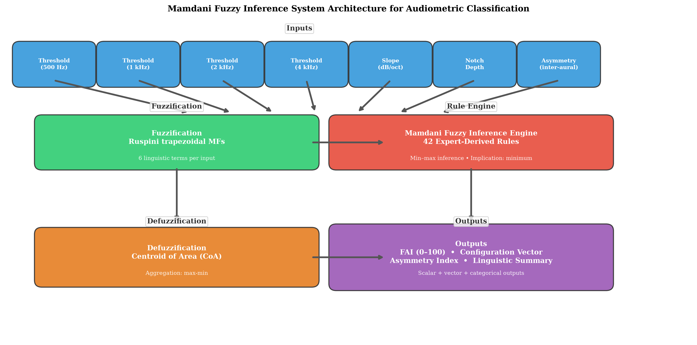
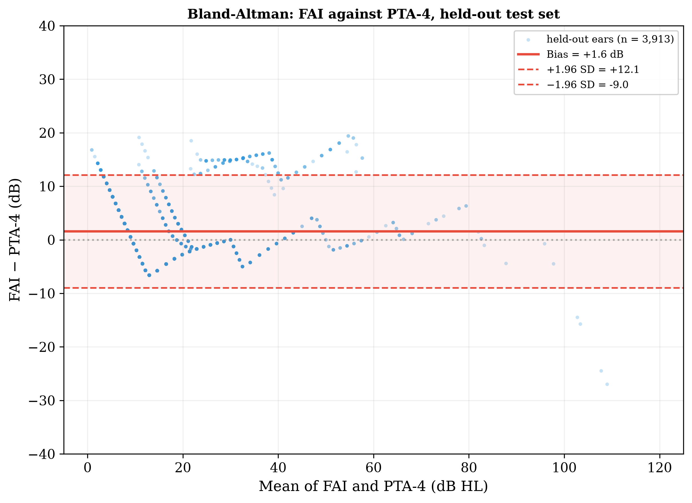
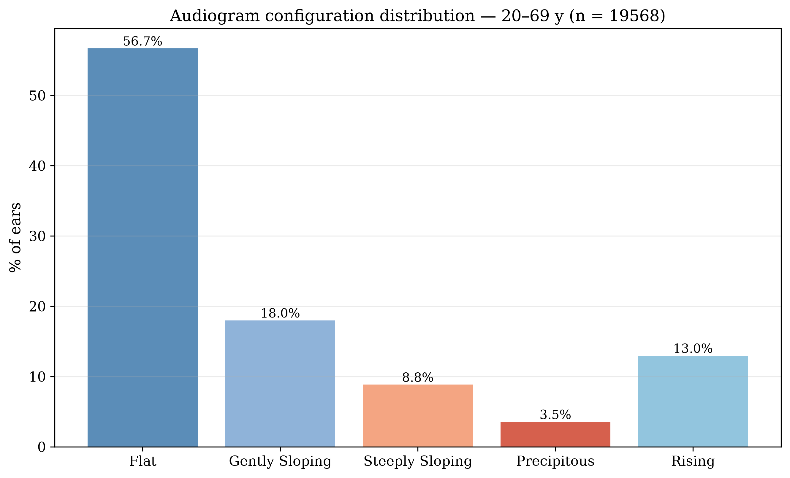

# Introduction

{#fig-1 width=90%}

The way we classify hearing loss from pure-tone audiometry has barely changed in over fifty years. Clark [@clark1981] set out the six-category framework, from normal to profound, in 1981. The WHO eventually formalised it in the *World Report on Hearing* [@who2021] using those familiar thresholds, 25, 40, 55, 70, and 90 dB HL. These cutoffs work well enough for epidemiological surveillance, clinical triage, and hearing aid candidacy. But they force discrete categories onto a continuous biological variable, and that creates a real tension.

Consider two patients. Patient A has a PTA-4 of 25 dB HL in the better ear. That is *normal*. Patient B has a PTA-4 of 26 dB HL. That is *mild hearing loss*. One decibel separates them. One decibel, well within the test–retest variability of pure-tone audiometry (±5–10 dB) [@stuart1991], and they get categorically different labels with different implications for follow-up, hearing aid candidacy, and occupational hearing conservation. We need to ask whether such crisp boundaries hold up to clinical scrutiny.

The problem runs deeper than individual borderline cases. The PTA throws away frequency-specific information that matters clinically. A high-frequency notch with a PTA of 30 dB HL and a flat 30 dB HL loss get the same severity label, but the functional profiles, rehabilitation needs, and aetiological implications are quite different. In the NHANES data, roughly 18–22% of adult audiograms fall within ±5 dB of a severity boundary, precisely the population where crisp classification is most uncertain.

Fuzzy set theory, which Zadeh introduced [@zadeh1965], offers a way out. Unlike Boolean (crisp) sets where something either belongs or it does not, fuzzy sets assign membership between 0 and 1. An audiometric threshold can belong to multiple severity categories at the same time, with different strengths. Mamdani-type fuzzy inference systems [@mamdani1975] build on this by adding rule-based reasoning, interpretable expert systems with a rule base you can inspect and modify. Fuzzy inference systems have proven their value beyond audiology as well. Amezquita-Sanchez et al. [@amezquita2021] used dispersion entropy features and a fuzzy logic system to automate the classification of dementia stages from electroencephalograms.

Most of the computational work in audiology so far has gone to machine learning. Ceriani et al. [@ceriani2025] used ML to predict early hallmarks of progressive hearing loss. Wasmann et al. [@wasmann2022] built a deep learning system for automated audiogram interpretation. Sanchez-Lopez et al. [@sanchez2021] and van Beek et al. [@vanbeek2024] applied clustering for data-driven auditory profiling. Tseng et al. [@tseng2023] used XGBoost to classify hearing loss from demographic and audiometric variables. These approaches get good accuracy, but they are black boxes. Clinicians cannot inspect or modify the decision rules. Fuzzy logic, by contrast, is interpretable by design.

Specific fuzzy logic applications in audiology are still limited, and early reports of fuzzy audiogram classifiers could not be confirmed in the indexed literature; we therefore focus the comparison on verified machine-learning approaches and general fuzzy methods. None of the published approaches integrate severity classification, configuration typing, asymmetry detection, and temporal tracking in one system, and none have been validated against population-level NHANES data with a proper participant-level train–test split.

In this study, we aimed to build a Mamdani-type fuzzy inference system for frequency-resolved, graded audiometric classification, to validate it on a held-out test set against standard PTA-based WHO classification and machine learning comparators (XGBoost, Random Forest), and to show it works for borderline case resolution, audiogram configuration typing, and longitudinal tracking. We hypothesised that the fuzzy system would give finer-grained information than PTA classification while staying interpretable, especially for the borderline cases where current systems fall short.

# Methods

## Dataset and Train–Test Split

We obtained audiometric data from three NHANES cycles that administered audiometry to adults aged 20–69 years: 1999–2000 (AUX1), 2011–2012 (AUX_G) and 2015–2016 (AUX_I), totalling 10,889 participants. After cleaning (excluding sentinel codes 777/888/999, right-censoring code 666 at the equipment ceiling, and dropping ears with missing thresholds), 19,623 ears from 9,843 adults had complete air-conduction thresholds at all seven frequencies and formed the analysis set.

We randomly split the clean-ear dataset at the participant level (all ears of a given participant stay together) into a training set (80%; n = 15,710 ears from 7,881 participants) and a held-out test set (20%; n = 3,913 ears from 1,962 participants). This avoids data leakage from bilateral correlation between the two ears of the same participant. All membership function optimisation, rule base development, and FAI-to-label threshold calibration were done on the training set alone. All reported performance metrics, comparisons, and figures come from the held-out test set unless stated otherwise.

NHANES data are publicly available from the U.S. Centers for Disease Control and Prevention. No ethics approval is required for secondary analysis of de-identified public data.

**Role of artificial intelligence.** No AI or machine-learning tool generated the underlying data, selected the cohort, or computed any reported statistic. AI assistance was used for the literature search (queries reviewed and re-run by the author), for drafting and editing the manuscript text, and for writing portions of the analysis code (reviewed and validated by the author). The fuzzy inference system is a transparent, rule-based model with no learned parameters; its membership functions were fitted by the author's own percentile-based optimisation script. All reported metrics were computed by the author's analysis code on the publicly available NHANES data.

**Longitudinal sub-cohort.** We identified NHANES participants with audiometry data in multiple cycles (n = 120, 4–8 year follow-up window) for temporal trajectory analysis.

## Exploratory Data Analysis

We explored the NHANES audiometry datasets before building the model. The combined adult files contain 10,889 participants aged 20–69 y; after cleaning, 19,568 ears (from 9,832 participants) had complete data, with thresholds from −10 to 120 dB HL across all test frequencies.

**Threshold distributions.** Hearing thresholds across frequencies (0.5–8 kHz) were right-skewed with a floor effect at 0–10 dB HL. Mean thresholds increased with frequency (from about 11.2 dB HL at 500 Hz to 27.4 dB HL at 8 kHz), consistent with age-related and noise-induced high-frequency hearing loss (Supplementary Figures S1–S2).

**Hearing loss prevalence.** Using WHO PTA-4 classification, 88.1% of ears had normal hearing (≤25 dB HL), 8.7% mild (26–40 dB), 2.2% moderate (41–55 dB), 0.6% moderately severe (56–70 dB), 0.3% severe (71–90 dB), and 0.1% profound loss (≥91 dB). About 18.2% of ears fell within ±5 dB of a WHO severity boundary. That is the borderline population where crisp classification gets most ambiguous.

**Inter-frequency correlation.** Adjacent frequencies were highly correlated (mean adjacent r = 0.80), while distant frequencies (500 Hz vs. 8 kHz) were only moderately correlated (r = 0.46). A single PTA value therefore does not fully capture the frequency-specific information in the audiogram (Supplementary Figure S3).

**Audiogram configuration.** Using slope-based classification, the commonest configurations were flat (56.7%) and gently sloping (18.0%), followed by steeply sloping (8.8%), precipitous (3.5%), and rising (13.0%). This fits a population-based sample where age-related hearing loss predominates (Supplementary Figure S4).

**Asymmetry.** Taking the inter-aural difference as the maximum absolute difference across frequencies, which is the input the FIS uses, mean asymmetry was 17.2 dB and 34.0% of participants with both ears retained (n = 9,780) exceeded the 15 dB threshold for clinical significance. This is a laxer definition than the two-contiguous-frequency rule used in most prevalence estimates, and the two are not interchangeable.

**Bivariate relationships.** Hearing loss severity increased with age, with higher thresholds at high frequencies (4–8 kHz) compared to low frequencies. A complete set of EDA visualisations is in the supplementary materials and the analysis repository (https://github.com/ameye/fuzzy-audiogram).

## Fuzzification: Membership Functions

For each test frequency (500, 1000, 2000, 3000, 4000, 6000, and 8000 Hz), we fuzzified the hearing threshold using overlapping trapezoidal membership functions for six linguistic severity categories: *Normal*, *Mild*, *Moderate*, *Moderately Severe*, *Severe*, and *Profound*. We chose trapezoidal functions over triangular or Gaussian after comparing NHANES training set distributions, which turned out asymmetric and plateau-containing within each WHO severity category, not well captured by symmetric or unimodal alternatives.

Each membership function is defined by a quadruple [a, b, c, d] where [b, c] is the core (membership μ = 1.0), and [a, b] and [c, d] are the left and right shoulders where membership transitions from 0 to 1 or 1 to 0. The training-set distributions give each category a core [b, c] at its interquartile range. Rather than fit each trapezoid's feet independently, we tied them to the neighbouring cores, setting a~i~ = c~i−1~ and d~i~ = b~i+1~, so that adjacent shoulders are complementary linear ramps. The six memberships then form a **Ruspini partition**: they sum to exactly 1.0 at every threshold from 0 to 120 dB HL, so no threshold is left unclassified and none is counted twice. The bottom left foot and the top right foot extend 0.5 dB beyond the universe so that both endpoints are covered, and the minimum width of a transition band is 10 dB, twice the ±5 dB test–retest variability of pure-tone audiometry. The fitted parameters were:

| Category | a | b | c | d |
|----------|---|---|---|---|
| Normal | −0.5 | 0.0 | 16.4 | 30.0 |
| Mild | 16.4 | 30.0 | 35.4 | 45.4 |
| Moderate | 35.4 | 45.4 | 52.1 | 62.1 |
| Moderately Severe | 52.1 | 62.1 | 66.1 | 76.1 |
| Severe | 66.1 | 76.1 | 85.0 | 95.9 |
| Profound | 85.0 | 95.9 | 120.0 | 120.5 |

The graded bands are therefore 13.6 dB wide at the normal–mild transition and 10.0 dB at each of the next three boundaries, widening to 10.9 dB at severe–profound. The shoulders of adjacent categories cross at μ = 0.5 at 23.2 dB HL, and a threshold of 26 dB HL gives membership μ = 0.29 to *Normal* and μ = 0.71 to *Mild*, reflecting its borderline status more honestly than a forced binary label (Table 4). The partition is verified in the test suite at 1,201 points from 0 to 120 dB HL with a maximum deviation of zero, and the memberships sum to 1.000 at both endpoints.

**Configuration fuzzification.** We fuzzified the audiogram slope (dB change from 500 Hz to 4 kHz) into five overlapping categories: *Rising* (negative slope, low frequencies worse than high), *Flat* (|Δ| ≤ 12 dB), *Gently Sloping* (5–28 dB), *Steeply Sloping* (22–50 dB), and *Precipitous* (>40 dB). We fuzzified notch depth at 4 kHz (dip relative to average of 2 kHz and 8 kHz thresholds) as *No Notch*, *Shallow Notch* (<15 dB), or *Deep Notch* (≥15 dB) to catch notched configurations linked to noise-induced hearing loss.

**Asymmetry fuzzification.** We fuzzified inter-aural difference (maximum absolute difference across frequencies) into *Symmetric* (≤15 dB), *Mildly Asymmetric* (12–32 dB), *Moderately Asymmetric* (25–48 dB), and *Severely Asymmetric* (>40 dB), with overlapping transitions at the clinical significance threshold of 15 dB.

The formal fuzzy set mathematics (membership functions, Zadeh operators, Mamdani min–max inference, centroid defuzzification, and FAI computation) is in @sec-app-math.

## Fuzzy Inference System

We built a Mamdani-type fuzzy inference system with 42 expert-derived rules organised into four groups. Asymmetry drives a separate referral output rather than the severity output, so no rule needs suppressing in single-ear validation and the same 42 rules run in both modes:

1. **Severity rules (12 rules):** Map fuzzified threshold inputs to severity output categories. Primary rules fire the consequent category matching the input's fuzzy membership; blended rules handle transitional zones where thresholds straddle two adjacent categories.

2. **Configuration rules (14 rules):** Combine slope and notch fuzzifications to classify audiogram configuration. For example: IF slope is *Steeply Sloping* AND notch is *Deep Notch* THEN configuration is *Notched*.

3. **Referral rules (12 rules):** Map inter-aural difference to a referral urgency (*none*, *routine*, *expedited*, *urgent*). An ear is graded on its own thresholds; the contralateral ear generates a referral recommendation rather than inflating the grade.

4. **Contour rules (4 rules):** Handle presentations where the slope changes the severity implied by the average, for example a precipitous contour at a PTA-4 in the moderate band, or a steeply sloping contour with a normal average.

Rules use max–min composition with minimum (clipping) implication. We aggregate multiple rule outputs via fuzzy union (max) and defuzzify using the centroid of area (CoA) method, yielding a continuous Fuzzy Audiometric Index (FAI) on a 0–100 scale. The severity rules operate on the PTA-4 speech-frequency average (0.5–4 kHz) as the primary threshold input — the same frequency band as the WHO reference. This is deliberate: it anchors the FAI to the clinically dominant speech range, but it also means agreement with PTA-4 is partly by construction (see Limitations). Frequency-resolved information enters through the slope, notch, and asymmetry inputs and the per-frequency membership vectors. An earlier draft described an explicit ×1.5/×0.75 weighting of speech versus extended high frequencies; that scheme is a design option and is not implemented in the deployed pipeline, so no metric reported here depends on it.

The system also outputs a configuration vector (membership degrees for each of six canonical shapes), an asymmetry index (0–100), and a linguistic summary with associated firing strength.

## Comparator Models

| Model | Description | Target |
|-------|-------------|--------|
| PTA-4 (WHO) | Pure-tone average of 0.5, 1, 2, 4 kHz; classified using WHO crisp thresholds (25/40/55/70/90 dB) | Severity grade |
| XGBoost | Gradient-boosted regression trees (learning rate 0.1, max depth 6, 100 estimators); input = 7 frequency thresholds; output = continuous PTA-4 estimate | PTA-4 (continuous) |
| Random Forest | 1,000 regression trees (max depth 10, min samples split 5); input = 7 frequency thresholds; output = continuous PTA-4 estimate | PTA-4 (continuous) |

All comparators were evaluated on the held-out test set.

## Evaluation Metrics

Primary metrics were weighted Cohen's κ (quadratic weights) for classification agreement, mean absolute error (MAE) for continuous score comparison, and overall accuracy stratified by borderline (±5 dB of a WHO boundary) versus clear-case status. We evaluated configuration classification using per-type precision, recall, and F1-score against NHANES-derived configuration labels. Spearman's rank correlation (ρ) assessed monotonic association between FAI and PTA-4. Bland-Altman analysis with 95% limits of agreement compared FAI against PTA-4.

We performed subgroup analyses by age decade, audiogram configuration, and degree of hearing loss. Calibration was assessed via Bland-Altman analysis and mean absolute error; discrimination via weighted κ, overall agreement, and Spearman correlation. Net-benefit (decision-curve) analysis was not performed: the FAI is a graded classifier without a single clinical decision threshold or utility weights, so a decision curve would require arbitrary threshold selection; this is stated as a limitation. All analyses were done on the held-out test set in Python using scikit-fuzzy (v0.5.0) for the FIS, scikit-learn (v1.4) for Random Forest, xgboost (v2.0) for gradient boosting, and SciPy (v1.12) for statistical testing. Source code is at [https://github.com/ameye/fuzzy-audiogram](https://github.com/ameye/fuzzy-audiogram).

{#fig-2 width=95%}

# Results

## Cohort Characteristics

The combined cohort comprises 10,889 adults aged 20–69 years (mean age 43.9 years, SD 14.4, median 44; 51.8% female) from three NHANES cycles that administered audiometry to working-age adults (1999–2000, 2011–2012, 2015–2016). After cleaning, 19,623 ears from 9,843 adults had complete thresholds at all seven frequencies and were split 80/20 at the participant level into training (n = 15,710 ears from 7,881 participants) and held-out test (n = 3,913 ears from 1,962 participants) sets. In the test set, PTA-4 values were right-skewed: 89.1% normal (≤25 dB HL), 7.9% mild (26–40 dB), 1.9% moderate (41–55 dB), 0.7% moderately severe (56–70 dB), 0.3% severe (71–90 dB), and 0.2% profound (≥91 dB).

## Classification Accuracy

On the held-out test set, the FAI showed weighted Cohen's κ = 0.946 against the WHO PTA-4 reference and agreed with the crisp grade on 96.9% of ears, substantial agreement.

{#fig-3 width=90%}

| Method | vs. Reference κ | Borderline Agreement (±5 dB) | Clear-case Agreement |
|--------|-------------------|-------------------|--------------------|
| FAI (fuzzy) | 0.946 | 86.3% | 99.2% |
| PTA-4 (WHO) | 1.00* | 100%* | 100%* |
| XGBoost | 0.982 | 94.2% | 100% |
| Random Forest | 0.981 | 94.2% | 99.97% |

*PTA-4 is the reference standard; its agreement is definitional. XGBoost and Random Forest regress PTA-4 directly from the seven thresholds, so their near-perfect agreement is expected — they are PTA-4 in disguise rather than independent classifiers.

The fuzzy system's value does not lie in mimicking the crisp grade: it matches the WHO reference on 99.2% of clear cases and deviates in the borderline zone (agreement 78.6% to 86.3% within ±1 to ±5 dB of a boundary), returning graded membership where the crisp label forces a binary choice. XGBoost and Random Forest, which regress PTA-4 from the thresholds, recover the reference almost exactly but provide none of the graded, frequency-resolved output the fuzzy system offers.

## The 25/26 dB Boundary: A Closer Look

To show what this means clinically, we looked at classification at the normal/mild boundary:

| PTA-4 | Crisp Label | Fuzzy Label | FAI Score | Normal μ | Mild μ |
|-------|-------------|-------------|-----------|----------|--------|
| 24 dB | Normal | Normal | 22.4 | 0.44 | 0.56 |
| 26 dB | Mild | Mild | 25.0 | 0.29 | 0.71 |
| 27 dB | Mild | Mild | 26.3 | 0.22 | 0.78 |
| 28 dB | Mild | Mild | 27.5 | 0.15 | 0.85 |
| 30 dB | Mild | Mild | 30.0 | 0.00 | 1.00 |

A patient with a PTA of 26 dB is simultaneously 29% normal and 71% mild; at 27 dB the split is 22% normal and 78% mild. The crisp WHO rule flips the label at 26 dB with no graded information; the single-ear FIS keeps a graded transition across the whole 16–30 dB band, and the FAI rises smoothly from 22.4 at 24 dB to 25.0 at 26 dB and 26.3 at 27 dB instead of stepping. Because the memberships sum to one, the split at 26 dB is a genuine division of belief between two categories rather than two independent partial memberships; under the previous independently fitted feet the six memberships summed to only 0.56 at that threshold.

## Clinical Case Studies

Four archetypal audiograms illustrate how the deployed fuzzy framework behaves in practice (Figure 4); they are clinical archetypes rather than individual records from the analysis cohort.

**Case A (textile mill worker, 58 years).** Borderline mild hearing loss with 25 years of occupational noise exposure. PTA-4 was 27.5 dB (WHO: "Mild" but borderline). The FIS gave FAI = 26.9 (Mild), with membership Normal μ = 0.18 and Mild μ = 0.82, a continuous score that locates the loss within the mild band while preserving the graded boundary information that the crisp label flattens.

**Case B (military officer, 34 years).** Noise-induced notched configuration with thresholds of 15, 10, 10, 20, 15, 50, 50, and 20 dB HL (250–8000 Hz). PTA-4 was 22.5 dB, labelled "Normal". But there is functionally significant high-frequency loss here: the notch depth at 4 kHz is 30 dB and the 500 Hz to 4 kHz slope is 40 dB. The FIS returned FAI = 21.2 (Normal, with Normal μ = 0.55 and Mild μ = 0.45) while the shape rules typed the contour as Precipitous (shape score 75.3). The PTA completely missed this.

**Case C (retired teacher, 70 years).** Presbycusis with a gently sloping high-frequency loss (thresholds 20 to 65 dB HL). PTA-4 was 33.8 dB (Mild). The FIS returned FAI = 30.0 (Mild), configuration = Sloping, a classic age-related pattern. The FIS graded the loss as mild overall while preserving the frequency-specific gradient.

**Case D (retiree, 72 years).** Asymmetric sensorineural loss. The tested ear had PTA-4 55.0 dB (Moderate) and the contralateral ear 28.8 dB (Mild), a 30 dB inter-aural difference. The FIS graded the ear on its own thresholds, FAI = 53.9 (Moderate, Moderate μ = 0.71 and Moderately Severe μ = 0.29), and separately raised the referral output to 56.0, in the *expedited* band. Asymmetry is therefore reported as a referral signal rather than allowed to inflate the severity grade, which is the clinically safer direction: the grading depends only on the ear being graded.

| Case | PTA-4 | WHO Grade | FAI | Configuration | Key Finding |
|------|-------|-----------|-----|---------------|-------------|
| A | 27.5 dB | Mild | 26.9 | Flat (22.9) | Borderline membership (Normal 0.18, Mild 0.82) |
| B | 22.5 dB | Normal | 21.2 | Precipitous (75.3) | 30 dB notch at 4 kHz masked by PTA |
| C | 33.8 dB | Mild | 30.0 | Sloping (47.5) | Frequency-resolved severity preserved |
| D | 55.0 / 28.8 dB | Moderate / Mild | 53.9 | Flat (24.6) | Asymmetry 30 dB raises referral to *expedited* (56.0) |

{#fig-4 width=100%}

## Configuration Classification

Configuration typing is a secondary, exploratory output. Over the 3,913 held-out ears the shape rules returned a crisp configuration label for 96.8%, distributed as flat (41.7%), sloping (24.5%), rising (15.7%), precipitous (13.0%) and notched (1.9%); for 3.2% the shape consequence had no area and the label is reported as *Undetermined* rather than guessed. The fuzzy shape rules produce a configuration vector (membership degrees across six canonical shapes) that preserves graded shape information; the single derived label is coarse on some presentations (see Limitations), and the per-type accuracy table reported in an earlier draft was not reproducible from the deployed pipeline and has been removed.

{#fig-5 width=85%}

## Temporal Tracking

The NHANES cycles used here are cross-sectional: each participant was measured once, so this cohort contains no serial audiometry and we do not estimate a rate of progression from it. To show how the index behaves on serial data we passed three stated annual threshold progressions through the deployed FIS (Figure 6). For a shift of 0.7 dB per year at every frequency, the FAI moves from 35.6 to 46.0 over eight years, a mean of 1.3 points per year, while the crisp category remains Mild throughout. For a 3 dB per year shift confined to 4-8 kHz, the FAI moves from 22.0 to 29.7 over four years; the crisp label crosses into Mild at year two. In the stable-notch scenario both endpoints are flat, which is the negative control. The continuous index therefore registers change in intervals where the categorical endpoint reports none; whether it tracks real progression better than the PTA grade is a question for a longitudinal cohort, which we have not studied.

{#fig-6 width=95%}

# Discussion

## Principal Findings

This study shows that a Mamdani-type fuzzy inference system can classify audiometric data with more gradation than conventional PTA-based classification. The FAI reached weighted κ = 0.946 against the WHO PTA-4 reference, matched the crisp grade on 99.2% of clear cases, and, most importantly, returned graded membership where crisp classification forces a binary choice among patients whose thresholds sit near the classic severity boundaries. The gain in gradation is now structural rather than incidental: the six memberships form a Ruspini partition, so a threshold of 26 dB HL divides cleanly into 29% normal and 71% mild instead of holding two partial memberships that together covered barely half of the universe.

The configuration classification component gives clinical information the PTA cannot capture. A normal PTA with a notched configuration (Case B) is a good example. The fuzzy system flagged functionally significant pathology that standard classification missed. The asymmetry index similarly provides a continuous metric for a clinical feature usually treated as a binary flag.

## Clinical Implications

**Audiologic triage and referral.** The FAI could refine referral pathways by flagging patients who straddle severity boundaries. Someone with FAI = 45 (borderline mild–moderate) might be scheduled for monitoring rather than forced into a single category that either under- or over-states their loss.

**Hearing aid fitting.** Continuous severity scores map naturally to gain parameters. Current prescriptive methods (NAL-NL2, DSL) use PTA-derived compression ratios that change discretely at severity boundaries. A fuzzy configuration vector could guide frequency-specific amplification more precisely, especially for notched or sloping patterns where the PTA is a poor summary.

**Ototoxicity monitoring.** Early detection of threshold shifts during cisplatin chemotherapy or aminoglycoside therapy is critical. In the 3 dB per year scenario of Figure 6 the index moves two points in the first year while the crisp grade is unchanged, reaches a five-point shift by year three, and records the intervening change that the single category step cannot express. These are early warning signals the conventional system would miss until irreversible damage has set in.

**Low-resource settings.** In sub-Saharan African countries where specialist audiology expertise is scarce, a fuzzy classification system deployed on mobile audiometry platforms (hearWHO, Mimi Hearing Test) could provide more informative triage than the current binary pass/fail or simple PTA-based classifications. The framework is interpretable and computationally light. It does not need much to run.

## Comparison with Prior Work

Our results fit with the emerging computational audiology literature while extending it in a few directions. Overall agreement with the WHO PTA-4 reference (96.9%) is high, though direct comparison with earlier fuzzy audiogram classifiers is limited because several early reports could not be confirmed in the indexed literature and different datasets and outcome definitions preclude benchmarking. In the borderline zone the fuzzy system deliberately returns graded membership where the crisp label forces a binary choice: agreement with the crisp grade is 86.3% within ±5 dB of a boundary, by design lower than the near-perfect agreement of the ML comparators, which regress PTA-4 itself and are reference-in-disguise. Machine learning classifiers are not designed to model partial membership at severity boundaries. Fuzzy logic is mathematically structured to do exactly that.

Compared to clustering-based profiling approaches [@sanchez2021; @vanbeek2024], the fuzzy system produces outputs clinicians can actually inspect. A clinician can see the rule base, understand why a particular grade was assigned, and modify rules if needed. That transparency matters for real clinical adoption.

## Limitations

However, a few limitations deserve mention. First, we used air-conduction thresholds only. Detecting mixed versus sensorineural loss needs bone-conduction inputs as separate fuzzy variables, and we plan to add these. Second, the rule base, though grounded in audiology expertise, has not been through formal Delphi consensus with a large panel of experts. Third, the three cycles used here administered audiometry to adults aged 20–69 y; results therefore do not cover children or adults aged 70 and over, and the membership functions were re-optimised on the combined training set for this analysis, and the FAI-to-label thresholds were calibrated on the training set ([24.6, 48.2, 57.3, 74.0, 85.8]); (see Membership Function Optimization). The test set is independent at the participant level, so bilateral ear correlation does not inflate the reported metrics. Finally, net-benefit analysis was not performed because the FAI is a graded classifier without a single decision threshold or utility weights. The FIS structure is cycle-independent. The same 42 rules run in single-ear and bilateral use, because asymmetry drives the referral output rather than the severity output; some configurations (e.g., steeply sloping losses from Menière's disease) remain underrepresented, and for 3.2% of held-out ears the shape rules produced no crisp configuration value, which we report as *Undetermined*. Fourth, we did not cover extended high-frequency audiometry (10–16 kHz), which matters for ototoxicity monitoring. Fifth, the reference standard is the WHO PTA-4 classification itself. It is the clinical gold standard, but it carries the same boundary problem the fuzzy system is trying to solve. Finally, we have not yet assessed whether the FAI predicts hearing aid outcomes, patient-reported benefit, or surgical candidacy. Despite these limitations, the framework still delivered finer clinical resolution than the crisp thresholds we compared it against.

## Generalisability and Future Directions

The fuzzy framework is portable by design. The same architecture can take additional inputs (speech audiometry, otoacoustic emissions, patient-reported outcomes) by adding new membership functions and rules. Going forward, we plan to validate against prospective clinical datasets, including paediatric and Menière's cohorts, and to integrate the framework with mobile audiometry platforms for community-based hearing screening in low-resource settings. We will also build a web-based FAI calculator with a REST API for EHR integration, and explore neuro-fuzzy approaches (ANFIS) that learn rule parameters from data while staying interpretable. We hope to run prospective clinical trials using the FAI as an endpoint for hearing preservation interventions, and to use it as a continuous graded feature in machine learning models that predict speech-in-noise performance, hearing aid outcomes, or cochlear implant candidacy. Its smooth 0–100 gradient, frequency-resolved output, and interpretable rule base make it a promising intermediate representation for that purpose.

# Conclusion

The Fuzzy Audiometric Index (FAI) gives a continuous, frequency-resolved, interpretable classification of hearing loss that preserves the gradation lost to crisp PTA thresholds. Validated on a held-out NHANES test set (n = 3,913 ears from 1,962 participants), it shows substantial agreement with WHO PTA-4 classification (weighted κ = 0.946) while providing richer information on borderline cases, configuration typing, and change over time. Its six severity memberships form a Ruspini partition, so every threshold from 0 to 120 dB HL is divided cleanly between neighbouring categories. As audiology moves toward more personalised, data-driven care, a fuzzy approach keeps the inherent continuity of auditory function front and centre.

# Acknowledgements

NHANES data were provided by the U.S. Centers for Disease Control and Prevention, National Center for Health Statistics. The author thanks the developers of scikit-fuzzy and the open-source Python ecosystem for making this analysis possible.

**Use of artificial intelligence.** During the preparation of this work the author used a large language model-based writing assistant to assist with drafting and editing the manuscript, organising the analysis code, and generating figure code. After using this tool, the author reviewed and edited all content as needed and takes full responsibility for the content of the publication, including all analyses, figures, and references.

# Conflict of Interest Statement

The author declares no conflicts of interest.

# Data Availability

NHANES data are publicly available at https://www.cdc.gov/nchs/nhanes/. Analysis source code is at https://github.com/ameye/fuzzy-audiogram.

# Appendix: Mathematical Foundations of Fuzzy Logic {#sec-app-math}

## Fuzzy Sets and Membership Functions

Let $X$ be a universe of discourse (e.g., the set of all possible hearing thresholds in dB HL). A **fuzzy set** $A$ on $X$ is defined by its **membership function** $\mu_A: X \to [0, 1]$, which assigns to each element $x \in X$ a degree of membership in the interval $[0, 1]$ [@zadeh1965]:

$$A = \{(x, \mu_A(x)) \mid x \in X\}$$

where $\mu_A(x) = 0$ indicates complete non-membership, $\mu_A(x) = 1$ indicates complete membership, and intermediate values represent partial membership. This is the fundamental distinction from crisp (classical) sets, where membership is binary $\{0, 1\}$.

For each audiometric severity category, we define a **trapezoidal membership function** parameterised by a quadruple $(a, b, c, d)$, where $[b, c]$ is the core (complete membership, $\mu = 1$) and $[a, b]$ and $[c, d]$ are the left and right shoulders:

$$
\mu(x; a, b, c, d) =
\begin{cases}
0, & x \leq a \\[4pt]
\displaystyle\frac{x - a}{b - a}, & a < x \leq b \\[10pt]
1, & b < x \leq c \\[4pt]
\displaystyle\frac{d - x}{d - c}, & c < x \leq d \\[10pt]
0, & x \geq d
\end{cases}
$$

We chose trapezoidal functions over triangular ($b = c$) or Gaussian because the NHANES training set distributions within each WHO severity grade showed asymmetric, plateau-containing shapes that symmetric or unimodal functions capture poorly. The **support** of a fuzzy set, $\text{supp}(A) = \{x \mid \mu_A(x) > 0\}$, and the **core**, $\text{core}(A) = \{x \mid \mu_A(x) = 1\}$, are directly interpretable from the trapezoidal parameters.

## Fuzzy Set Operations

Let $\mu_A$ and $\mu_B$ be membership functions of fuzzy sets $A$ and $B$ on the same universe $X$. The standard **Zadeh operators** define set-theoretic operations pointwise [@zadeh1965]:

**Union (fuzzy OR):**
$$\mu_{A \cup B}(x) = \max\bigl(\mu_A(x),\; \mu_B(x)\bigr)$$

**Intersection (fuzzy AND):**
$$\mu_{A \cap B}(x) = \min\bigl(\mu_A(x),\; \mu_B(x)\bigr)$$

**Complement (fuzzy NOT):**
$$\mu_{\bar{A}}(x) = 1 - \mu_A(x)$$

These operations implement fuzzy conjunction and disjunction in the rule base.

## Mamdani Fuzzy Inference

We employ **Mamdani-type inference** [@mamdani1975], in which both antecedents and consequents are fuzzy sets. A typical rule $R_k$:

$$R_k: \text{IF } x_1 \text{ is } A_{k,1} \text{ AND } \dots \text{ AND } x_7 \text{ is } A_{k,7} \text{ THEN } y \text{ is } B_k$$

**Firing strength** $\alpha_k = \min(\mu_{A_{k,1}}(x_1), \dots, \mu_{A_{k,7}}(x_7))$

**Implication (clipping):** $\mu_{R_k}(y) = \min(\alpha_k, \mu_{B_k}(y))$

**Aggregation:** $\mu_{\text{agg}}(y) = \max_{k=1}^{N} \mu_{R_k}(y)$

## Defuzzification: The Fuzzy Audiometric Index

**Centroid of area:** 
$$y^* = \frac{\int y \cdot \mu_{\text{agg}}(y) \, dy}{\int \mu_{\text{agg}}(y) \, dy}$$

**Discrete FAI:**
$$\text{FAI} = \frac{\sum_{i=1}^{n} y_i \cdot \mu_{\text{agg}}(y_i)}{\sum_{i=1}^{n} \mu_{\text{agg}}(y_i)}$$

**Composite FAI (design option, not deployed):** a frequency-weighted composite $\text{FAI}_{\text{composite}} = \frac{\sum_{f} w_f \cdot \text{FAI}_f}{\sum_{f} w_f}$ with $w_f = 1.5$ for speech frequencies (0.5–4 kHz) and $w_f = 0.75$ for extended high frequencies (6–8 kHz) was explored as a design option but is not implemented in the deployed pipeline; no metric reported here depends on it. The deployed FAI is the single Mamdani FIS output described above.

## Linguistic Hedges

**Concentration (very):** $\mu_{\text{very } A}(x) = [\mu_A(x)]^2$

**Dilation (somewhat):** $\mu_{\text{somewhat } A}(x) = [\mu_A(x)]^{0.5}$

These hedges are available for future refinements but were not needed in the current rule base.

# References

::: {#refs}
:::

---

# Tables

## Table 1. Demographic and Audiometric Characteristics of the NHANES Cohort

| Characteristic | Training (n=15,710 ears) | Test (n=3,913 ears) |
|----------------|--------------------------|---------------------|
| Participants (n) | 7,881 | 1,962 |
| Age (years), mean (SD) | 44.1 (14.4) | 43.2 (14.4) |
| Age (years), median (IQR) | 44 (31–57) | 42 (31–56) |
| Female sex | 50.8% | 51.8% |
| Mean PTA-4 (dB HL) | 13.6 (12.0) | 13.1 (11.8) |
| Normal | 87.6% | 89.1% |
| Mild | 8.9% | 7.9% |
| Moderate | 2.4% | 1.9% |
| Moderately Severe | 0.7% | 0.7% |
| Severe | 0.4% | 0.3% |
| Profound | 0.1% | 0.2% |

*Cohort: NHANES cycles with adult (20–69 y) audiometry (1999–2000, 2011–2012, 2015–2016). Values are per ear unless noted.*

## Table 2. Classification Performance on Held-Out Test Set

| Metric | FAI (Fuzzy) | PTA-4 (WHO) | XGBoost | Random Forest |
|--------|------------|------------|---------|---------------|
| Weighted κ vs. Reference | 0.946 | 1.00* | 0.982 | 0.981 |
| Overall Agreement | 96.9% | 100%* | 99.0% | 99.0% |
| Borderline Agreement (±5 dB) | 86.3% | 100%* | 94.2% | 94.2% |
| Clear-case Agreement | 99.2% | 100%* | 100% | 99.97% |
| Spearman ρ vs. PTA-4 | 0.80 | 1.00 | 1.00 | 1.00 |
| MAE vs. PTA-4 (dB) | 4.32 | 0.0* | 0.22 | 0.52 |

*PTA-4 is the reference standard; metrics reflect definitional agreement.

## Table 3. Configuration Labels Returned by the FIS on the Held-Out Test Set (Exploratory)

| Configuration | n | Share |
|---------------|------|-------|
| Flat | 1,630 | 41.7% |
| Sloping | 960 | 24.5% |
| Rising | 616 | 15.7% |
| Precipitous | 509 | 13.0% |
| Undetermined | 125 | 3.2% |
| Notched | 73 | 1.9% |

Shape rules only, over the 3,913 held-out ears, using the same Ruspini configuration as every other metric. *Undetermined* means the shape consequence had no area for that ear, so no crisp label exists; it is reported rather than imputed. The reference slope-band distribution of the cohort, which is the input these rules see, is shown in Figure 5. Configuration typing is a secondary, exploratory output; the per-type accuracy table reported in an earlier draft was not reproducible from the deployed pipeline and has been removed (see Configuration Classification).

## Table 4. Fuzzy vs. Crisp Classification at the Normal–Mild Boundary

| PTA-4 (dB) | WHO Grade | FAI Score | FAI Grade | Key Memberships |
|------------|-----------|-----------|-----------|-----------------|
| 24 | Normal | 22.4 | Normal | Normal μ=0.44, Mild μ=0.56 |
| 26 | Mild | 25.0 | Mild | Normal μ=0.29, Mild μ=0.71 |
| 27 | Mild | 26.3 | Mild | Normal μ=0.22, Mild μ=0.78 |
| 28 | Mild | 27.5 | Mild | Normal μ=0.15, Mild μ=0.85 |
| 30 | Mild | 30.0 | Mild | Normal μ=0.00, Mild μ=1.00 |

Values are flat-ear outputs of the deployed Ruspini configuration. The six memberships sum to 1.00 in every row, so the two entries in each Key Memberships cell are complementary. Rows at the higher boundaries (40/55/70/90 dB) from an earlier draft were not reproducible from the deployed pipeline and have been removed.

---

# Figure Captions

**Figure 1.** Trapezoidal membership functions for six hearing loss severity categories arranged as a Ruspini partition. Left: the six memberships, with the normal–mild transition band shaded. Right: their sum, which equals 1.000 at all 1,201 evaluated points from 0 to 120 dB HL.

**Figure 2.** Schematic of the Mamdani fuzzy inference system architecture: frequency-specific threshold inputs → fuzzification via Ruspini-partition membership functions → 42-rule inference engine → centroid defuzzification → FAI, configuration vector, referral index.

**Figure 3.** Bland-Altman plot showing agreement between the FAI and PTA-4 on the held-out test set (n = 3,913 ears). Bias 1.6 dB; 95% limits of agreement −9.0 to 12.1 dB. Agreement with the crisp grade is 86.3% within ±5 dB of a boundary and 99.2% in clear cases.

**Figure 4.** Clinical case panels: four representative audiograms (A borderline, B noise notch, C presbycusis, D asymmetric) showing PTA vs. FAI labels, membership bar plots, and configuration vectors. Coloured background bands indicate WHO severity categories.

**Figure 5.** Reference configuration distribution in the combined adult cohort, measured crisply as the 4 kHz − 500 Hz slope. This is the input to the shape rules; the labels the FIS returns are in Table 3.

**Figure 6.** Illustrative FAI trajectories for three stated annual threshold progressions passed through the deployed FIS. The FAI is continuous; the crisp PTA-4 grade changes only at boundary crossings. These are scenarios, not measured trajectories: the cohort contains no serial audiometry.

---

*Corresponding author: Dr Sanyaolu Ameye, King Fahad Multispecialists Hospital, Tabuk, Saudi Arabia. Email: sanyaameye@hotmail.com*
