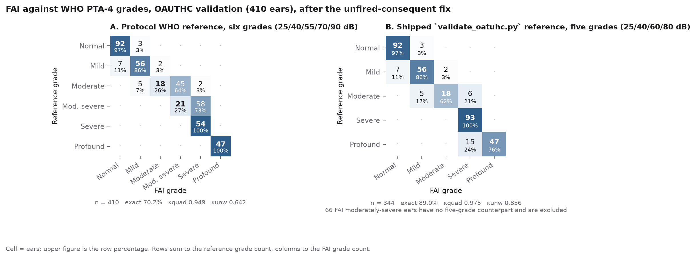

# OAUTHC Agreement Analysis: Clean Re-Run After the Unfired-Consequent Fix

**Data:** OAUTHC validation export, 410 ears from 205 patients, all included
**Index:** Fuzzy Audiometric Index, version 0.3.1 (`f9893a9` plus the fix in this commit)
**Script:** `oatuhc_eda/stage5_rerun.py` -> `stage5.json`, `figures/fig11_confusion_matrices.png`
**Date:** 15 November 2026

This supersedes the agreement figures in sections 1.9, 2.6 and 3.3 of `EDA_REPORT.md`. It
does not revise the exploratory, boundary-proximity, data-quality or feasibility findings
of that report; where a number there depended on the 390 classifiable ears, the corrected
value is given here and the original is retained for comparison.

---

## 1. What changed between the two runs

| | EDA run | This run |
|---|---|---|
| Ears the FAI can grade | 390 of 410 (20 raised `KeyError`) | **410 of 410** (0 errors; 406 FIS scores, 4 flagged fallbacks) |
| Inference state | one built FIS, deep-copied per ear | **rebuilt inside every call**; no shared object |
| Severity for a consequent with no crisp value | not defined (call aborted) | crisp WHO fallback, flagged (`fai_label_source`) |
| Configuration for a consequent with no crisp value | not defined (call aborted) | explicit `Undetermined`, flagged (`configuration_source`) |
| Reference schemes | Clark/WHO six grades, WHO 1997 five grades | both, plus the protocol's six-grade scheme stated explicitly |

No membership function, rule, rule weight, label threshold or threshold constant was
touched. On the 390 ears that classified before, every `fai_score`, `fai_label` and
`configuration_label` is identical: **0 score changes, 0 label changes, 0 configuration
changes**. The 20 recovered ears are new information, not a changed index.

## 2. Clean state and its verification

`classify_audiogram` builds its own `ControlSystem` on every call and now calls
`sim.reset()` before setting inputs, so no membership, firing strength or previous output
can survive from one ear to the next. Three independent paths were run over all 410 ears
and compared on score, label, configuration, both source flags, unfired count and error:

| Run | Construction | Ears differing from the primary run |
|---|---|---|
| A (primary) | fresh `ControlSystem` inside every call | n/a |
| B | one built system, deep-copied per ear (the stage-2 pattern) | **0 of 410** |
| C | **one simulation object reused for all 410 ears** | **0 of 410** |
| D | 40 randomly chosen ears re-run in a fresh state | **0 of 40** |

Run C is the one that matters. scikit-fuzzy clears consequent state for the first rule
only, so a reused simulation can return the previous ear's consequent; that is the
mechanism behind the EDA's false "PTA of 120 graded normal". With the per-call reset the
worst case, a single object reused 410 times, reproduces the clean run exactly. The EDA's
verification covered 15 ears on the deep-copy path only.

## 3. Unfired consequents in this dataset

| Consequent | Ears | Share | Returned value |
|---|---|---|---|
| `severity` | 4 (55, 56, 83, 84) | 1.0 per cent | crisp WHO grade, all `Profound`; `fai_score = None` |
| `audiogram_shape` | 16 (13, 70, 107, 115, 165, 182, 198, 204, 214, 217, 230, 238, 265, 280, 305, 381) | 3.9 per cent | `Undetermined`; `configuration_score = None` |

**20 ears (4.9 per cent) have one unfired consequent and 390 have none**; no ear has two.
The four severity gaps are all PTA-4 of exactly 120.0 dB HL, on the closed right edge of
the universe, where every severity membership function has fallen to zero. The sixteen
configuration gaps are three antecedent combinations the rule base never covers
(`rising` + `shallow_notch`, 8 ears; `steeply_sloping` + `shallow_notch`, 7;
`precipitous` + `deep_notch`, 1). Details and the reasoning behind each fallback are in
`FAI_FIX_REPORT.md`.

Because the severity fallback is the reference grade itself, those four ears agree by
construction against a crisp reference. The primary estimate therefore excludes them:

| FAI vs Clark, six grades | n | Exact | Kappa (quadratic) | Kappa (unweighted) |
|---|---|---|---|---|
| All 410 ears (4 by-construction agreements included) | 410 | 70.2% | 0.949 | 0.642 |
| Excluding the 4 fallback ears (primary) | 406 | 70.0% | 0.948 | 0.638 |

The difference is 0.001 on the weighted kappa and 0.004 unweighted, so the choice does not
carry the result either way. Both are reported; neither depends on the fallback.

## 4. Agreement against the two reference schemes

Rows are reference grades, so the table below is read as "FAI said X for an ear the
reference graded Y".

| Reference | n | Kappa, quadratic (95% CI) | Kappa, linear (95% CI) | Kappa, unweighted (95% CI) | Exact | Within one grade |
|---|---|---|---|---|---|---|
| **Clark, six grades** | 410 | **0.949** (0.938 to 0.958) | 0.848 (0.822 to 0.873) | **0.642** (0.591 to 0.692) | **70.2%** | 99.5% |
| **Protocol WHO, six grades at 25/40/55/70/90** | 410 | **0.949** (0.938 to 0.958) | 0.848 (0.822 to 0.873) | **0.642** (0.591 to 0.692) | **70.2%** | 99.5% |
| **Shipped `validate_oatuhc.py`, five grades at 25/40/60/80** | 344 | 0.975 (0.967 to 0.982) | 0.934 (0.913 to 0.953) | 0.856 (0.810 to 0.897) | 89.0% | 100% |

Patient-clustered intervals, which account for two ears per patient, are 0.935 to 0.960
(six-grade) and 0.967 to 0.983 (five-grade); measured design effect 1.17 and 1.08. The
ear-level intervals above are the primary ones and are the ones comparable with the EDA.

### The two six-grade rows are identical, and that is a finding, not a shortcut

The protocol (`oatuhc_protocol/oatuhc_fai_validation_protocol.qmd` section 12.3) defines
six grades with the cuts 25/40/55/70/90. `fuzzy_audiogram.validate.crisp_classify` already
implements exactly those cuts with the same six labels, so "Clark" and "protocol WHO" are
the same classification of these ears. They are printed as two rows because they are two
named references in the protocol and the EDA, and a reader is entitled to see that they
coincide rather than take it on trust.

**The protocol's reference is the six-grade one.** The five-grade scheme is not the
protocol's: it has no "moderately severe" category and moves the moderate and severe cuts
from 55/70 to 60/80. Naming it a WHO scheme does not make it the reference the protocol
specifies.

The five-grade row is computed the way the shipped script computes it, and that method has
a cost which is stated rather than hidden: an ear the FAI calls *moderately severe* has no
five-grade counterpart, so it is dropped. **66 of 410 ears (16.1 per cent) are excluded**,
all of them ears the FAI graded in the middle of the scale, and the surviving sample is
easier than the full one. The 0.975 should be read with that in mind: it is not a better
result than 0.949, it is the same index measured on the ears where the two schemes agree
about what the categories are.

### Which to report

This is the author's decision, not the software's, and the EDA flagged the conflict for
exactly that reason. Nothing here resolves it. What the numbers say is that the six-grade
protocol reference costs 18.8 percentage points of exact agreement (70.2 against 89.0) and
0.026 of weighted kappa, and that the five-grade alternative buys that apparent agreement
by discarding a sixth of the sample. The protocol's pre-specified reference is the one the
primary analysis should use.

## 5. Confusion matrices



**Six grades, protocol WHO reference (n = 410), rows reference, columns FAI:**

| Reference ↓ / FAI → | Normal | Mild | Moderate | Mod. severe | Severe | Profound |
|---|---|---|---|---|---|---|
| Normal | **92** | 3 | 0 | 0 | 0 | 0 |
| Mild | 7 | **56** | 2 | 0 | 0 | 0 |
| Moderate | 0 | 5 | **18** | 45 | 2 | 0 |
| Moderately severe | 0 | 0 | 0 | **21** | 58 | 0 |
| Severe | 0 | 0 | 0 | 0 | **54** | 0 |
| Profound | 0 | 0 | 0 | 0 | 0 | **47** |

**Five grades, shipped-script reference (n = 344, 66 moderately severe FAI labels excluded):**

| Reference ↓ / FAI → | Normal | Mild | Moderate | Severe | Profound |
|---|---|---|---|---|---|
| Normal | **92** | 3 | 0 | 0 | 0 |
| Mild | 7 | **56** | 2 | 0 | 0 |
| Moderate | 0 | 5 | **18** | 6 | 0 |
| Severe | 0 | 0 | 0 | **93** | 0 |
| Profound | 0 | 0 | 0 | 15 | **47** |

The six-grade matrix shows the structural problem plainly: the FAI's mass sits one grade
above the reference in the middle of the range. 45 of 70 moderate ears and 58 of 79
moderately severe ears are called one grade worse. That is a calibration offset between
the defuzzified score and the label thresholds, which is a published-index question and is
outside a bug fix.

## 6. Direction of disagreement

| Reference | n | FAI graded higher | FAI graded lower | Equal |
|---|---|---|---|---|
| Clark / protocol WHO, six grades | 410 | **110 (26.8%)** | **12 (2.9%)** | 288 (70.2%) |
| Shipped script, five grades | 344 | 11 (3.2%) | 27 (7.8%) | 306 (89.0%) |

The asymmetry is severe on the protocol reference: the index errs high by one grade nine
times more often than it errs low. Under the five-grade scheme the sign reverses (11 higher,
27 lower), and the cause is the movement of the boundaries, not a property of the index.
The profound boundary moves from 90 to 80 dB, so 15 ears in the 81-90 band become reference
"profound" while the FAI still calls them severe. The moderate/severe cut moves from 55 to
60 dB. The 66 ears the FAI calls moderately severe are dropped rather than scored.
The two references therefore do not merely differ in precision: one understates the index's
high-side error and the other overstates its low-side error, which is another reason the
scheme cannot be chosen after seeing the results.

## 7. Configuration agreement

Against `documented_shape`, which remains under the provenance query in EDA section 1.3:

| | n | Exact |
|---|---|---|
| All ears with a documented shape and an FAI configuration | 409 | **40.6%** (166/409) |
| Excluding the 16 `Undetermined` ears | 393 | 42.2% (166/393) |

Twenty ears previously vanished from this denominator because the call failed; sixteen now
appear as explicit non-agreements and four as rated ears. Reporting 42.2 per cent and
quietly dropping them would overstate configuration performance by 1.6 points and hide 3.9
per cent of the sample.

The crosstab makes the reason for the low figure visible: the FAI emits `Notched` for 9
ears, `Precipitous` for 49 and `Rising` for 107, against 116 notched, 160 sloping,
79 flat and 54 rising ears documented. Whether that
is an index failure or a data problem is the provenance question, unresolved here.

## 8. Before and after

| Metric | EDA (n = 390) | This run (n = 410) | Change |
|---|---|---|---|
| Ears graded | 390 | 410 | +20 |
| Kappa, quadratic | 0.947 | **0.949** | **+0.002** |
| 95% CI, quadratic | 0.935 to 0.958 | 0.938 to 0.958 | n/a |
| Kappa, linear | 0.844 | 0.848 | +0.004 |
| Kappa, unweighted | 0.632 | **0.642** | **+0.010** |
| Exact agreement | 69.5% | 70.2% | +0.7 pp |
| Within one grade | 99.5% | 99.5% | 0 |
| Mean absolute grade error | 0.31 | 0.30 | −0.01 |
| FAI graded higher | 107 | 110 | +3 |
| FAI graded lower | 12 | 12 | 0 |
| Configuration agreement | 42.7% (n = 389) | 40.6% (n = 409); 42.2% among graded ears | see section 7 |
| Clear: exact / kappa | 77.4% / 0.973 (n = 164) | 78.2% / 0.975 (n = 174) | +0.8 pp / +0.002 |
| Borderline: exact / kappa | 63.7% / 0.909 (n = 226) | 64.4% / 0.910 (n = 236) | +0.7 pp / +0.001 |
| WHO 1997 five grades: n / kappa | 327 / 0.975 | 344 / 0.975 | +17 ears, no change |
| WHO 1997 five grades: exact | 89.0% | 89.0% | 0 |
| Spearman vs PTA-4 | 0.994 | 0.993 | −0.001 |
| MAE vs PTA-4 | 5.56 dB | 5.55 dB | −0.01 |
| Bias vs PTA-4 | −2.94 dB | −2.74 dB | +0.20 |
| 95% limits of agreement | −15.7 to +9.8 dB | −15.59 to +10.11 dB | n/a |

### Did the exclusion bias agreement upward, as the EDA predicted?

**No. The prediction was wrong in direction, and the size is immaterial.** EDA section 1.9
argued that losing the 20 worst-hearing ears would flatter the index, so restoring them
should push agreement down. Restoring them pushes it up: quadratic kappa 0.947 to 0.949
(+0.002), unweighted 0.632 to 0.642 (+0.010), exact agreement 69.5 to 70.2 per cent.

The reason is visible in the recovered ears. Of the 20, 17 now agree with the reference and
3 are graded one step higher; the base rate is 70.2 per cent, so the recovered group agrees
at 85 per cent, above the sample average. They were severe ears, but the index reads severe
ears well: it is the middle of the scale, not the top, where it errs high. The four
by-construction agreements account for +0.001 of the +0.002, so even without them the
direction holds.

What the fix demonstrably did do is move the analysis from 390 ears to 410, remove an
unexplained gap at the worst-hearing end, replace 16 silent drops with 16 explicit
non-agreements, and make both directions of error reportable. Those are worth more than
0.002 of kappa, and claiming a large correction would have been the wrong result to
report.

## 9. What this does not settle

1. **The reference scheme.** Six grades per the protocol, or five as the shipped script
   computes it. The rows above are given for both and nothing here chooses.
2. **`consultant_grade` and `documented_shape` provenance.** Unchanged by this run and
   still the larger threat to Objectives 2 and 4.
3. **The calibration offset.** 110 of the 122 disagreements are the FAI grading higher.
   middle of the range. Recalibrating `SEVERITY_LABEL_THRESHOLDS` would move them, would
   change the published index, and is a versioned decision for the author, not a fix.
4. **The configuration coverage gap.** 3.9 per cent of ears have no rule for their
   slope/notch combination. Adding those three combinations would change the instrument;
   `Undetermined` reports the gap instead of hiding it.

## 10. Reproducing

```bash
cd oatuhc_eda
python clean.py            # derived/analysis_clean.csv (patient-level, git-ignored)
python stage5_rerun.py     # stage5.json, derived/fai_runs_fixed.csv
python figures_confusion.py
```

`stage5_rerun.py` rebuilds the inference system for every ear, so a run takes about four
minutes on the pinned stack (NumPy 2.4.6, SciPy 1.18.0, scikit-fuzzy 0.5.0). Bootstrap
intervals use 2000 resamples with a fixed seed (20261115), so the intervals are exactly
reproducible.
