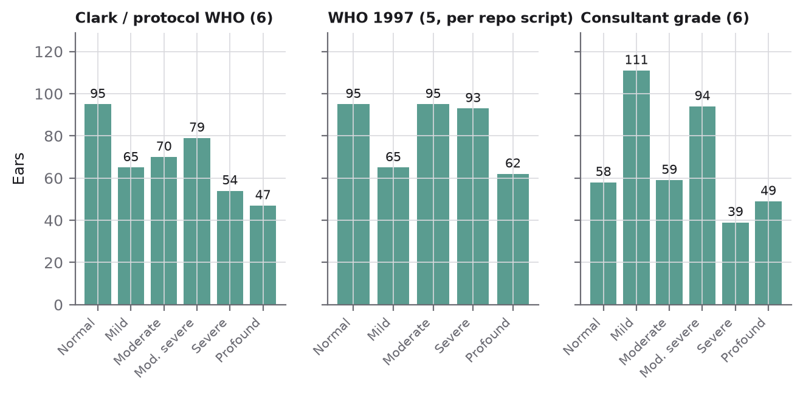
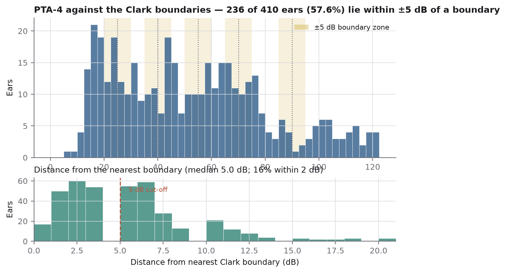
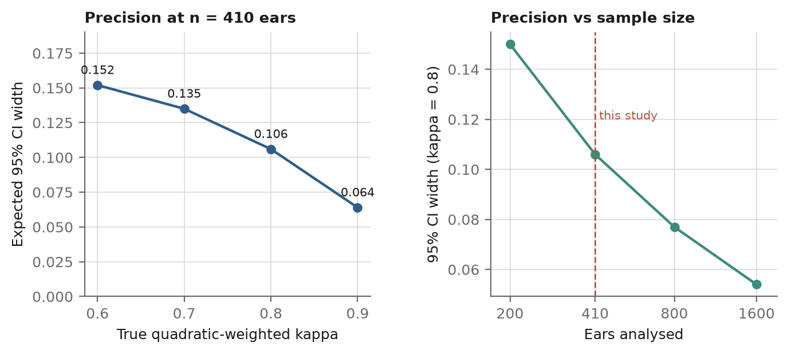

# OAUTHC Fuzzy Audiometric Index Validation — Exploratory Data Analysis and Data-Quality Audit

**Dataset:** `raw_export.csv` — 410 ear records from 205 patients, OAUTHC Department of Otorhinolaryngology
**Protocol:** `oatuhc_protocol/oatuhc_fai_validation_protocol.qmd` v1.0 (16 Aug 2026); `data_dictionary.md` v1.0
**Prepared:** 15 November 2026
**Scope:** data-quality audit, descriptive analysis, boundary examination, and feasibility assessment. No thresholds were altered and no records were dropped. The FAI itself was run with the frozen implementation already present in this repository.

---

## Headline

The dataset is large enough, well spread across grades, and unusually rich in boundary cases — on the three questions the validation actually depends on, it is in good shape. It is also **not clean**, and two of the defects are serious enough to change what the paper can claim:

1. **The frozen FAI cannot classify 20 of 410 ears (4.9%).** `classify_audiogram()` raises `KeyError` on 16 ears because no `audiogram_shape` rule fires and on 4 because no `severity` rule fires. The failure is reproducible on the pinned stack (NumPy 2.4.6 / SciPy 1.18.0 / scikit-fuzzy 0.5.0). This is an implementation defect, not a data defect, and it must be resolved before the primary analysis is run.
2. **`consultant_grade` is populated for 100% of ears.** The protocol says this field is recorded "only where explicitly documented; blank otherwise". A 100% fill rate from chart review is not credible on its face, and the variable behaves like a derived measure rather than an independent human read (Section 1.3). This is the reference standard for Objective 2; it needs verification before any agreement statistic against it is reported.
3. **The protocol and the repository disagree about the grading scheme.** The protocol specifies six WHO grades (25/40/55/70/90). `scripts/validate_oatuhc.py` implements a *five*-grade scheme (25/40/60/80) with no "moderately severe" category. Running the shipped batch script would silently answer a different question from the one the protocol poses.

Against that: **57.6% of ears sit within ±5 dB of a Clark boundary** (236/410), all six grades are represented with at least 47 ears each, and a kappa of 0.8 would carry a 95% CI of ±0.053. The sample is not dominated by clear-cut cases — the opposite. That is the finding, and it is a good one for the paper.

---

## 1. Data quality audit

Nothing here was corrected silently. Every finding carries a disposition: **fixable** (mechanical, done in `clean.py` on a copy), **query** (must go back to the data collector), or **limitation** (declare in the paper).

### 1.0 Structure

| Check | Result | Disposition |
|---|---|---|
| Rows | 410 | — |
| Patients | 205, all contributing exactly 2 ears | — |
| Left / right | 205 / 205 | — |
| Duplicate `study_id` | 0 | pass |
| Duplicate (`patient_id`, `ear`) | 0 | pass |
| Patients with two different ages | 0 | pass |
| `ear_included` = 1 | 410 (100%) | see 1.8 |
| `exclusion_reason` populated | 0 | see 1.8 |
| Patients with identical AC vector in both ears | 2 (patients 28 and 42; studies 55/56 and 83/84) | **query** |

The two identical-vector patients are also both all-120 or near-120 ears that the FAI cannot classify. Either they are genuine symmetric profound losses or one record was duplicated across ears. Only the source charts can settle it.

### 1.1 `test_month_year` formatting

50 distinct raw strings for 39 months of data. **58 rows (14.1%) are not in the `Mon YYYY` form the dictionary specifies:**

| Raw form | Rows | Studies | Rule |
|---|---|---|---|
| `Sept 2022` | 20 | 319–336, 339–340 | fixable (abbrev) |
| `dec 2020` | 10 | — | fixable (case) |
| `oct 2020` | 6 | — | fixable (case) |
| `sep 2020` | 4 | — | fixable (case) |
| `feb 2020` | 4 | — | fixable (case) |
| `sept 2020` | 2 | — | fixable (abbrev) |
| `SEP 2020` | 2 | — | fixable (case) |
| `Seo 2020` | 2 | 9, 10 | **query** (misspelling of Sep) |
| `Msr 2020` | 2 | 83, 84 | **query** (misspelling of Mar) |
| `Mar 25` | 2 | 361, 362 | **query** (2-digit year) |
| `June 2026` | 2 | 409, 410 | fixable (long month name) |
| *(blank)* | 2 | 285, 286 | **query** |

`Seo` and `Msr` are almost certainly `Sep` and `Mar` (keyboard-adjacent and transposed), and `Mar 25` almost certainly `Mar 2025`, but **these are inferences, not facts.** `clean.py` maps them and logs each one with rule `DATE_ASSUMED_YEAR` or `DATE_MISSING` so the assumption is visible and reversible. They should still be confirmed against the charts.

### 1.2 The 2026 dates are inside the study window — but the window is not otherwise met

The protocol's study window is **1 January 2020 to 30 June 2026** (§9.1). The 2026 records are:

| Studies | Month | Verdict |
|---|---|---|
| 395–398 | Apr 2026 | inside window |
| 399–400 | May 2026 | inside window |
| 409–410 | Jun 2026 | inside window, on the final permitted month |

So the 2026 dates are **not** a protocol violation. They sit at the extreme edge of the window and should be confirmed as real testing dates rather than data-entry artefacts, but they do not require exclusion.

What *is* a problem is the shape of the collection:

| Year | Ears |
|---|---|
| 2020 | 92 |
| 2021 | 88 |
| 2022 | 84 |
| **2023** | **0** |
| 2024 | 94 |
| 2025 | 42 |
| 2026 | 8 |

- **2023 is entirely absent.** A six-and-a-half-year window with a complete calendar-year hole is not a sampling fluctuation; it is a gap in the archive or in the extraction.
- Only **40 of the 78 months** in the window are represented (51% month coverage).
- Several months contain **exactly 22 ears** (2020-09, 2020-12, 2021-06, 2021-12, 2022-09), with others at 24, 28 and 32.

Protocol §10 states the records were "drawn consecutively from the study window". The monthly pattern looks more like **batch extraction to a target** than consecutive sampling. Disposition: **query** — ask the site lead to confirm the sampling frame, and state the true frame in the paper's methods. This is a limitation to declare either way, because it bears directly on whether the sample represents the clinic population.

### 1.3 Categorical fields

**`diagnosis_category`** — 15 rows use `csoM` instead of a protocol token; canonicalised to `csom` (**fixable**). After normalisation:

| Category | Ears | Patients |
|---|---|---|
| other | 137 (33.4%) | 75 |
| not_documented | 92 (22.4%) | 48 |
| presbyacusis | 76 (18.5%) | 38 |
| meniere | 32 | 17 |
| ototoxicity | 24 | 12 |
| otosclerosis | 20 | 12 |
| csom | 15 | 10 |
| nihl | 10 | 5 |
| ssnhl | 4 | 2 |

Two-thirds of the sample sits in `other` or `not_documented`. **`other` is the single largest category and is not defined anywhere in the protocol** — it is a residual bin, and a subgroup analysis on it means very little. `ssnhl` (4 ears), `nihl` (10) and `csom` (15) are too small for any subgroup inference (Section 4).

**`consultant_grade`** — **410/410 populated, no blanks.** The dictionary says the field records a grade "only where explicitly documented; blank otherwise". Every single record having an explicit consultant grade is implausible for a retrospective chart review, and the distribution is suspiciously even (58/111/59/94/39/49).

The variable's relationship to PTA-4 is also not what an independent human read looks like:

| Consultant grade | PTA-4 range (dB) |
|---|---|
| normal | 6.25 – 25.0 |
| mild | 15.0 – 47.5 |
| moderate | 30.0 – 65.0 |
| moderately_severe | 47.5 – 82.5 |
| severe | 48.75 – 93.75 |
| profound | 87.5 – 120.0 |

Each grade's range overlaps its neighbours by 7.5–20 dB, so grade is not a monotone function of PTA-4 (an ear at PTA 20 can be "mild" while one at PTA 25 is "normal"). No single PTA formula reproduces it: the best of four candidate averages matches only 78.0% exactly.

That pattern is *consistent* with genuine clinician judgement using shape, asymmetry and history rather than PTA alone — which would be fine, and is in fact the point of an independent reference. But it is equally consistent with a semi-derived field. **Disposition: query.** Ask explicitly: was `consultant_grade` transcribed from a written consultant opinion, or inferred by the extractor from the audiogram? If the latter, Objective 2 has no independent human reference and cannot be reported as agreement with a clinician.

Note also that agreement with consultant grade looks very high under quadratic weights (kappa 0.951) while exact agreement is only 74.6% — the same weighting artefact discussed in Section 3.3.

**`documented_shape`** — 409/410 populated (missing: study 257, left). sloping 160, notched 116, flat 79, rising 54. Again, near-total documentation of a field the protocol says is "only where explicitly documented" — same query as above, lower stakes. Note there is no `normal` shape option, so shape cannot be missing-by-design for normal ears.

**`sex`** — 158 male / 252 female, no missing values, only 1/2 used. Clean.

### 1.4 The value 120.0 — a ceiling code, not a measured threshold

This is the most consequential numeric issue in the file. **143 of 3065 threshold cells (4.7%) are exactly 120.0, spread across 54 ears (13.2%).**

| Freq | 250 | 500 | 1k | 2k | 3k | 4k | 6k | 8k |
|---|---|---|---|---|---|---|---|---|
| cells at 120 | 2 | 9 | 13 | 19 | 12 | 23 | 40 | 25 |

Three pieces of evidence say these are saturation values rather than measured thresholds:

1. **120 appears at 8 kHz, 25 times.** Clinical audiometers typically cannot deliver 120 dB HL at 8 kHz — output ceilings there are usually 90–110 dB HL. A 120 at 8 kHz is a recorder entering "maximum output" rather than a threshold at which the patient responded.
2. **27 ears have 120 at 6 kHz and a *lower* value at 8 kHz** (studies 1, 2, 55, 56, 64, 67, 83, 84, 93, 94, 131, 132, 176, 207, 240, 305, 357, …); 16 of those have 120 at 4 kHz with 8 kHz below it. A patient cannot fail to respond at 120 dB at 6 kHz and then respond at 100 dB at 8 kHz. The 120 marks the end of the testable range, not a response.
3. **120 and 115 co-occur in 21 ears.** The scale runs past 115, so 120 is the recorded endpoint of the instrument, and nothing above it exists.

**Verdict: 120 behaves as a right-censored ceiling ("no response at maximum output"), and the export contains no explicit code distinguishing it from a real threshold.** The protocol's validation rule set has no convention for this — rule 5 accepts 120 as a legal numeric value and nothing else addresses it.

**Consequence, quantified.** Because 120 is the top of the permitted range, treating it as a number rather than a censored value does **not** change any WHO grade: recomputing PTA-4 with 120 replaced by 121 changes 0 grades and moves PTA-4 by at most 1.0 dB. So the *graded* analysis is safe. Two things are not:

- 28 ears carry at least one 120 among the four PTA-4 frequencies; 4 ears (studies 55, 56, 83, 84) are 120 at all four.
- The FAI uses all eight thresholds, and 120 at 6/8 kHz feeds the slope and notch features. Five of the 54 ears carrying a 120 are among the 20 the FIS cannot classify at all (Section 1.9).

**Disposition:** declare as a limitation; add a `threshold_120` flag (done in `clean.py`); and add a sentence to the methods stating that 120 dB HL is treated as a censored ceiling. Do **not** re-code it to 130 or drop those ears without a protocol amendment.

### 1.5 Bone conduction

The protocol is explicit and it is not what one might expect: **data dictionary rule 10 states that a negative air–bone gap is *not* an error** — BC exceeding AC by 5–10 dB is expected from test–retest variability, bone-vibrator output limits, unmasked BC reflecting the contralateral ear, and vibrotactile responses at high levels. The automated check was deliberately removed on 21 September 2026.

So the audit threshold is **>10 dB**, not "any negative gap":

| Check | Ears | Studies |
|---|---|---|
| BC − AC > 0 at any frequency | 285 cells total | — |
| **BC − AC > 10 dB (beyond protocol tolerance)** | **59 (14.4%)** | see below |
| **BC − AC > 20 dB (physiologically implausible)** | **10** | 54, 82, 107, 180, 194, 237, 289, 315, 332, 386 |
| **AC − BC > 60 dB** | **15** | 3, 4, 48, 51, 52, 64, 73, 219, 220, 230, 236, 250, 259, 363, 364 |

By frequency, the reversals concentrate at 2 kHz (43 ears exceed +10 dB there, max +45). The 59 ears exceeding the 10 dB tolerance:

`21, 43, 44, 54, 57, 78, 82, 96, 107, 108, 110, 119, 137, 141, 142, 146, 147, 153, 154, 155, 160, 180, 184, 194, 214, 216, 221, 222, 226, 232, 237, 239, 246, 248, 254, 256, 265, 267, 270, 272, 289, 290, 295, 296, 309, 311, 315, 316, 323, 324, 332, 343, 344, 353, 354, 370, 379, 386, 393`

Two corrections to the framing in the brief, both of which matter for interpretation:

- **Study 237** (AC 70 at 1 kHz, BC 90) is real and is in the >20 dB group — a 20 dB reverse gap at speech frequency is not physiological and is either a transcription error or a masked/unmasked mix. Agreed.
- **Studies 81/82 are not one finding.** Study 81 has BC 40 at 500 Hz against AC 30 at 500 Hz — a +10 dB reverse gap, exactly at the protocol's tolerance, not an error. The "25" in the brief is AC at *250* Hz, and comparing BC at 500 Hz with AC at 250 Hz is a cross-frequency comparison that is not a valid air–bone check. **Study 82** does have BC 45 against AC 15 at 500 Hz (+30 dB) and is genuinely implausible.

**Disposition:** the 10 ears above +20 dB are a **query** — they need chart review and likely exclusion under protocol §9.3 ("obvious data-entry errors that cannot be resolved from the chart"). The 15 ears with a >60 dB AC–BC gap are a **query** too; some are legitimate large conductive losses, but gaps of 70–90 dB at 500 Hz with BC in the 20–50 dB range are more likely mismatched masked/unmasked values. Neither group should be repaired by rule. All are flagged (`flag_bc_gt_ac_20`, `flag_ac_bc_gap_60`) and retained.

**Negative BC values** (9 cells at −5.0, in studies 29, 30, 38, 81, 82, 243, 351) are **within** the dictionary's declared −10…120 dB HL range and −5 dB HL is a normal audiometric value. **Not an error.** No action.

### 1.6 Missingness

| Field | Missing | % | Pattern |
|---|---|---|---|
| th_250, th_500, th_1k, th_2k, th_4k, th_8k | 0 | 0% | complete |
| **th_3k** | **200** | **48.8%** | structural, see below |
| th_6k | 15 | 3.7% | 2026 batch + 2 pairs |
| bc_500 / 1k / 2k / 4k | 10 / 9 / 9 / 9 | ~2.4% | scattered |
| PTA-4 frequencies | **0 ears incomplete** | 0% | all 410 computable |

`th_3k` missingness is not random — it is a change in recording practice:

| Year | Ears | 3 kHz missing |
|---|---|---|
| 2020 | 92 | 2 (2%) |
| 2021 | 88 | 0 (0%) |
| 2022 | 84 | 56 (67%) |
| **2024** | 94 | **94 (100%)** |
| 2025 | 42 | 40 (95%) |
| 2026 | 8 | 8 (100%) |

Loss of 3 kHz begins mid-2022 and is total from 2024. It splits evenly by ear (100 left, 100 right), so it is a chart/format change rather than an ear-specific issue.

Per dictionary rule 8, blanks at 3 and 6 kHz are expected and are **not** completeness defects — but the *step change* is worth naming, because it means any analysis using 3 kHz (slope features, notch depth, the FAI's configuration module) is effectively restricted to the 2020–2022 third of the sample. `th_6k` is missing for 15 ears, 9 of which are the 2025–2026 batch (studies 393–400, 410).

The FAI's service layer interpolates missing frequencies in log-frequency space rather than treating them as missing, so a blank 3 kHz is silently reconstructed from 2 and 4 kHz. That is a defensible choice but it should be stated in the methods, since it means "3 kHz missing" and "3 kHz measured" are not treated differently by the model.

### 1.7 Age

Range **18–98**, median **60** (IQR 41–72); no values outside the protocol's 18–110, none implausible for an ENT clinic. Male median 61 (n=158), female 59 (n=252); difference is negligible. 30.2% of ages end in 0 or 5 against an expected 20% under no heaping — mild digit preference, consistent with ages recorded from memory or from the chart rather than calculated from date of birth. Low impact: age is a subgroup variable only.

### 1.8 Inclusion and exclusions — the analysis set

**All 410 ears are flagged `ear_included = 1` and no `exclusion_reason` is populated anywhere.**

Mechanically this is defensible: every ear has all four PTA-4 frequencies, no threshold is outside −10…120, and there are no duplicates, so no *automatic* protocol exclusion criterion fires. But protocol §9.3 also excludes records with "obvious data-entry or transcription errors … that cannot be resolved from the chart", and this file contains 10 physiologically impossible bone-conduction reversals and 15 extreme conductive gaps. A 100% inclusion rate means that judgement was never applied.

**The analysis set is therefore 410 ears, with 20 ears unclassifiable by the FAI (Section 1.9), leaving 390 for the primary agreement analysis.** Recommend the exclusion review be actually performed before submission and the number excluded reported.

### 1.9 Monotonicity and the FAI implementation failure

**Monotonicity (protocol rule 7, >40 dB jump between adjacent measured frequencies): 18 ears** — studies 1, 31, 61, 64, 87, 127, 134, 195, 264, 275, 289, 305, 332, 341, 357, 372, 393, 409. Per the rule these are flagged for review and not corrected. Most are sharp high-frequency drops (e.g. study 1: 60 dB at 1 kHz → 120 dB at 2 kHz), which are unusual but not impossible.

**More important: the frozen FAI throws an exception on 20 ears (4.9%).**

| Error | Ears | Studies |
|---|---|---|
| `KeyError: 'audiogram_shape'` | 16 | 13, 70, 107, 115, 165, 182, 198, 204, 214, 217, 230, 238, 265, 280, 381 |
| `KeyError: 'severity'` | 4 | 55, 56, 83, 84 |

Root cause, confirmed by inspection: for these input combinations no rule in the corresponding consequent fires, so scikit-fuzzy never populates that key in `sim.output`, and `core.py` reads it unconditionally (lines 378–379). The severity score is often computable — study 13 returns a valid `severity` but the call dies on `audiogram_shape`. **A missing optional output is being treated as a total failure.**

This is not an environment artefact: it reproduces exactly on the pinned stack (NumPy 2.4.6, SciPy 1.18.0, scikit-fuzzy 0.5.0, as pinned in `requirements.txt`), and it is not the monotonicity set — only study 305 appears in both.

The 20 failures are skewed severe (median PTA-4 67.5 dB vs 48.1 dB for the ears that classify), and 5 of them carry a 120 dB HL ceiling value. They are not random: the FAI is losing precisely the worst-hearing ears, which biases any agreement statistic upward.

**Disposition: fixable in code, but must not be fixed silently.** Two acceptable routes: (a) patch `classify_audiogram` to return the severity score with `shape=None` when the shape consequent is empty, and re-freeze with a documented version bump; or (b) report n=390 and declare the 20 unclassified ears explicitly, including their severity distribution. Route (a) is better science; either way this must be settled before the primary analysis, and the paper must state which.

### 1.10 Summary of dispositions

| # | Finding | Count / IDs | Disposition |
|---|---|---|---|
| 1 | Non-standard date strings | 58 rows (54 format, 2 assumed year, 2 blank) | fixable / **query** for blank + `Mar 25` |
| 2 | 2026 dates | 8 ears (395–400, 409, 410) | inside window — no action |
| 3 | No records in 2023; 40/78 months covered | 0 ears in 2023 | **query** + limitation |
| 4 | Likely batch, not consecutive, sampling | 5 months at exactly 22 ears | **query** + limitation |
| 5 | `csoM` capitalisation | 15 ears | fixable |
| 6 | `other` / `not_documented` dominate aetiology | 137 / 92 ears | limitation |
| 7 | `consultant_grade` 100% populated | 410/410 | **query** — reference validity |
| 8 | `documented_shape` 99.8% populated | 409/410 | **query** (lower stakes) |
| 9 | 120 dB HL used as a ceiling code | 143 cells / 54 ears | fixable (flag) + limitation |
| 10 | BC − AC > 10 dB | 59 ears | review |
| 11 | BC − AC > 20 dB | 10 ears | **query** / probable exclusion |
| 12 | AC − BC > 60 dB | 15 ears | **query** |
| 13 | Negative BC (−5) | 9 cells, 7 ears | not an error |
| 14 | 3 kHz missing from mid-2022 | 200 ears | limitation |
| 15 | Monotonicity > 40 dB | 18 ears | review |
| 16 | FAI cannot classify | 20 ears | **fix before analysis** |
| 17 | Zero exclusions applied | 410/410 included | **query** |
| 18 | Identical binaural vectors | patients 28, 42 | **query** |

---

## 2. Descriptive analysis

### 2.1 Age and laterality

410 ears, 205 patients, 205 left and 205 right, complete pairs for every patient.

| Group | n (ears) | Median | IQR | Range |
|---|---|---|---|---|
| All | 410 | 60 | 41 – 72 | 18 – 98 |
| Male | 158 | 61 | 40 – 71 | 18 – 98 |
| Female | 252 | 59 | 43 – 73 | 18 – 95 |

Sex is unbalanced (38.5% male) but not pathologically so for an ENT referral population.

### 2.2 Threshold distributions

Medians rise monotonically with frequency, as expected in a presbyacusis-heavy clinic sample.

| dB HL | 250 | 500 | 1k | 2k | 3k | 4k | 6k | 8k |
|---|---|---|---|---|---|---|---|---|
| Median | 50 | 45 | 45 | 50 | 55 | 60 | 65 | 65 |
| IQR | 30–70 | 25–70 | 25–70 | 25–70 | 25–70 | 30–80 | 35–90 | 35–95 |
| n | 410 | 410 | 410 | 410 | 210 | 410 | 395 | 410 |

All values are multiples of 5 (no 1 dB or 2.5 dB steps anywhere), consistent with standard audiometric recording. Range −5 to 120, nothing outside the protocol bounds.

Bone conduction medians: 30 (500 Hz), 30 (1 kHz), 40 (2 kHz), 35 (4 kHz) — systematically below air conduction, as it should be.

### 2.3 Air–bone gap

Where BC exists (400–401 ears per frequency), the BC − AC distribution is centred slightly below zero (median −5 to 0 dB), which is the expected measurement-artefact direction. The bulk of the distribution sits within ±20 dB; the implausible tail is quantified in Section 1.5.

### 2.4 Configuration and aetiology

`documented_shape`: sloping 160 (39.0%), notched 116 (28.3%), flat 79 (19.3%), rising 54 (13.2%), missing 1.
`diagnosis_category`: as tabulated in Section 1.3.

Both fields are near-completely populated, and both are clinician-assigned categories with no definition in the protocol. `notched` at 28.3% is high for a general ENT clinic; if the extractor inferred shape from the audiogram rather than transcribing a written opinion, that would explain it. Same query as `consultant_grade`.

### 2.5 Grade distributions

| Grade | Clark / protocol WHO (6) | WHO 1997 (5, repo script) | WHO 2021 (7) | Consultant |
|---|---|---|---|---|
| normal | 95 (23.2%) | 95 (23.2%) | 63 | 58 |
| mild | 65 (15.9%) | 65 (15.9%) | 78 | 111 |
| moderate | 70 (17.1%) | **95** | 69 | 59 |
| moderately severe | 79 (19.3%) | — | 77 | 94 |
| severe | 54 (13.2%) | **93** | 61 | 39 |
| profound | 47 (11.5%) | 62 | 19 | 49 |
| complete (≥95) | — | — | 43 | — |

**No grade holds most of the ears under any scheme.** The largest is `normal` at 23.2% on the protocol scheme — a dramatic contrast with the NHANES development cohort, where roughly 88–89% of ears were normal. That difference is the single most important property of this sample and it is what makes the validation informative.

`consultant_grade` is the most skewed (mild 27.1%) but still spans all six levels.

### 2.6 Consultant grade against the computed schemes

| Comparison | n | Exact | Quadratic kappa | Within 1 grade | Spearman (vs PTA-4) |
|---|---|---|---|---|---|
| Consultant vs Clark (6) | 410 | 74.6% | 0.951 | 99.8% | 0.959 |
| Consultant vs WHO 1997 (5) | 316 | 77.8% | 0.943 | 100% | 0.946 |
| Consultant vs WHO 2021 (7) | 410 | 58.0% | 0.927 | 99.5% | 0.959 |

Consultant–Clark crosstab:

| Consultant ↓ / Clark → | normal | mild | moderate | mod-severe | severe | profound |
|---|---|---|---|---|---|---|
| normal | 58 | 0 | 0 | 0 | 0 | 0 |
| mild | 37 | 61 | 13 | 0 | 0 | 0 |
| moderate | 0 | 4 | 46 | 9 | 0 | 0 |
| moderately_severe | 0 | 0 | 10 | 64 | 20 | 0 |
| severe | 0 | 0 | 1 | 6 | 31 | 1 |
| profound | 0 | 0 | 0 | 0 | 3 | 46 |

The disagreement is almost entirely one step (99.8% within one grade), which is why quadratic kappa reads 0.951 while exact agreement is 74.6%. The 37 ears graded `mild` by the consultant but `normal` by PTA-4 are the largest single cell of disagreement and are worth a clinical look — a clinician calling PTA 15–25 "mild" may be using a lower threshold (WHO 2021 places normal at ≤20 dB, which would explain much of this). That is a substantive interpretive point for the paper, not a data error.

---

## 3. The question the validation rests on

### 3.1 Boundary proximity — 57.6%, not 18.7%

**236 of 410 ears (57.6%) sit within ±5 dB of a Clark/WHO boundary** on PTA-4.

| Reference scheme | Boundaries | Within ±5 dB | % | Within ±2 dB |
|---|---|---|---|---|
| **Clark / protocol WHO (6 grades)** | 25, 40, 55, 70, 90 | **236 / 410** | **57.6%** | 16.3% |
| WHO 1997 (5 grades, repo script) | 25, 40, 60, 80 | 208 / 410 | 50.7% | 13.9% |
| WHO 2021 (7 grades) | 20, 35, 50, 65, 80, 95 | 272 / 410 | 66.3% | 21.2% |

This is three times the 18.7% seen in the NHANES work, and the reason is **case mix, not a defect**. The ±5 dB window around five boundaries covers 50 dB of the PTA-4 axis. In NHANES, 88% of ears were normal and clustered below 20 dB HL — outside every window — so almost nothing could be borderline. Here PTA-4 has an IQR of 26.6–70.0 dB, spread right across all five bands, so most ears are *by construction* near a boundary.

That is exactly what a validation sample should look like, and it strengthens the paper's central claim rather than threatening it. **The sample is not dominated by clear-cut cases.** 226 of the 390 classifiable ears (57.9%) are borderline and 164 (42.1%) are clear.

### 3.2 Grade distribution — adequate at every level

Covered in Section 2.5. All six protocol grades hold 47–95 ears. Compared with a development cohort that was five-sixths normal, this sample is far better suited to testing graded classification.

### 3.3 Where the FAI actually stands

Run on the 390 classifiable ears against the Clark/protocol reference:

| Metric | FAI vs Clark (6) | FAI vs WHO 1997 (5) | FAI vs WHO 2021 (7) |
|---|---|---|---|
| n | 390 | 327 | 390 |
| Quadratic weighted kappa | **0.947** (95% CI 0.935–0.958) | 0.975 | 0.932 |
| Exact agreement | **69.5%** | 89.0% | 55.9% |
| Within one grade | 99.5% | 99.4% | 99.2% |
| Mean absolute grade error | 0.31 | 0.13 | 0.47 |

**Read the kappa with the exact agreement beside it.** Quadratic weighting charges a one-step disagreement only 1/25 of a full penalty, so kappa 0.947 coexists with 30.5% disagreement. For contrast, on the same data: linear-weighted kappa 0.844, unweighted kappa **0.632**. The paper should report the weighted kappa as pre-specified but state the unweighted figure too, or a reviewer will compute it.

The disagreements are strongly **directional** — 107 ears graded *higher* by the FAI than by PTA-4, only 12 graded lower:

| Clark ↓ / FAI → | normal | mild | moderate | mod-sev | severe | profound |
|---|---|---|---|---|---|---|
| normal | 91 | 3 | 0 | 0 | 0 | 0 |
| mild | 7 | 54 | 1 | 0 | 0 | 0 |
| moderate | 0 | 5 | 16 | 44 | 2 | 0 |
| moderately_severe | 0 | 0 | 0 | 19 | 57 | 0 |
| severe | 0 | 0 | 0 | 0 | 50 | 0 |
| profound | 0 | 0 | 0 | 0 | 0 | 41 |

The FAI's centroid sits high in the middle of the range: 44/67 moderate ears and 57/76 moderately-severe ears are called one grade worse. This is a **calibration offset**, not noise, and it is the most actionable finding in this section — a recalibration of the score→label thresholds (not the rule base) would likely recover most of the 30.5% disagreement.

Borderline stratification, which is the protocol's key claim:

| Group | n | Exact agreement | Kappa | MAE |
|---|---|---|---|---|
| Clear (≥6 dB from boundary) | 164 | 77.4% | 0.973 | 0.23 |
| Borderline (±5 dB) | 226 | 63.7% | 0.909 | 0.37 |

The FAI does degrade at boundaries, as designed — but only from 77.4% to 63.7%, and it stays within one grade for ~99% of borderline ears. That is a defensible result; the framing in the manuscript should be "degrades gracefully", not "excels at boundaries".

Configuration agreement is poor: **42.7%** exact against `documented_shape` (n=389), and the FAI emits `Notched` for only 9 ears against 116 documented notched. If `documented_shape` is trustworthy, Objective 4 fails as things stand; if it was extractor-assigned, the comparison is circular. Resolve the query in Section 1.3 before reporting it.

Continuous agreement: Spearman ρ = 0.994 between FAI score and PTA-4, MAE 5.56 dB, bias −2.94 dB, 95% limits of agreement −15.7 to +9.8 dB. The high ρ reflects a monotone mapping; the bias shows the FAI reads slightly low. Note the **score saturates at 95.5** — 40 ears score above 94 and 43 have PTA-4 above 95 — so the index has no resolution in the profound range.

---

## 4. Feasibility for the validation

### 4.1 Precision of kappa at n = 410 ears

Estimated by resampling the observed FAI-vs-Clark agreement matrix, blended toward independence to span the plausible kappa range (so the interval reflects this sample's actual error structure and grade marginals, not an assumed one):

| True kappa | 95% CI width | Half-width | Bootstrap SE |
|---|---|---|---|
| 0.60 | 0.152 | ±0.076 | 0.043 |
| 0.70 | 0.135 | ±0.067 | 0.036 |
| **0.80** | **0.106** | **±0.053** | **0.029** |
| 0.90 | 0.064 | ±0.032 | 0.019 |

The protocol assumed "a standard error of approximately 0.03" at ~400 ears. At kappa 0.8 that is almost exactly right (SE 0.029). The assumption is sound.

Because 205 patients contribute 2 ears each, the effective sample size is below 410. Measured design effect on the real data: **1.12** (cluster-bootstrap SE 0.0064 vs i.i.d. 0.0058), far lower than the theoretical 2.0 because the two ears of a patient usually receive the same grade. Applying it, the patient-level CI at kappa 0.8 is roughly ±0.06 rather than ±0.05. This is a modest penalty and the paper should simply state that the interval accounts for pairing.

### 4.2 What the sample supports

| Analysis | Units available | Verdict |
|---|---|---|
| Primary kappa (FAI vs WHO/Clark PTA-4) | 410 ears / 205 patients | **Supported.** CI ±0.05 at κ=0.8 |
| Borderline vs clear stratification | 226 / 164 ears | **Supported.** Both arms large |
| Grade-level agreement table | 47–95 per grade | **Supported** |
| Continuous agreement, Bland–Altman | 390 ears | **Supported** |
| Configuration agreement | 389 ears | Supported statistically; validity depends on shape query |
| Subgroup: sex | 158 / 252 ears (79 / 126 patients) | **Marginal.** CI ≈ ±0.09 / ±0.06 at κ=0.8 — enough to detect a large difference only |
| Subgroup: age band | 94 / 108 / 208 ears | **Marginal.** CI ≈ ±0.11 / ±0.10 / ±0.07 |
| Subgroup: presbyacusis | 76 ears | **Weak.** CI ≈ ±0.12 |
| Subgroup: other | 137 ears | Descriptive only — heterogeneous residual bin |
| Subgroup: meniere / ototoxicity / otosclerosis | 32 / 24 / 20 ears | **Not supported.** CI ≈ ±0.19 to ±0.24 |
| Subgroup: csom / nihl | 15 / 10 ears | **Not supported.** CI ≈ ±0.28 / ±0.34 |
| Subgroup: ssnhl | 4 ears | **Not possible.** CI would exceed the parameter space |
| Exclusion sensitivity analyses | 10–30 ears | Descriptive only |

Subgroup widths are derived from the measured n-vs-width curve (width ≈ 0.106 × √(410/n) at κ=0.8) and should be quoted as approximate.

### 4.3 Is 205 patients enough?

**For the primary analysis, yes — comfortably.** The protocol's own minimum (250 ears) is exceeded by 64%, the grade distribution is the best possible case for an ordinal kappa, and the borderline stratum is more than large enough to carry the paper's central claim. At κ=0.8 the interval is ±0.05, which distinguishes "good agreement" from "moderate agreement" without ambiguity. n=205 patients is not the limiting factor.

**For the protocol as written, no — two of its six objectives are not deliverable.**

- **Objective 5 (subgroup analyses by age, sex and aetiology).** Age and sex are workable but underpowered for anything but large effects. Aetiology is the real casualty: five of nine categories have fewer than 25 ears, and the two largest categories are `other` and `not_documented`. The protocol promises aetiology-stratified performance; the data can support it for presbyacusis only, and marginally at that. Either drop aetiology subgroups to a descriptive table or expand the sample.
- **Objective 4 (configuration).** Needs the `documented_shape` provenance resolved first; at 42.7% agreement the current comparison is either a negative result or a circular one, and the protocol does not say which it expects.

To make aetiology subgroups real, the sample would need roughly 100 ears per category of interest — realistically 600–900 ears — or a deliberate over-sampling of csom/nihl/otosclerosis. If the six-year archive holds roughly 900–1,000 eligible ears (extrapolating 410 from 39 of 78 months), that is achievable by completing the extraction rather than by extending the window.

**Recommendation:** proceed with 410 ears for the primary analysis and borderline claim; report age/sex subgroups with explicit confidence intervals and no significance testing; demote aetiology to descriptive; and either fix or rescope the configuration objective before ERC submission.

---

## 5. Reproducibility

| File | Role |
|---|---|
| `raw_export.csv` | Source data. **Never modified, never committed** (clinical data; git-ignored). |
| `clean.py` | Non-destructive cleaning. Writes `derived/analysis_clean.csv`, plus `derived/cleaning_log.csv` recording all 73 changes with study_id, field, old value, new value, rule and action. Thresholds are never altered; suspect records are flagged, not dropped. |
| `stage1_audit.py` | All Part-1 and Part-2 audit statistics → `stage1.json` |
| `stage2_fai.py` | Runs the frozen FAI once per ear (cached to `derived/fai_runs.csv`), agreement and precision → `stage2.json` |
| `stage3_checks.py` | Alternative weightings, uncached verification, subgroup counts → `stage3.json` |
| `figures.py` | All ten figures at 200 dpi → `figures/` |

`derived/` is git-ignored: it contains patient-level rows and the cleaning log.

**Environment.** The pinned stack from `requirements.txt` (NumPy 2.4.6, SciPy 1.18.0, scikit-fuzzy 0.5.0). `stage2_fai.py` memoises the FIS *build* and deep-copies it per ear; reusing one `ControlSystemSimulation` across ears leaks `sim.output` between calls and silently returns a previous ear's score when a compute produces no output — a real trap, and one that produced a plausible-looking 9.66/"normal" for studies 83/84 before it was caught. The deep-copy path was verified against a fully uncached run on 15 random ears: 15/15 identical scores and labels.

**On the grading-scheme discrepancy.** `scripts/validate_oatuhc.py` hard-codes `WHO_BOUNDS = [25, 40, 60, 80]` and a five-grade `who_grade()`. The protocol (§12.3) specifies six grades at 25/40/55/70/90. This EDA uses the protocol definition throughout. The shipped script should be corrected before it is used, or every agreement figure it produces will be against the wrong reference.

---

## 6. Bottom line

- **Ship-ready after three fixes:** patch the FAI's missing-output crash (20 ears), correct the batch script's grading scheme, and resolve whether `consultant_grade` and `documented_shape` were transcribed or inferred. Everything else is either mechanical or declarable.
- **The sample is fit for purpose.** 410 ears, all six grades represented, 57.6% within ±5 dB of a boundary, and ±0.05 precision at κ=0.8. This is a better validation sample than the development cohort was.
- **The aetiology objective will not survive review as written.** Say so in the protocol amendment rather than discovering it at analysis time.
- **Two findings are worth flagging to the site lead now**, because they change what the data means: 2023 is entirely missing, and the sampling looks batched rather than consecutive.
