# OAUTHC Fuzzy Audiometric Index Validation: Exploratory Data Analysis and Data-Quality Audit

**Dataset:** `raw_export.csv`, 410 ear records from 205 patients, OAUTHC Department of Otorhinolaryngology
**Protocol:** `oatuhc_protocol/oatuhc_fai_validation_protocol.qmd` v1.0 (16 Aug 2026); `data_dictionary.md` v1.0
**Prepared:** 15 November 2026
**Built on:** commit `f9893a9` ("Fix count of headline findings"), branch `main`
**Status:** the unfired-consequent defect in section 1.9 is fixed in FAI 0.3.1, and the
agreement analysis has been re-run on all 410 ears. `FAI_FIX_REPORT.md` records the fix and
its frequency; `AGREEMENT_RERUN.md` replaces the agreement figures in sections 1.9, 6.3 and
6.4 and sets them beside the 390-ear numbers below. This report itself still describes the
390-ear run it was built on. Every other finding stands unchanged.
**Scope:** data-quality audit, descriptive analysis, threshold and configuration structure, boundary examination, agreement analysis and feasibility assessment. No thresholds were altered and no records were dropped. The FAI was run with the frozen implementation present in this commit.

---

## Headline

The dataset is large enough, well spread across grades, and unusually rich in boundary cases. On the three questions the validation actually depends on, it is in good shape. It is also **not clean**, and three of the defects are serious enough to change what the paper can claim:

1. **The frozen FAI cannot classify 20 of 410 ears (4.9%).** `classify_audiogram()` raises `KeyError` on 16 ears because no `audiogram_shape` rule fires and on 4 because no `severity` rule fires. The failure is reproducible on the pinned stack (NumPy 2.4.6 / SciPy 1.18.0 / scikit-fuzzy 0.5.0), and it reproduced again on a completely uncached re-run in a fresh clone for this report. This is an implementation defect, not a data defect, and it must be resolved before the primary analysis is run.
2. **`consultant_grade` is populated for 100% of ears.** The protocol says this field is recorded "only where explicitly documented; blank otherwise". A 100% fill rate from chart review is not credible on its face, and the variable behaves like a derived measure rather than an independent human read (Section 5.3). This is the reference standard for Objective 2; it needs verification before any agreement statistic against it is reported.
3. **The protocol and the repository disagree about the grading scheme.** The protocol specifies six WHO grades (25/40/55/70/90). `scripts/validate_oatuhc.py` implements a *five*-grade scheme (25/40/60/80) with no "moderately severe" category. Running the shipped batch script would silently answer a different question from the one the protocol poses.

Against that: **57.6% of ears sit within ±5 dB of a Clark boundary** (236/410), all six grades are represented with at least 47 ears each, and a kappa of 0.8 would carry a 95% CI of ±0.053. The sample is not dominated by clear-cut cases, which is the opposite of the usual problem and is good news for the paper.

Three descriptive results are new in this version and worth knowing before the statistics:

- **Age is only weakly related to hearing** (Spearman rho +0.25, 3.5% of variance), and the relationship is not monotone across grades: ears graded profound are *younger* (median 55) than ears graded moderately severe (68).
- **The threshold vector has little configuration structure that survives clustering.** Level-normalised profiles separate into one flat group and three degrees of high-frequency slope. Documented shape is associated with those clusters (V=0.41) but not recovered by them: 111 of 116 documented "notched" ears are not called notched by the FAI, and 84 of 116 are classified flat by a transparent threshold rule.
- **The choice of pure-tone average is not innocuous.** Moving from PTA-3 to PTA-4 changes the Clark grade of 73 ears (17.8%); moving to an eight-frequency mean changes 105 (25.6%).

---

## 0. How to read this report

**Units.** The record is an *ear* (410), nested two per *patient* (205). Ear-level counts are reported unweighted.

**Weighting.** No design weights exist: the export carries no sampling weights, and the sampling frame is unconfirmed and looks batched rather than consecutive (Section 2.4). Survey weighting would therefore manufacture precision the data do not have. **All proportions are unweighted ear-level counts**, and the one alternative that is defensible here, counting each patient once, is reported where it changes the picture.

The clustering that does exist is quantified rather than assumed. The intraclass correlation of PTA-4 between the two ears of a patient is **0.733**, so the design effect for an ear-level proportion is **1.73**, and 410 ears carry roughly the information of **237 independent observations** for PTA-level quantities. For the *kappa*, which depends on grade agreement rather than on PTA itself, the measured cluster-bootstrap design effect is much smaller (**1.12** to **1.16** depending on the run) because a patient's two ears usually receive the same grade. Both numbers are used where they belong: 1.73 for PTA-4 distributions, 1.12 for agreement statistics.

**Tests.** Every comparison reports the test, its statistic, its p-value, an effect size and a confidence interval, and every p-value is preceded by a statement of what was compared. Rank tests are used throughout because thresholds are quantised to 5 dB and bounded at 120; t-tests would rest on an assumption the data visibly violate. Effect sizes are rank-biserial for two groups, epsilon-squared for Kruskal-Wallis, Cramer's V for contingency tables, and Spearman rho with a percentile bootstrap interval for association.

**Figures.** Thirty-five figures at 200 dpi, sized for A4 width. No figure encodes a category by colour alone: every series also carries a marker, a line style or a hatch, so the figures survive greyscale printing. Each carries the statistic that justifies it.

**FAI implementation status.** This report is built on `f9893a9`, and **the unfired-consequent crash fix is not in that commit**. All FAI agreement figures are therefore on the **390 classifiable ears**, as in the previous version, and the 20 failures are reported as a finding rather than repaired. A fix is in progress in a separate working copy at the time of writing. If it lands, Section 6 must be re-run on 410 ears and every number there replaced wholesale; do not mix the two.

---

## 1. Data quality audit

Nothing here was corrected silently. Every finding carries a disposition: **fixable** (mechanical, done in `clean.py` on a copy), **query** (must go back to the data collector), **review** (a judgement call for the investigators), or **limitation** (declare in the paper).

### 1.0 Structure

| Check | Result | Disposition |
|---|---|---|
| Rows | 410 | pass |
| Patients | 205, all contributing exactly 2 ears | pass |
| Left / right | 205 / 205 | pass |
| Duplicate `study_id` | 0 | pass |
| Duplicate (`patient_id`, `ear`) | 0 | pass |
| Patients with two different ages | 0 | pass |
| `ear_included` = 1 | 410 (100%) | see 1.8 |
| `exclusion_reason` populated | 0 | see 1.8 |
| Patients with identical AC vector in both ears | 2 (patients 28 and 42; studies 55/56 and 83/84) | **query** |

The two identical-vector patients are also both all-120 or near-120 ears that the FAI cannot classify. Either they are genuine symmetric profound losses or one record was duplicated across ears. Only the source charts can settle it.

`study_id` runs 1 to 410 with no gaps and in test order, so row order is extraction order and the collection pattern in Section 2.4 can be read directly from it.

### 1.1 `test_month_year` formatting

50 distinct raw strings for 39 months of data. **58 rows (14.1%) are not in the `Mon YYYY` form the dictionary specifies:**

| Raw form | Rows | Studies | Rule |
|---|---|---|---|
| `Sept 2022` | 20 | 319–336, 339–340 | fixable (abbrev) |
| `dec 2020` | 10 | | fixable (case) |
| `oct 2020` | 6 | | fixable (case) |
| `sep 2020` | 4 | | fixable (case) |
| `feb 2020` | 4 | | fixable (case) |
| `sept 2020` | 2 | | fixable (abbrev) |
| `SEP 2020` | 2 | | fixable (case) |
| `Seo 2020` | 2 | 9, 10 | **query** (misspelling of Sep) |
| `Msr 2020` | 2 | 83, 84 | **query** (misspelling of Mar) |
| `Mar 25` | 2 | 361, 362 | **query** (2-digit year) |
| `June 2026` | 2 | 409, 410 | fixable (long month name) |
| *(blank)* | 2 | 285, 286 | **query** |

`Seo` and `Msr` are almost certainly `Sep` and `Mar` (keyboard-adjacent and transposed), and `Mar 25` almost certainly `Mar 2025`, but **these are inferences, not facts.** `clean.py` maps them and logs each one with rule `DATE_ASSUMED_YEAR` or `DATE_MISSING` so the assumption is visible and reversible. They should still be confirmed against the charts.

### 1.2 The 2026 dates are inside the study window, but the window is not otherwise met

The protocol's study window is **1 January 2020 to 30 June 2026** (§9.1). The 2026 records are:

| Studies | Month | Verdict |
|---|---|---|
| 395–398 | Apr 2026 | inside window |
| 399–400 | May 2026 | inside window |
| 409–410 | Jun 2026 | inside window, on the final permitted month |

So the 2026 dates are **not** a protocol violation. They sit at the extreme edge of the window and should be confirmed as real testing dates rather than data-entry artefacts, but they do not require exclusion.

What *is* a problem is the shape of the collection:

| Year | Ears |
|---|---|
| 2020 | 92 |
| 2021 | 88 |
| 2022 | 84 |
| **2023** | **0** |
| 2024 | 94 |
| 2025 | 42 |
| 2026 | 8 |

- **2023 is entirely absent.** A six-and-a-half-year window with a complete calendar-year hole is not a sampling fluctuation; it is a gap in the archive or in the extraction.
- Only **40 of the 78 months** in the window are represented (51.3% month coverage).
- Several months contain **exactly 22 ears** (2020-09, 2020-12, 2021-06, 2021-12, 2022-09), with others at 24, 28 and 32.

Protocol §10 states the records were "drawn consecutively from the study window". The monthly pattern looks more like **batch extraction to a target** than consecutive sampling. Section 2.4 quantifies that. Disposition: **query**, and it is a limitation to declare either way, because it bears directly on whether the sample represents the clinic population.

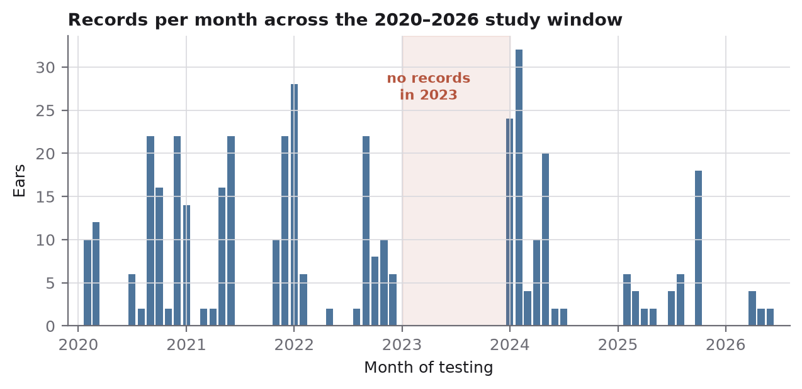

**Figure 1 (fig03).** Records per month across the 2020–2026 study window. 410 ears over 78 months, 40 months populated, 2023 empty.

### 1.3 Categorical fields

**`diagnosis_category`**: 15 rows use `csoM` instead of a protocol token; canonicalised to `csom` (**fixable**). After normalisation:

| Category | Ears | Ear % | Patients | Patient % |
|---|---|---|---|---|
| other | 137 | 33.4 | 75 | 36.6 |
| not_documented | 92 | 22.4 | 48 | 23.4 |
| presbyacusis | 76 | 18.5 | 38 | 18.5 |
| meniere | 32 | 7.8 | 17 | 8.3 |
| ototoxicity | 24 | 5.9 | 12 | 5.9 |
| otosclerosis | 20 | 4.9 | 12 | 5.9 |
| csom | 15 | 3.7 | 10 | 4.9 |
| nihl | 10 | 2.4 | 5 | 2.4 |
| ssnhl | 4 | 1.0 | 2 | 1.0 |

Ear percentages sum to 100. Patient percentages count each patient once and therefore do not (Section 5.1).

Two-thirds of the sample sits in `other` or `not_documented`. **`other` is the single largest category and is not defined anywhere in the protocol**: it is a residual bin, and a subgroup analysis on it means very little. `ssnhl` (4 ears), `nihl` (10) and `csom` (15) are too small for any subgroup inference (Section 7.2).

**`consultant_grade`**: **410/410 populated, no blanks.** The dictionary says the field records a grade "only where explicitly documented; blank otherwise". Every single record having an explicit consultant grade is implausible for a retrospective chart review, and the distribution is suspiciously even (58/111/59/94/39/49). Section 5.3 returns to this.

**`documented_shape`**: 409/410 populated (missing: study 257, left). sloping 160, notched 116, flat 79, rising 54. Again, near-total documentation of a field the protocol says is "only where explicitly documented", the same query as above at lower stakes. Note there is no `normal` shape option, so shape cannot be missing-by-design for normal ears.

**`sex`**: 158 male / 252 female, no missing values, only 1/2 used. Clean.

### 1.4 The value 120.0: a ceiling code, not a measured threshold

This is the most consequential numeric issue in the file. **143 of 3065 threshold cells (4.7%) are exactly 120.0, spread across 54 ears (13.2%).**

| Freq | 250 | 500 | 1k | 2k | 3k | 4k | 6k | 8k |
|---|---|---|---|---|---|---|---|---|
| cells at 120 | 2 | 9 | 13 | 19 | 12 | 23 | 40 | 25 |
| cells at 115 | 0 | 2 | 5 | 3 | 3 | 1 | 11 | 4 |

Three pieces of evidence say these are saturation values rather than measured thresholds:

1. **120 appears at 8 kHz, 25 times.** Clinical audiometers typically cannot deliver 120 dB HL at 8 kHz; output ceilings there are usually 90–110 dB HL. A 120 at 8 kHz is a recorder entering "maximum output" rather than a threshold at which the patient responded.
2. **27 ears have 120 at 6 kHz and a *lower* value at 8 kHz** (studies 1, 2, 55, 56, 64, 67, 83, 84, 93, 94, 121, 129, 131, 132, 138, 176, 207, 220, 240, 257, 287, 292, 298, 305, 306, 357, 364); 16 of those have 120 at 4 kHz with 8 kHz below it (studies 1, 2, 55, 56, 67, 83, 84, 93, 94, 131, 132, 176, 207, 240, 305, 357). A patient cannot fail to respond at 120 dB at 6 kHz and then respond at 100 dB at 8 kHz. The 120 marks the end of the testable range, not a response.
3. **21 ears carry both a 120 and a 115**, of the 27 ears that carry a 115 anywhere. The scale runs past 115 (the highest value recorded below 120 is 115), so 120 is the recorded endpoint of the instrument, and nothing above it exists.

**Verdict: 120 behaves as a right-censored ceiling ("no response at maximum output"), and the export contains no explicit code distinguishing it from a real threshold.** The protocol's validation rule set has no convention for this; rule 5 accepts 120 as a legal numeric value and nothing else addresses it.

**Consequence, quantified.** Because 120 is the top of the permitted range, treating it as a number rather than a censored value does **not** change any WHO grade: recomputing PTA-4 with 120 replaced by 121 changes **0 grades** and moves PTA-4 by at most **1.0 dB**. So the *graded* analysis is safe. Two things are not:

- 28 ears carry at least one 120 among the four PTA-4 frequencies; 4 ears (studies 55, 56, 83, 84) are 120 at all four.
- The FAI uses all eight thresholds, and 120 at 6/8 kHz feeds the slope and notch features. Five of the 54 ears carrying a 120 are among the 20 the FIS cannot classify at all (Section 1.9).

**Disposition:** declare as a limitation; add a `threshold_120` flag (done in `clean.py`); and add a sentence to the methods stating that 120 dB HL is treated as a censored ceiling. Do **not** re-code it to 130 or drop those ears without a protocol amendment.

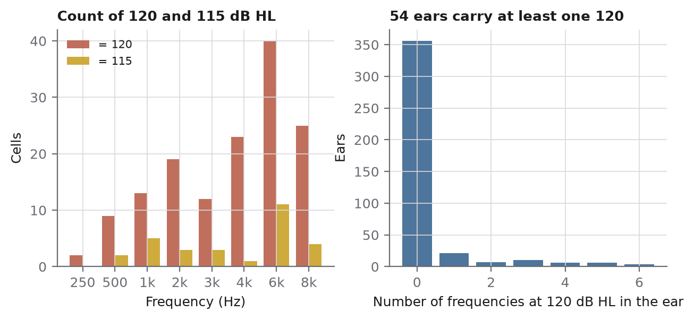

**Figure 2 (fig08).** Count of 120 and 115 dB HL by frequency, and the number of frequencies at 120 per ear. 143 cells across 54 ears.

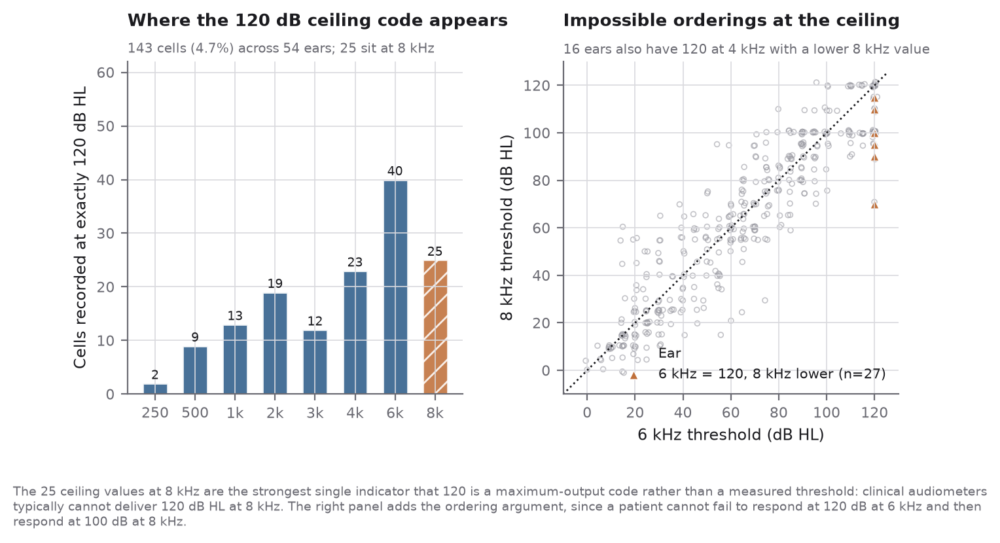

**Figure 3 (fig34).** The ceiling pattern against the frequency where it is impossible. Left: 143 ceiling cells by frequency, 25 of them at 8 kHz. Right: 6 kHz against 8 kHz, with the 27 ears at 120 at 6 kHz and lower at 8 kHz highlighted. A monotone threshold cannot produce that pattern.

### 1.5 Bone conduction

The protocol is explicit and it is not what one might expect: **data dictionary rule 10 states that a negative air–bone gap is *not* an error**, because BC exceeding AC by 5–10 dB is expected from test–retest variability, bone-vibrator output limits, unmasked BC reflecting the contralateral ear, and vibrotactile responses at high levels. The automated check was deliberately removed on 21 September 2026.

So the audit threshold is **>10 dB**, not "any negative gap":

| Check | Ears | Studies |
|---|---|---|
| BC − AC > 0 at any frequency | 285 cells | |
| **BC − AC > 10 dB (beyond protocol tolerance)** | **59 (14.4%)** | see below |
| **BC − AC > 20 dB (physiologically implausible)** | **10** | 54, 82, 107, 180, 194, 237, 289, 315, 332, 386 |
| **AC − BC > 60 dB** | **15** | 3, 4, 48, 51, 52, 64, 73, 219, 220, 230, 236, 250, 259, 363, 364 |

By frequency, the reversals concentrate at 2 kHz (43 ears exceed +10 dB there, max +45). The 59 ears exceeding the 10 dB tolerance:

`21, 43, 44, 54, 57, 78, 82, 96, 107, 108, 110, 119, 137, 141, 142, 146, 147, 153, 154, 155, 160, 180, 184, 194, 214, 216, 221, 222, 226, 232, 237, 239, 246, 248, 254, 256, 265, 267, 270, 272, 289, 290, 295, 296, 309, 311, 315, 316, 323, 324, 332, 343, 344, 353, 354, 370, 379, 386, 393`

Two corrections to the framing in the brief, both of which matter for interpretation:

- **Study 237** (AC 70 at 1 kHz, BC 90) is real and is in the >20 dB group. A 20 dB reverse gap at speech frequency is not physiological and is either a transcription error or a masked/unmasked mix. Agreed.
- **Studies 81/82 are not one finding.** Study 81 has BC 40 at 500 Hz against AC 30 at 500 Hz, a +10 dB reverse gap, exactly at the protocol's tolerance, not an error. The "25" in the brief is AC at *250* Hz, and comparing BC at 500 Hz with AC at 250 Hz is a cross-frequency comparison that is not a valid air–bone check. **Study 82** does have BC 45 against AC 15 at 500 Hz (+30 dB) and is genuinely implausible.

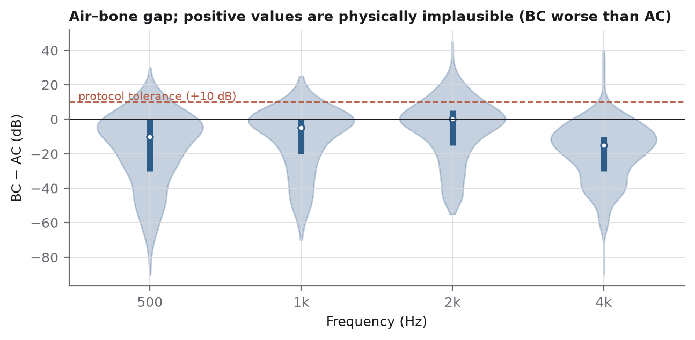

**Figure 4 (fig07).** BC − AC by frequency. Positive values are physically implausible; the dashed line is the protocol tolerance at +10 dB. Medians are −10, −5, 0 and −15 dB at 500 Hz, 1 kHz, 2 kHz and 4 kHz.

**Disposition:** the 10 ears above +20 dB are a **query**. They need chart review and likely exclusion under protocol §9.3 ("obvious data-entry errors that cannot be resolved from the chart"). The 15 ears with a >60 dB AC–BC gap are a **query** too; some are legitimate large conductive losses, but gaps of 70–90 dB at 500 Hz with BC in the 20–50 dB range are more likely mismatched masked/unmasked values. Neither group should be repaired by rule. All are flagged (`flag_bc_gt_ac_20`, `flag_ac_bc_gap_60`) and retained.

**Negative BC values** (9 cells at −5.0, in studies 29, 30, 38, 81, 82, 243, 351) are **within** the dictionary's declared −10 to 120 dB HL range and −5 dB HL is a normal audiometric value. **Not an error.** No action.

Section 4 develops the air–bone analysis descriptively.

### 1.6 Missingness

| Field | Missing | % | Pattern |
|---|---|---|---|
| th_250, th_500, th_1k, th_2k, th_4k, th_8k | 0 | 0% | complete |
| **th_3k** | **200** | **48.8%** | structural, see below |
| th_6k | 15 | 3.7% | 2026 batch + 2 pairs |
| bc_500 / 1k / 2k / 4k | 10 / 9 / 9 / 9 | ~2.4% | scattered |
| PTA-4 frequencies | **0 ears incomplete** | 0% | all 410 computable |

`th_3k` missingness is not random. It is a change in recording practice:

| Year | Ears | 3 kHz missing |
|---|---|---|
| 2020 | 92 | 2 (2%) |
| 2021 | 88 | 0 (0%) |
| 2022 | 84 | 56 (67%) |
| **2024** | 94 | **94 (100%)** |
| 2025 | 42 | 40 (95%) |
| 2026 | 8 | 8 (100%) |

Loss of 3 kHz begins mid-2022 and is total from 2024. It splits evenly by ear (100 left, 100 right; chi-square p = 1.000), so it is a chart or format change rather than an ear-specific issue.

Per dictionary rule 8, blanks at 3 and 6 kHz are expected and are **not** completeness defects, but the *step change* is worth naming, because it means any analysis using 3 kHz (slope features, notch depth, the FAI's configuration module) is effectively restricted to the 2020–2022 third of the sample. `th_6k` is missing for 15 ears, 9 of which are the 2025–2026 batch (studies 393–400, 410).

The FAI's service layer interpolates missing frequencies in log-frequency space rather than treating them as missing, so a blank 3 kHz is silently reconstructed from 2 and 4 kHz. That is a defensible choice but it should be stated in the methods, since it means "3 kHz missing" and "3 kHz measured" are not treated differently by the model.

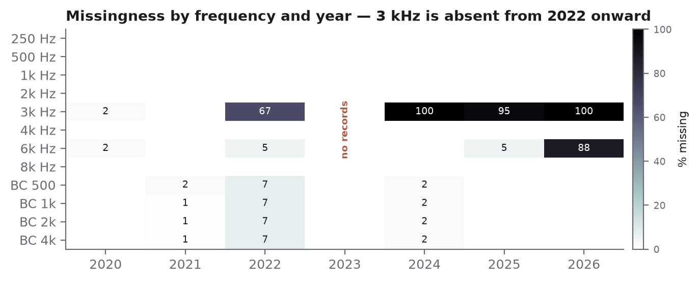

**Figure 5 (fig04).** Missingness by frequency and year. 3 kHz is absent from 2022 onward; 2023 carries no records at all.

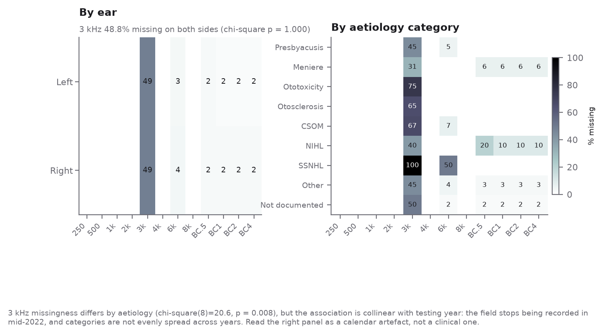

**Figure 6 (fig33).** The same missingness extended by ear and by aetiology. Left: 3 kHz is 48.8% missing on both sides (chi-square p = 1.000), so the gap is not ear-specific. Right: it varies from 31% (Meniere) to 100% (SSNHL, 4 ears) across categories, an association (chi-square(8) = 20.6, p = 0.008, V = 0.22) that is collinear with testing year and should not be read as clinical.

### 1.7 Age

Range **18–98**, median **60** (IQR 41–72, mean 56.6, SD 20.6); no values outside the protocol's 18–110, none implausible for an ENT clinic. Male median 61 (n=158), female 59 (n=252); the difference is negligible (Mann-Whitney U = 19,246, p = 0.571, rank-biserial −0.03, median difference +2.0 years, 95% CI −7.5 to 6.5). 30.2% of ages end in 0 or 5 against an expected 20% under no heaping (124 of 410, exact binomial p < 0.001), a mild digit preference consistent with ages recorded from memory or from the chart rather than calculated from date of birth. Low impact: age is a subgroup variable only.

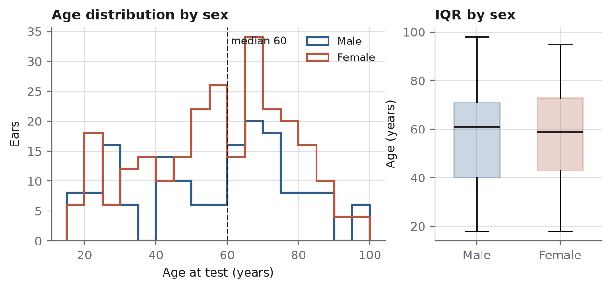

**Figure 7 (fig01).** Age distribution overall and by sex. Median 60 (IQR 41 to 72); male 61, female 59.

Section 2.1 develops age against ear, grade, aetiology and PTA.

### 1.8 Inclusion and exclusions: the analysis set

**All 410 ears are flagged `ear_included = 1` and no `exclusion_reason` is populated anywhere.**

Mechanically this is defensible: every ear has all four PTA-4 frequencies, no threshold is outside −10 to 120, and there are no duplicates, so no *automatic* protocol exclusion criterion fires. But protocol §9.3 also excludes records with "obvious data-entry or transcription errors that cannot be resolved from the chart", and this file contains 10 physiologically impossible bone-conduction reversals and 15 extreme conductive gaps. A 100% inclusion rate means that judgement was never applied.

**The analysis set is therefore 410 ears, with 20 ears unclassifiable by the FAI (Section 1.9), leaving 390 for the primary agreement analysis.** Recommend the exclusion review be actually performed before submission and the number excluded reported.

### 1.9 Monotonicity and the FAI implementation failure

**Monotonicity (protocol rule 7, >40 dB jump between adjacent measured frequencies): 18 ears**, studies 1, 31, 61, 64, 87, 127, 134, 195, 264, 275, 289, 305, 332, 341, 357, 372, 393, 409. Per the rule these are flagged for review and not corrected. Most are sharp high-frequency drops (for example study 1: 60 dB at 1 kHz to 120 dB at 2 kHz), which are unusual but not impossible.

**More important: the frozen FAI throws an exception on 20 ears (4.9%).**

| Error | Ears | Studies |
|---|---|---|
| `KeyError: 'audiogram_shape'` | 16 | 13, 70, 107, 115, 165, 182, 198, 204, 214, 217, 230, 238, 265, 280, 381 |
| `KeyError: 'severity'` | 4 | 55, 56, 83, 84 |

Root cause, confirmed by inspection: for these input combinations no rule in the corresponding consequent fires, so scikit-fuzzy never populates that key in `sim.output`, and `core.py` reads it unconditionally (lines 378–379). The severity score is often computable; study 13 returns a valid `severity` but the call dies on `audiogram_shape`. **A missing optional output is being treated as a total failure.**

This is not an environment artefact: it reproduces exactly on the pinned stack (NumPy 2.4.6, SciPy 1.18.0, scikit-fuzzy 0.5.0, as pinned in `requirements.txt`), and it is not the monotonicity set; only study 305 appears in both. It was reproduced a third time for this report by deleting the cached run and re-running `stage2_fai.py` from scratch in a fresh clone of `f9893a9`: 390 classified, the same 20 study IDs, and **0 score or label differences** against the cached run.

The 20 failures are skewed severe (median PTA-4 67.5 dB vs 48.1 dB for the ears that classify), and 5 of them carry a 120 dB HL ceiling value. They are not random: the FAI is losing precisely the worst-hearing ears, which biases any agreement statistic upward.

**Disposition: fixable in code, but must not be fixed silently.** Two acceptable routes: (a) patch `classify_audiogram` to return the severity score with `shape=None` when the shape consequent is empty, and re-freeze with a documented version bump; or (b) report n=390 and declare the 20 unclassified ears explicitly, including their severity distribution. Route (a) is better science; either way this must be settled before the primary analysis, and the paper must state which. **This report takes route (b)**, because the fix is not in the commit it is built on.

### 1.10 Summary of dispositions

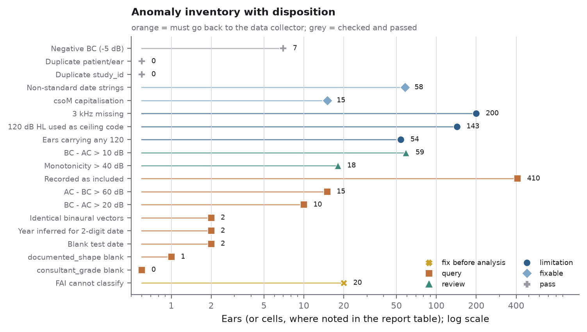

**Figure 8 (fig35).** Every defect the audit found, ordered by disposition, on a log scale so a 2-ear problem is visible beside a 410-ear one.

| # | Finding | Count / IDs | Disposition |
|---|---|---|---|
| 1 | Non-standard date strings | 58 rows (54 format, 2 assumed year, 2 blank) | fixable / **query** for blank and `Mar 25` |
| 2 | 2026 dates | 8 ears (395–400, 409, 410) | inside window, no action |
| 3 | No records in 2023; 40/78 months covered | 0 ears in 2023 | **query** + limitation |
| 4 | Likely batch, not consecutive, sampling | 5 months at exactly 22 ears | **query** + limitation |
| 5 | `csoM` capitalisation | 15 ears | fixable |
| 6 | `other` / `not_documented` dominate aetiology | 137 / 92 ears | limitation |
| 7 | `consultant_grade` 100% populated | 410/410 | **query**, reference validity |
| 8 | `documented_shape` 99.8% populated | 409/410 | **query** (lower stakes) |
| 9 | 120 dB HL used as a ceiling code | 143 cells / 54 ears | fixable (flag) + limitation |
| 10 | BC − AC > 10 dB | 59 ears | review |
| 11 | BC − AC > 20 dB | 10 ears | **query** / probable exclusion |
| 12 | AC − BC > 60 dB | 15 ears | **query** |
| 13 | Negative BC (−5) | 9 cells, 7 ears | not an error |
| 14 | 3 kHz missing from mid-2022 | 200 ears | limitation |
| 15 | Monotonicity > 40 dB | 18 ears | review |
| 16 | FAI cannot classify | 20 ears | **fix before analysis** |
| 17 | Zero exclusions applied | 410/410 included | **query** |
| 18 | Identical binaural vectors | patients 28, 42 | **query** |

---

## 2. Sample and structure

410 ears from 205 patients, 205 left and 205 right, complete pairs for every patient. Nothing is missing on `age_years`, `sex` or `ear`.

### 2.1 Age: overall, by sex, by ear

| Group | n | Median | IQR | Range | Mean (SD) |
|---|---|---|---|---|---|
| All ears | 410 | 60.0 | 41.0 to 72.0 | 18 to 98 | 56.6 (20.6) |
| Male | 158 | 61.0 | 40.3 to 71.0 | 18 to 98 | |
| Female | 252 | 59.0 | 43.0 to 73.0 | 18 to 95 | |
| Left ear | 205 | 60.0 | 41.0 to 72.0 | 18 to 98 | |
| Right ear | 205 | 60.0 | 41.0 to 72.0 | 18 to 98 | |
| Patients (one row each) | 205 | 60.0 | 41.0 to 72.0 | 18 to 98 | |

| Comparison | n | Test | Statistic | p | Effect size | Difference (95% CI) |
|---|---|---|---|---|---|---|
| Male vs female | 158 vs 252 | Mann-Whitney U | U = 19,246 | 0.571 | rank-biserial −0.03 | +2.0 years (−7.5 to 6.5) |
| Left vs right ear | 205 pairs | Mann-Whitney U | U = 21,012.5 | 1.000 | rank-biserial 0.00 | 0.0 years (−6.0 to 6.0) |

Sex is unbalanced (38.5% male) but not pathologically so for an ENT referral population. Age is, as it must be, identical in both ears of a patient: the two rows are the same person, so the left/right test is a formality that confirms the file is internally consistent.

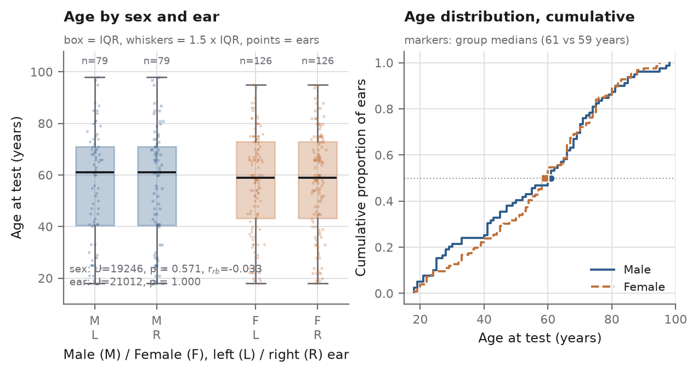

**Figure 9 (fig11).** Age by sex and ear, with the cumulative distribution. Four groups, median 61 (male) against 59 (female); Mann-Whitney p = 0.571, so the 2-year gap is not distinguishable from zero.

### 2.2 Age by grade

Age is not a monotone function of severity in this sample, and the departure is informative: median age rises from 45 in the normal band to 68 in the moderately severe band and then *falls* to 55 in the profound band.

| Clark grade | n | Median | IQR | Range |
|---|---|---|---|---|
| normal | 95 | 45.0 | 31.5 to 60.0 | 18 to 80 |
| mild | 65 | 60.0 | 46.0 to 68.0 | 18 to 94 |
| moderate | 70 | 66.0 | 49.0 to 76.5 | 21 to 92 |
| moderately severe | 79 | 68.0 | 50.0 to 80.0 | 18 to 95 |
| severe | 54 | 66.0 | 45.0 to 74.5 | 18 to 98 |
| profound | 47 | 55.0 | 37.5 to 73.5 | 18 to 91 |

| Comparison | Test | Statistic | p | Effect size | Interval |
|---|---|---|---|---|---|
| Age across the six Clark grades | Kruskal-Wallis | H(5) = 49.1 | < 0.001 | epsilon-squared 0.11 | |
| Monotone trend across ordered grades | Spearman rho | rho = +0.235 | < 0.001 | | |
| Age across the six consultant grades | Kruskal-Wallis | H(5) = 51.2 | < 0.001 | epsilon-squared 0.11 | |

The same shape appears under the consultant grade (normal 40, mild 60, moderate 65, moderately severe 68, severe 66, profound 55), so it is a property of the sample rather than of one grading scheme. The likely explanation is aetiology: the profound band contains the ototoxic and NIHL cases, which are younger than presbyacusis, and this is visible in Section 2.3.

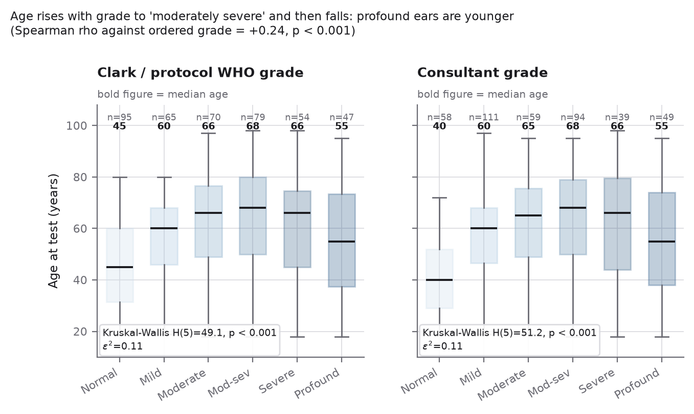

**Figure 10 (fig12).** Age by Clark grade and by consultant grade. Kruskal-Wallis H(5) = 49.1 and 51.2, both p < 0.001, epsilon-squared 0.11 in each case. The rise then fall is present in both panels.

### 2.3 Age by aetiology

| Aetiology | n | Median | IQR |
|---|---|---|---|
| presbyacusis | 76 | 79.5 | 74.0 to 88.0 |
| otosclerosis | 20 | 61.5 | 38.3 to 68.5 |
| meniere | 32 | 60.0 | 54.0 to 66.3 |
| not documented | 92 | 56.0 | 35.3 to 66.0 |
| ototoxicity | 24 | 53.0 | 44.5 to 71.3 |
| other | 137 | 53.0 | 30.0 to 66.0 |
| ssnhl | 4 | 48.5 | 28.0 to 69.0 |
| csom | 15 | 45.0 | 33.0 to 63.5 |
| nihl | 10 | 44.0 | 42.0 to 45.0 |

Kruskal-Wallis H(8) = 141.1, p < 0.001, epsilon-squared 0.33: aetiology explains a third of the rank variance in age, which is the largest effect size anywhere in this report. Presbyacusis sits 35 years above NIHL and CSOM, exactly as the diagnostic labels imply.

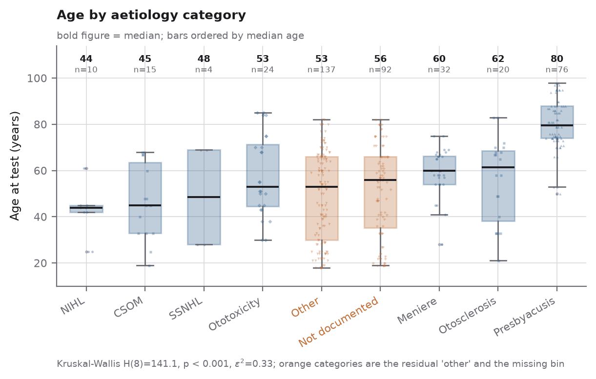

**Figure 11 (fig13).** Age by aetiology, ordered by median. Kruskal-Wallis H(8) = 141.1, p < 0.001, epsilon-squared 0.33. NIHL and CSOM are the youngest categories, presbyacusis the oldest by a wide margin.

### 2.4 Sex composition by decade and the collection pattern

| Decade | Male | Female | Total |
|---|---|---|---|
| 18–29 | 32 | 30 | 62 |
| 30–39 | 6 | 26 | 32 |
| 40–49 | 24 | 24 | 48 |
| 50–59 | 12 | 48 | 60 |
| 60–69 | 36 | 48 | 84 |
| 70–79 | 26 | 42 | 68 |
| 80+ | 22 | 34 | 56 |

Pearson chi-square(6) = 21.8, p = 0.0013, Cramer's V = 0.23. The female preponderance is concentrated between 30 and 59 years (6 male against 26 female at 30–39; 12 against 48 at 50–59) and disappears below 30 and above 60. This is a composition fact about the clinic, not a data defect, but it means sex and age are not independent in any subgroup analysis.

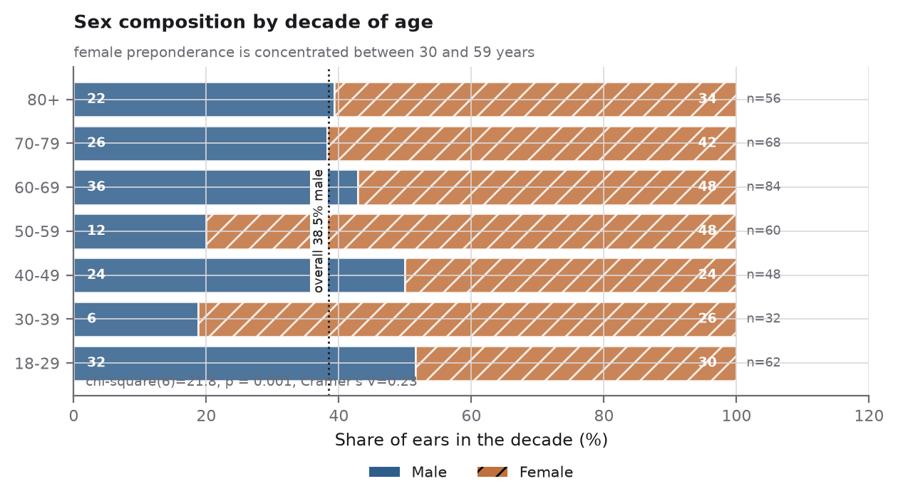

**Figure 12 (fig15).** Sex composition by decade. chi-square(6) = 21.8, p = 0.0013, V = 0.23; the imbalance is concentrated in the 30–59 range.

The collection pattern is the more consequential structure. The 410 records fall into **11 contiguous runs of months**, not one continuous series:

| Run | Months | Ears |
|---|---|---|
| 2020-02 to 2020-03 | 2 | 22 |
| 2020-07 to 2021-01 | 7 | 84 |
| 2021-03 to 2021-06 | 4 | 42 |
| 2021-11 to 2022-02 | 4 | 66 |
| 2022-05 | 1 | 2 |
| 2022-08 to 2022-12 | 5 | 48 |
| 2024-01 to 2024-07 | 7 | 94 |
| 2025-02 to 2025-05 | 4 | 14 |
| 2025-07 to 2025-08 | 2 | 10 |
| 2025-10 | 1 | 18 |
| 2026-04 to 2026-06 | 3 | 8 |

Run sizes range from 2 to 94 ears (SD 32), which is what a series of separate extraction passes looks like and is not what consecutive sampling looks like. Five months sit at exactly 22 ears and the monthly maximum is 32. Combined with the empty 2023, this is the strongest evidence that the frame is a set of batches rather than a calendar.

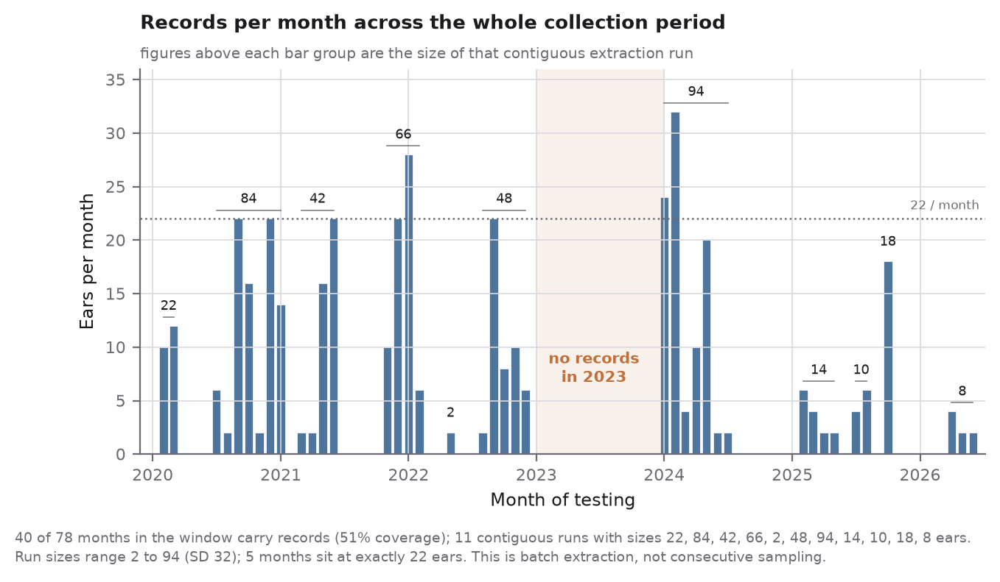

**Figure 13 (fig17).** Records per month with each contiguous extraction run labelled by size. 40 of 78 months carry records (51.3%), 11 runs, sizes 2 to 94, SD 32.

### 2.5 Laterality and interaural asymmetry

Laterality is balanced by construction: 205 left, 205 right, and 205 patients contribute both ears. What matters clinically is how much the two ears differ.

| Measure | Value |
|---|---|
| Patients with both ears | 205 |
| Median right minus left PTA-4 | 0.0 dB (IQR −7.5 to 8.8) |
| Mean right minus left PTA-4 | +1.26 dB (SD 20.9) |
| Range | −85 to +75 dB |
| Ears identical | 13 patients (6.3%) |
| Right worse | 93 patients |
| Left worse | 99 patients |
| Median absolute difference | 7.5 dB |
| **Asymmetric by 15 dB or more** | **66 patients (32.2%, 95% CI 26.2 to 38.9)** |
| Asymmetric by 30 dB or more | 35 patients (17.1%) |

Wilcoxon signed-rank across ears: W = 9,154.5, p = 0.887, so there is no systematic side preference; the asymmetry is symmetric noise around zero with a heavy tail. A third of patients differ by at least 15 dB, which is the clinically conventional threshold for calling a loss asymmetric, and 17% differ by at least 30 dB. Asymmetry is not associated with aetiology category (chi-square(8) = 9.0, p = 0.344, V = 0.21).

The intraclass correlation of PTA-4 between paired ears is 0.733: ears are strongly but not completely correlated, which is why the design effect for ear-level proportions is 1.73 and why n=410 ears is not n=410 independent observations.

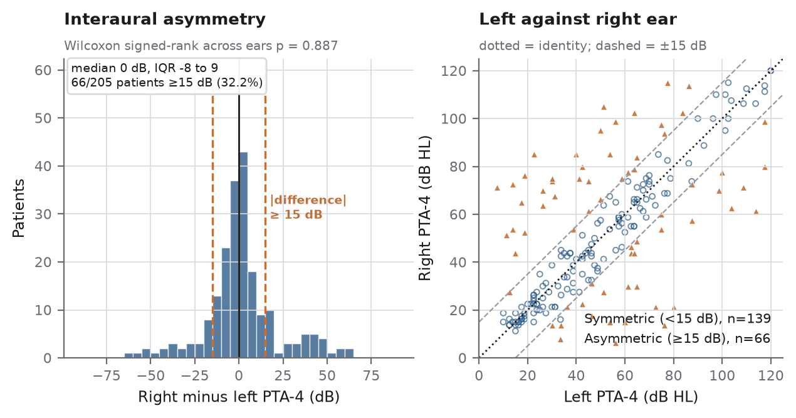

**Figure 14 (fig16).** Right minus left PTA-4 (left) and left against right (right). Median difference 0 dB, but 66 of 205 patients (32.2%) differ by 15 dB or more and 35 by 30 dB or more. Wilcoxon p = 0.887 for a systematic side effect.

### 2.6 Age against PTA

| Comparison | n | Statistic | p | Effect size | Interval |
|---|---|---|---|---|---|
| Age vs PTA-4 (ears) | 410 | Spearman rho | < 0.001 | rho = +0.247 | 95% CI +0.152 to +0.341 |
| Age vs mean PTA-4 (patients) | 205 | Spearman rho | < 0.001 | rho = +0.272 | |
| Age vs PTA-4 (OLS) | 410 | slope +0.260 dB/year | < 0.001 | R-squared 0.035 | 95% CI +0.128 to +0.393 |

The association is positive, statistically unambiguous and *small*: age explains 3.5% of the variance in PTA-4. Applied across the 80-year age range the slope is worth about 21 dB, which is why a large sample can make a small gradient significant. For the validation this is good news: the sample is not a presbyacusis cohort with a narrow range, and PTA-4 is not a proxy for age.

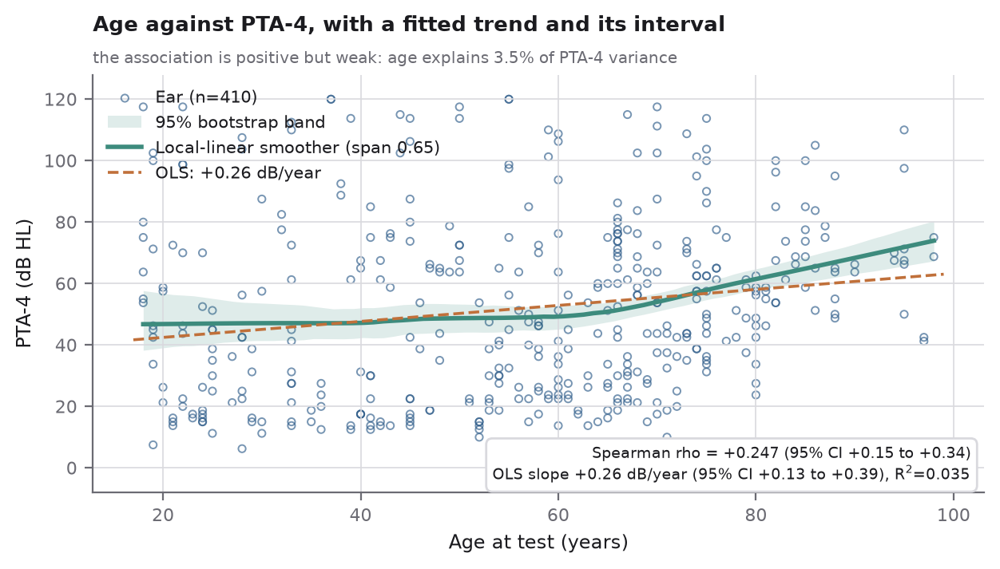

**Figure 15 (fig14).** Age against PTA-4 with a local-linear smoother (span 0.65) and its 95% bootstrap band, plus the OLS line. Spearman rho +0.247 (95% CI +0.15 to +0.34); OLS +0.26 dB per year (95% CI +0.13 to +0.39), R-squared 0.035.

---

## 3. Thresholds

### 3.1 Distribution at each frequency and by ear

| dB HL | 250 | 500 | 1k | 2k | 3k | 4k | 6k | 8k |
|---|---|---|---|---|---|---|---|---|
| n | 410 | 410 | 410 | 410 | 210 | 410 | 395 | 410 |
| Median | 50 | 45 | 45 | 50 | 55 | 60 | 65 | 65 |
| IQR | 30–70 | 25–70 | 25–70 | 25–70 | 25–70 | 30–80 | 35–90 | 35–95 |
| Range | 5–120 | 5–120 | 5–120 | 0–120 | 0–120 | 0–120 | 0–120 | 0–120 |

Medians rise with frequency, as expected in a presbyacusis-heavy clinic sample, and the high-frequency IQR widens because the 120 ceiling compresses the top of the distribution. All values are multiples of 5, consistent with standard audiometric recording.

| Frequency | Left median | Right median | Paired Wilcoxon | p |
|---|---|---|---|---|
| 250 | 50 | 50 | 7,004.5 | 0.882 |
| 500 | 45 | 45 | 7,473.5 | 0.937 |
| 1k | 45 | 45 | 6,284.0 | 0.688 |
| 2k | 50 | 55 | 5,039.0 | 0.118 |
| 3k | 55 | 55 | 1,806.0 | 0.644 |
| 4k | 60 | 60 | 7,411.0 | 0.966 |
| 6k | 65 | 65 | 5,420.0 | 0.062 |
| 8k | 65 | 65 | 5,998.0 | 0.824 |

The two ears are indistinguishable at every frequency (n = 205 pairs, 105 at 3 kHz). The strongest hint of a difference is at 6 kHz (p = 0.062, right slightly worse), which does not survive any correction for eight tests. For the audit this matters: laterality is not a source of confounding, and an ear-level analysis does not need to adjust for side.

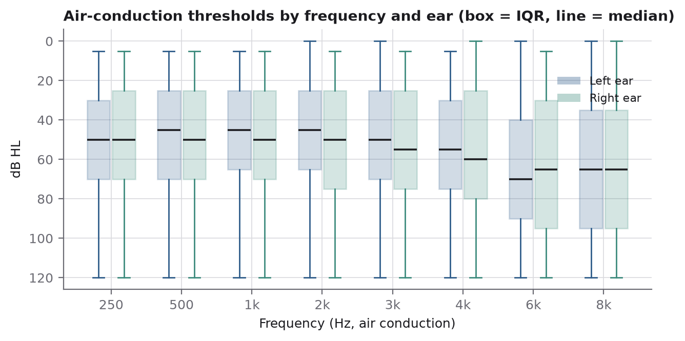

**Figure 16 (fig02).** Air-conduction thresholds at each frequency, by ear. Box = IQR, line = median; the 3 kHz band covers half the sample.

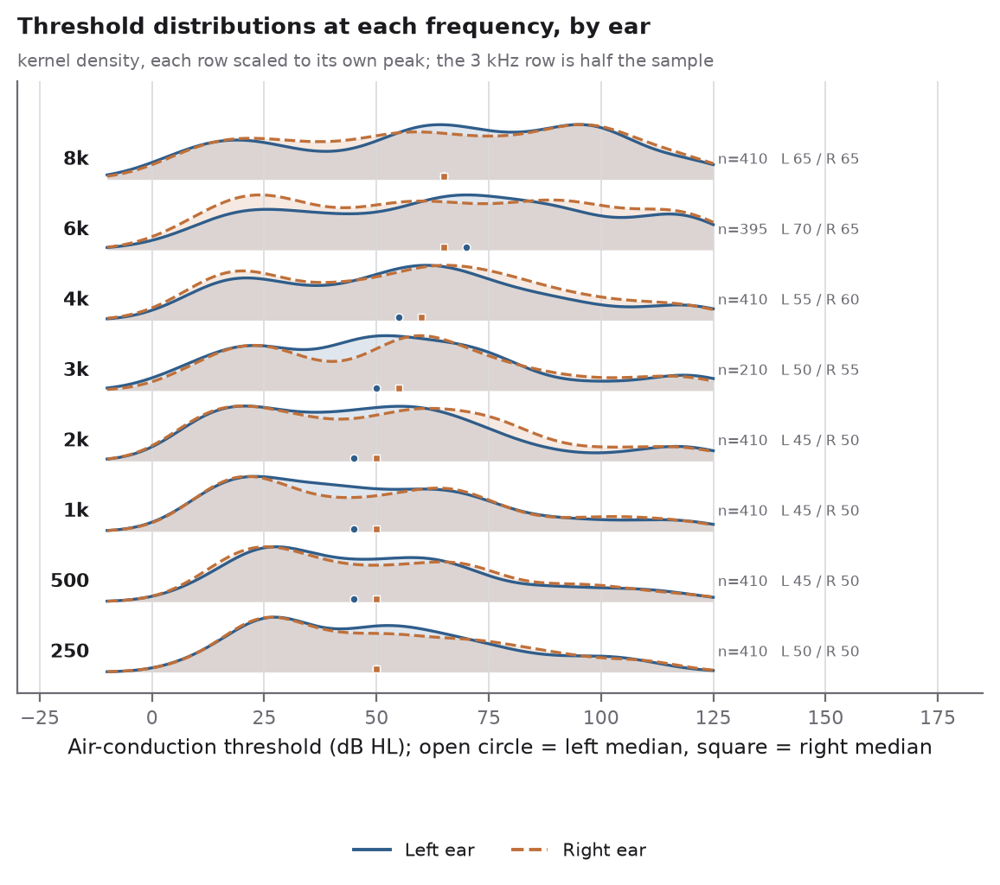

**Figure 17 (fig18).** The same distributions as kernel densities, one row per frequency, left ear solid and right ear dashed. Each row is scaled to its own peak, with medians marked; the bimodality visible at 4 kHz and above is the 120 dB ceiling accumulating mass at the top of the scale.

### 3.2 Median threshold by frequency, ear and grade

The ear effect is nil; the grade effect is large and orderly. Median thresholds rise monotonically across consultant grade at every frequency, and the only irregularity is the profound band at 6 and 8 kHz, where the ceiling code takes over.

| Consultant grade | 250 | 500 | 1k | 2k | 3k | 4k | 6k | 8k |
|---|---|---|---|---|---|---|---|---|
| normal | 20 | 20 | 15 | 10 | 10 | 15 | 20 | 15 |
| mild | 30 | 30 | 25 | 25 | 25 | 30 | 45 | 50 |
| moderate | 50 | 45 | 45 | 45 | 45 | 55 | 62 | 60 |
| moderately severe | 60 | 65 | 65 | 60 | 65 | 70 | 85 | 85 |
| severe | 80 | 80 | 75 | 75 | 70 | 80 | 90 | 95 |
| profound | 100 | 105 | 105 | 110 | 110 | 110 | 120 | 100 |

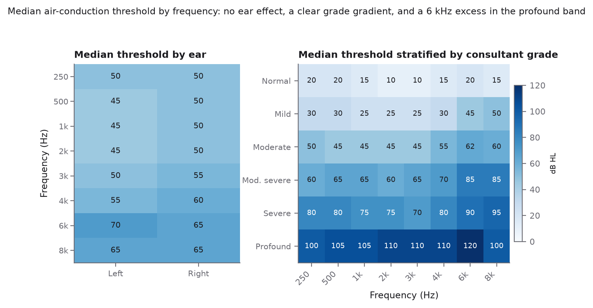

**Figure 18 (fig19).** Median threshold by ear (left) and by consultant grade (right). The two ears are identical cell by cell; the grade gradient is about 90 dB from normal to profound, and the 6 kHz cell in the profound band (120) sits above its 8 kHz neighbour (100).

### 3.3 Correlation between frequencies

| Pair | Spearman rho | n |
|---|---|---|
| 250 vs 500 | 0.95 | 410 |
| 500 vs 1k | 0.92 | 410 |
| 1k vs 2k | 0.93 | 410 |
| 2k vs 3k | 0.95 | 210 |
| 3k vs 4k | 0.95 | 210 |
| 4k vs 6k | 0.90 | 395 |
| 6k vs 8k | 0.92 | 395 |
| 250 vs 8 kHz (weakest pair) | 0.66 | 410 |

Every adjacent pair correlates at 0.90 or above, and the 3 kHz row, present in only 210 ears, still correlates 0.81 to 0.95 with every other frequency. The threshold vector therefore carries a strong common severity factor, which is exactly why the FAI's severity module can work from eight numbers and why a single PTA is a reasonable summary. The weakest pair is the two ends of the audiogram (250 Hz against 8 kHz, rho 0.66), the classic slope signature.

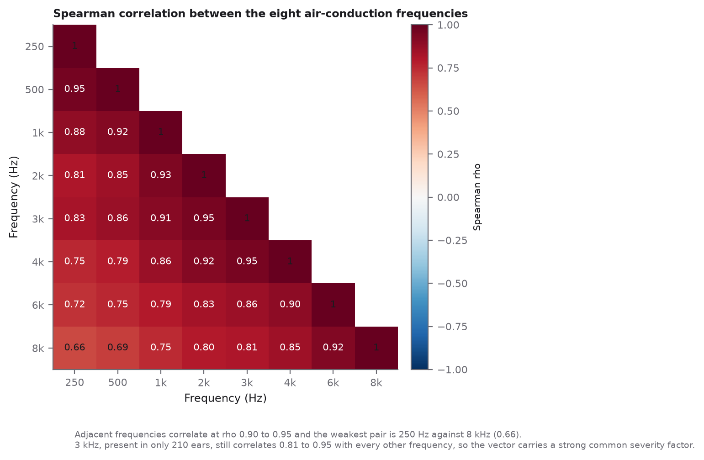

**Figure 19 (fig20).** Spearman correlation between the eight air-conduction frequencies, lower triangle, pairwise complete. Adjacent pairs 0.90 to 0.95; the weakest pair is 250 Hz against 8 kHz at 0.66.

### 3.4 Configuration: what the threshold profiles actually look like

Configuration is a property of the *shape* of a profile, not its level: two ears at 20 and 70 dB with the same 4 kHz slope have the same documented shape. Ears were therefore clustered on their seven measured frequencies (3 kHz excluded, since it is missing for half the sample), each centred on its own mean, and k-means with k = 4 was used because the comparator (`documented_shape`) has four categories.

Silhouette by k, shape-normalised: 0.332 (k=2), 0.278 (k=3), **0.263 (k=4)**, 0.236 (k=5), 0.185 (k=6). Silhouette is maximised at k=2, which separates only "better" from "worse" hearing and says nothing about configuration. Clustering the raw, un-normalised thresholds instead gives a higher silhouette at every k (0.477 at k=2, 0.372 at k=4) but produces four severity bands with near-identical flat shapes, which is why the level was removed. The k=4 solution is weakly separated and that is reported rather than hidden.

| Cluster | n | Slope, 4 kHz minus 250 Hz (dB per octave) | Median PTA-4 | Median level |
|---|---|---|---|---|
| C1 | 171 | −2.5 (essentially flat, slight reverse slope) | 36.3 | 38.6 |
| C2 | 86 | 0.0, with a sharp 6 to 8 kHz drop (−11 dB at 2 kHz to +23 at 8 kHz, centred) | 49.4 | 60.0 |
| C3 | 97 | +5.0 | 65.0 | 68.6 |
| C4 | 56 | +7.5 | 46.3 | 59.3 |

Against the documented shapes (rows cluster, columns documented):

| | flat | sloping | rising | notched |
|---|---|---|---|---|
| C1 | 57 | 4 | 45 | 64 |
| C2 | 10 | 44 | 9 | 23 |
| C3 | 11 | 60 | 0 | 26 |
| C4 | 1 | 52 | 0 | 3 |

Pearson chi-square(9) = 207.7, p < 0.001, Cramer's V = 0.41; cluster purity 53.8%. The association is real and moderately strong, but the clusters do not reproduce the labels: 64 of the 116 documented "notched" ears sit in the flat cluster, 26 in the sloping cluster, 23 in the high-frequency-drop cluster and only 3 in the steepest cluster. Whatever "notched" means in this file, it is not a notch in the threshold vector.

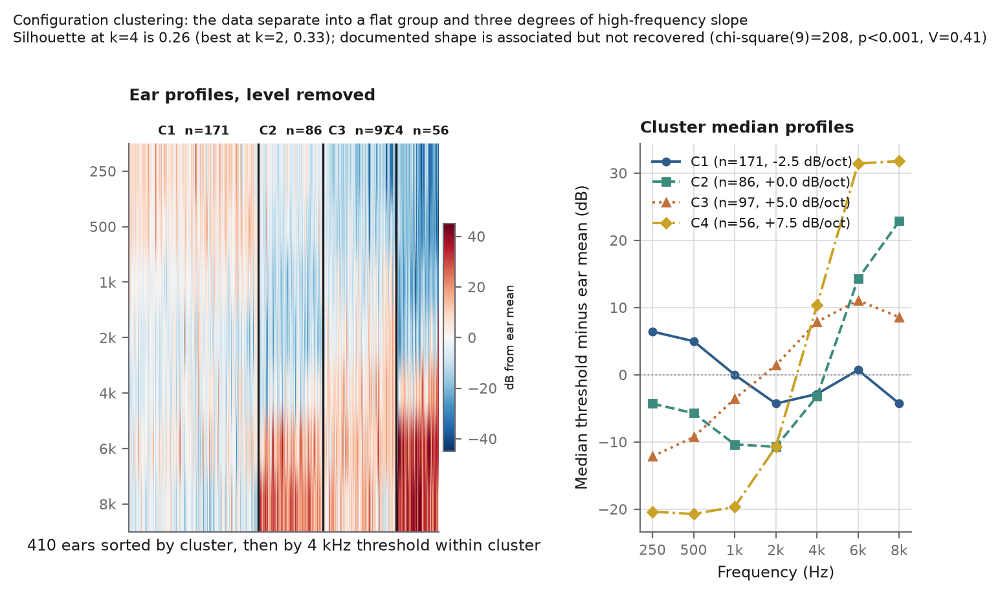

**Figure 20 (fig21).** Left: all 410 ear profiles with the level removed, grouped by cluster. Right: cluster median profiles. k=4, silhouette 0.26; chi-square against documented shape = 207.7 (df 9), p < 0.001, V = 0.41, purity 54%.

### 3.5 Which average? PTA-3, PTA-4 and an eight-frequency mean

| Average | Frequencies | Median | IQR | Range |
|---|---|---|---|---|
| PTA-3 | 500, 1k, 2k | 46.7 | 25.4 to 68.3 | 5.0 to 120 |
| **PTA-4** (WHO 2021 and the FAI's `pt4a`) | 500, 1k, 2k, 4k | **48.75** | 26.6 to 70.0 | 6.25 to 120 |
| Mean of 250 Hz to 8 kHz | all eight (available) | 55.0 | 30.6 to 73.7 | 7.9 to 116.4 |

| Contrast | Median difference | IQR of difference | Ears changing Clark grade |
|---|---|---|---|
| PTA-4 minus PTA-3 | +1.25 dB | −0.8 to +3.75 | **73 (17.8%)**: 59 one grade less severe, 14 one grade more |
| PTA-8 minus PTA-4 | +2.50 dB | −0.3 to +6.8 | **105 (25.6%)**: 12 one grade less, 92 one grade more, 1 two grades more |

The three averages correlate at rho 0.98 to 0.99, so they rank ears almost identically, and yet they disagree about the *grade* of a sixth to a quarter of the sample. That is a direct consequence of 42% of ears lying within ±5 dB of a boundary (Section 6.1): where boundaries are dense, a 1.25 dB shift is enough to move a grade.

The WHO 2021 recommendation uses 500, 1k, 2k and 4 kHz, which is identical to the FAI's `pt4a` and to the PTA-4 used throughout this report; there is no separate "WHO average" to compute. The comparison that matters is therefore PTA-3 against PTA-4 (does dropping 4 kHz matter?) and PTA-4 against the full eight-frequency mean (does ignoring 250, 3, 6 and 8 kHz matter?). Both do.

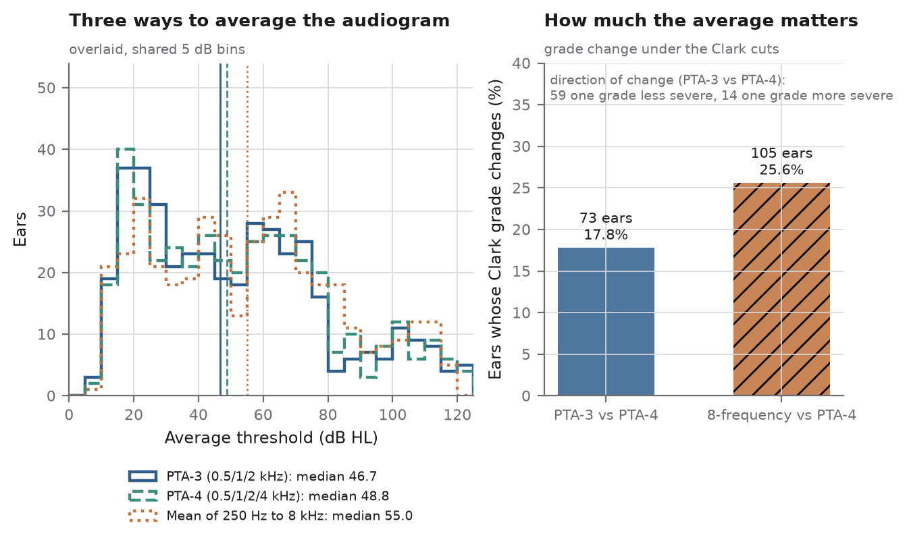

**Figure 21 (fig22).** Three averages overlaid (medians 46.7, 48.75 and 55.0 dB), and the share of ears whose Clark grade changes when the average changes: 17.8% for PTA-3 against PTA-4, 25.6% for the eight-frequency mean against PTA-4.

The protocol fixes PTA-4, so this is not a decision the study has to make. It is a decision the *field* makes every time it compares studies, and the size of the effect here is worth one sentence in the methods: PTA-3 and an eight-frequency mean would each produce a materially different grade distribution from the one in Section 6.2.

---

## 4. Air–bone conduction

### 4.1 Overall and by frequency

| Frequency | n | Median BC − AC | IQR | Range |
|---|---|---|---|---|
| 500 | 400 | −10 | −30 to 0 | −90 to +30 |
| 1k | 401 | −5 | −20 to 0 | −70 to +25 |
| 2k | 401 | 0 | −15 to 5 | −55 to +45 |
| 4k | 401 | −15 | −30 to −10 | −90 to +40 |
| All cells pooled | 1,603 | −10 | −25 to 0 | −90 to +45 |

Bone conduction itself, for reference: median 30 dB at 500 Hz (IQR 20 to 50), 30 at 1 kHz (20 to 55), 40 at 2 kHz (25 to 60) and 35 at 4 kHz (15 to 55), n = 400 to 401 per frequency, against air-conduction medians of 45, 45, 50 and 60 at the same frequencies. BC sits systematically below AC, as it should.

Per ear, the mean of the four available BC − AC differences: median **−8.75 dB** (IQR −23.75 to −1.25, range −63.75 to +22.5, n = 401, mean −13.4, SD 16.7).

Pooled across cells, **17.8% are positive** (BC worse than AC) and **4.6% exceed +10 dB**. Both are the expected direction for a sensorineural sample with measurement noise, and the positive tail is the part that Section 1.5 adjudicates.

At 1 kHz, where the comparison is cleanest, median AC is 45 dB and median BC 30 dB (Wilcoxon p < 0.001, n = 401) and the two correlate at rho 0.776: BC tracks AC closely enough to be credible as the same ear's bone conduction, and sits systematically 15 dB better, which is the conductive component of this clinic population.

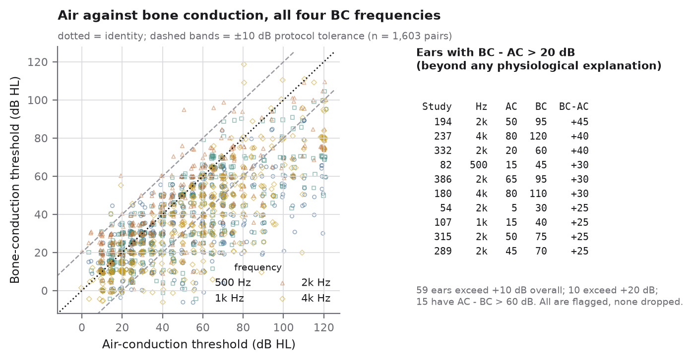

**Figure 22 (fig23).** Air against bone conduction, all four BC frequencies, 1,603 pairs. Dotted line is the identity; the dashed bands mark ±10 dB. The ten ears above +20 dB are listed with study ID, frequency and both thresholds.

### 4.2 Air–bone gap by diagnosis and by grade

| Group | n | Median mean ABG (dB) |
|---|---|---|
| CSOM | 15 | −27.5 |
| Otosclerosis | 20 | −21.3 |
| Ototoxicity | 24 | −13.8 |
| Presbyacusis | 76 | −8.1 |
| Other | 133 | −8.8 |
| Not documented | 90 | −5.0 |
| Meniere | 30 | −5.0 |
| NIHL | 9 | −5.0 |
| SSNHL | 4 | −8.1 |

Kruskal-Wallis H(8) = 20.2, p = 0.009, epsilon-squared 0.03. The ordering is clinically sensible at the top (CSOM and otosclerosis carry the largest conductive components) and the effect size is small because eight of the nine categories sit within 9 dB of each other.

| Consultant grade | n | Median mean ABG (dB) |
|---|---|---|
| normal | 54 | −2.5 |
| mild | 111 | −3.8 |
| moderate | 58 | −10.0 |
| moderately severe | 92 | −10.0 |
| severe | 39 | −23.8 |
| profound | 47 | −38.8 |

Kruskal-Wallis H(5) = 139.6, p < 0.001, epsilon-squared 0.34; against the Clark grades H(5) = 161.7, p < 0.001, epsilon-squared 0.40.

That gradient is real but it must not be read as "worse grade, worse conduction". In the severe and profound bands the air thresholds are pinned at or near 120 while bone conduction is recorded lower, so the gap is partly an artefact of where the scale stops. The honest statement is that mean ABG and severity are strongly associated in this file, and that the association is confounded by the ceiling.

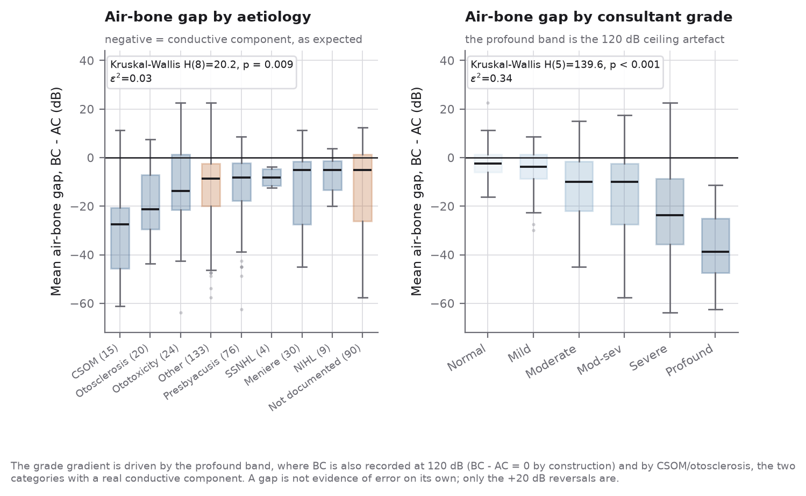

**Figure 23 (fig24).** Mean air–bone gap by aetiology (Kruskal-Wallis H(8) = 20.2, p = 0.009) and by consultant grade (H(5) = 139.6, p < 0.001, epsilon-squared 0.34). Negative values are a conductive component.

---

## 5. Categorical variables

### 5.1 Aetiology

Counts are in Section 1.3. Adding PTA-4 by category:

| Category | n | Median PTA-4 | IQR |
|---|---|---|---|
| ssnhl | 4 | 83.8 | 58.8 to 104.7 |
| ototoxicity | 24 | 75.0 | 58.4 to 98.1 |
| csom | 15 | 71.2 | 42.5 to 80.6 |
| presbyacusis | 76 | 62.5 | 50.0 to 71.2 |
| otosclerosis | 20 | 61.2 | 39.7 to 72.8 |
| meniere | 32 | 39.4 | 28.4 to 62.8 |
| other | 137 | 36.2 | 21.2 to 67.5 |
| not documented | 92 | 36.2 | 21.2 to 63.8 |
| nihl | 10 | 34.4 | 15.3 to 53.4 |

Kruskal-Wallis H(8) = 60.1, p < 0.001, epsilon-squared 0.13. Aetiology carries real information about severity, but five of the nine categories have fewer than 25 ears, and the two largest are the residual bin and the missing bin.

**44.1% of ears carry a named diagnosis**; 55.9% are `other` or `not_documented`. That is the number to quote when the protocol promises aetiology-stratified performance.

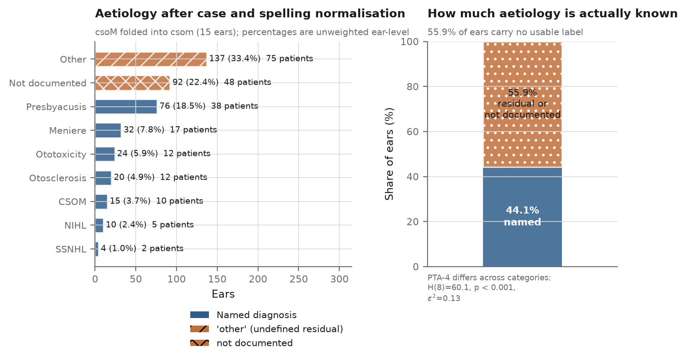

**Figure 24 (fig25).** Aetiology after case and spelling normalisation, with patient counts beside ear counts, and the named share separated from the residual and missing bins. PTA-4 differs across categories: H(8) = 60.1, p < 0.001, epsilon-squared 0.13.

### 5.2 Documented configuration against computed configuration

`documented_shape` is 409/410 populated: sloping 160, notched 116, flat 79, rising 54. The FAI's configuration module, run on the same 389 ears with a documented shape and a successful classification, returns:

| FAI configuration | Ears |
|---|---|
| Sloping | 122 |
| Rising | 108 |
| Flat | 106 |
| Precipitous | 45 |
| Notched | 9 |
| no output (classification failed) | 20 |

| Documented (rows) x FAI (cols) | Flat | Sloping | Rising | Precipitous | Notched |
|---|---|---|---|---|---|
| Flat | 41 | 12 | 18 | 6 | 0 |
| Sloping | 32 | 84 | 19 | 12 | 4 |
| Rising | 9 | 5 | 36 | 1 | 0 |
| Notched | 24 | 21 | 34 | 26 | 5 |

**Exact agreement 42.7% (166 of 389; 95% CI 37.9 to 47.6%), unweighted Cohen kappa 0.267.** The FAI emits `Notched` for 9 ears against 116 documented notched, and 111 of those 116 are not called notched by the FAI. Sloping and rising are recovered reasonably (84/160 and 36/54); notched and flat are not.

A second, independent check removes the FAI from the question. A transparent rule applied directly to the thresholds (notch if 3 kHz exceeds 4 kHz by 15 dB or more; sloping if 4 kHz exceeds 500 Hz by 20 dB or more; rising if the reverse; flat otherwise) gives:

| Documented (rows) x threshold rule (cols) | Flat | Sloping | Rising | Notched | Undetermined |
|---|---|---|---|---|---|
| Flat | 74 | 3 | 2 | 0 | 0 |
| Sloping | 81 | 73 | 6 | 0 | 0 |
| Rising | 31 | 0 | 23 | 0 | 0 |
| Notched | 84 | 19 | 10 | 3 | 0 |
| **Rule output total** | **271** | **95** | **41** | **3** | 0 |

Exact agreement **42.3%** (173 of 409), within one percentage point of the FAI's 42.7%. Two unrelated automatic schemes agree with the documented label at almost exactly the same rate, which is the strongest single piece of evidence that the documented shapes are not a function of the threshold vector. The rule calls two thirds of the sample flat, because most of these profiles genuinely are: median 4 kHz minus 500 Hz is +15 dB in the sloping cluster and near zero everywhere else.

This does not prove the shape field is wrong. A clinician can label a notch that is 2 dB deep and clinically meaningful, and 3 kHz is missing for half the sample, which weakens any notch rule. It does mean **Objective 4 cannot be settled by counting agreement**: either the documented shapes carry information the thresholds do not, in which case the comparison is not a validation of the threshold model, or they were inferred from the thresholds by a different rule, in which case agreement measures that rule.

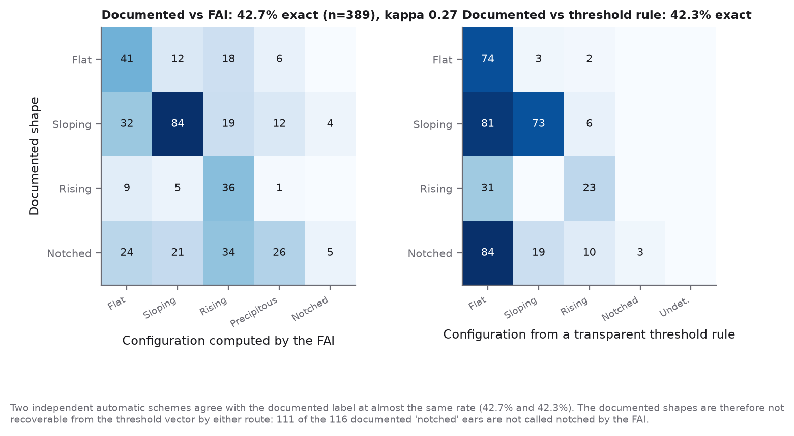

**Figure 25 (fig26).** Documented shape against the FAI configuration (42.7% exact, kappa 0.27, n = 389) and against a transparent threshold rule (42.3% exact, n = 409). The two near-identical rates are the finding.

### 5.3 Consultant grade against the computed schemes

| Comparison | n | Exact | Quadratic kappa | Within 1 grade | Spearman vs PTA-4 |
|---|---|---|---|---|---|
| Consultant vs Clark (6) | 410 | 74.6% | 0.951 | 99.8% | 0.959 |
| Consultant vs WHO 1997 (5) | 316 | 77.8% | 0.943 | 100% | 0.946 |
| Consultant vs WHO 2021 (7) | 410 | 58.0% | 0.927 | 99.5% | 0.959 |

| Consultant (rows) x Clark (cols) | normal | mild | moderate | mod-severe | severe | profound |
|---|---|---|---|---|---|---|
| normal | 58 | 0 | 0 | 0 | 0 | 0 |
| mild | 37 | 61 | 13 | 0 | 0 | 0 |
| moderate | 0 | 4 | 46 | 9 | 0 | 0 |
| moderately severe | 0 | 0 | 10 | 64 | 20 | 0 |
| severe | 0 | 0 | 1 | 6 | 31 | 1 |
| profound | 0 | 0 | 0 | 0 | 3 | 46 |

The disagreement is almost entirely one step (99.8% within one grade), which is why quadratic kappa reads 0.951 while exact agreement is 74.6%. The signed departure is 306 exact, 60 one grade lower, 43 one grade higher, 1 two grades lower.

The 37 ears graded `mild` by the consultant but `normal` by PTA-4 are the largest single cell of disagreement and are worth a clinical look: a clinician calling PTA 15 to 25 "mild" may be using a lower threshold, since WHO 2021 places normal at 20 dB or below, which would explain much of this. That is a substantive interpretive point for the paper, not a data error.

| Consultant grade | PTA-4 range (dB) |
|---|---|
| normal | 6.25 to 25.0 |
| mild | 15.0 to 47.5 |
| moderate | 30.0 to 65.0 |
| moderately severe | 47.5 to 82.5 |
| severe | 48.75 to 93.75 |
| profound | 87.5 to 120.0 |

Each grade's range overlaps its neighbours by 7.5 to 20 dB, so grade is not a monotone function of PTA-4 (an ear at PTA 20 can be "mild" while one at PTA 25 is "normal"). No single PTA formula reproduces it: the best of three candidate averages, PTA-3, matches only 78.0% exactly, against 74.6% for PTA-4 and 65.1% for the eight-frequency mean.

That pattern is *consistent* with genuine clinician judgement using shape, asymmetry and history rather than PTA alone, which would be fine, and is in fact the point of an independent reference. But it is equally consistent with a semi-derived field. **Disposition: query.** Ask explicitly: was `consultant_grade` transcribed from a written consultant opinion, or inferred by the extractor from the audiogram? If the latter, Objective 2 has no independent human reference and cannot be reported as agreement with a clinician.

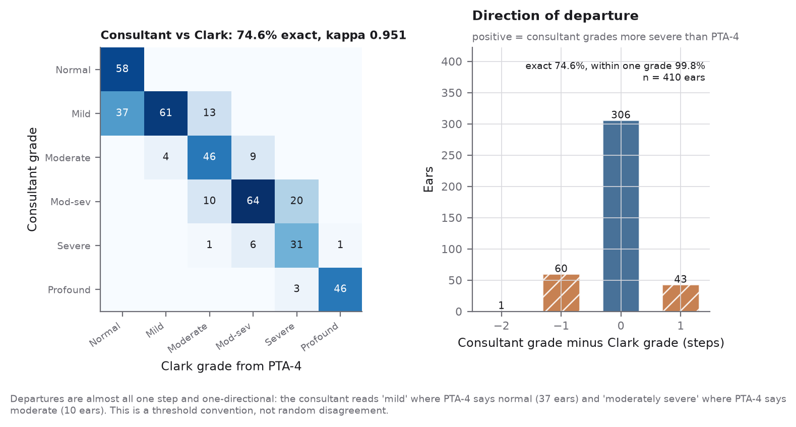

**Figure 26 (fig27).** Consultant grade against the Clark grade from PTA-4 (74.6% exact, kappa 0.951, 99.8% within one grade) and the distribution of signed departures. The departures are almost all one step and one-directional.

---

## 6. The validation questions

### 6.1 Boundary proximity: 57.6%, not 18.7%

**236 of 410 ears (57.6%) sit within ±5 dB of a Clark/WHO boundary** on PTA-4.

| Reference scheme | Boundaries | Within ±2 dB | Within ±5 dB | Within ±10 dB |
|---|---|---|---|---|
| **Clark / protocol WHO (6 grades)** | 25, 40, 55, 70, 90 | 67 (16.3%) | **236 (57.6%)**, 95% CI 52.7 to 62.3 | 357 (87.1%) |
| WHO 1997 (5 grades, shipped script) | 25, 40, 60, 80 | 57 (13.9%) | 208 (50.7%), 95% CI 45.9 to 55.5 | 343 (83.7%) |
| WHO 2021 (7 grades) | 20, 35, 50, 65, 80, 95 | 87 (21.2%) | 272 (66.3%), 95% CI 61.6 to 70.7 | 384 (93.7%) |

The Clark and the protocol's six-grade WHO scheme are the same cuts (25/40/55/70/90), so they produce identical numbers on every ear: 0 ears differ. There is no separate "WHO six-grade" column to report.

Per boundary, ears within ±5 dB: 25 dB (62), 40 dB (54), 55 dB (49), 70 dB (56), 90 dB (15). The density falls at the top because the 120 ceiling pulls a mass of ears well above 90.

**Figure 27 (fig05).** PTA-4 against the Clark boundaries, with the ±5 dB zones shaded, and the distance from the nearest boundary. 236 of 410 ears (57.6%) are within ±5 dB; 67 (16.3%) within ±2 dB.

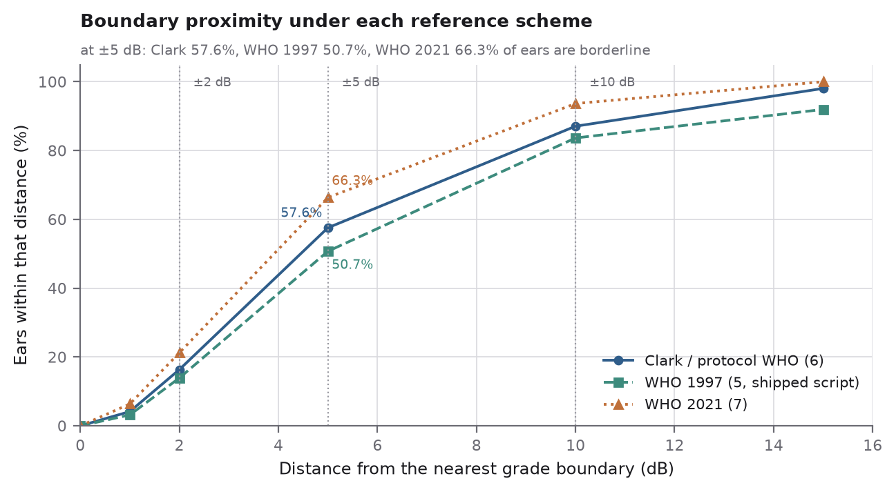

**Figure 28 (fig28).** The same distance distribution under all three reference schemes, as a cumulative curve. At ±2 dB: 16.3% (Clark), 13.9% (WHO 1997), 21.2% (WHO 2021). At ±5 dB: 57.6%, 50.7%, 66.3%.

This is three times the 18.7% seen in the NHANES work, and the reason is **case mix, not a defect**. The ±5 dB window around five boundaries covers 50 dB of the PTA-4 axis. In NHANES, 88% of ears were normal and clustered below 20 dB HL, outside every window, so almost nothing could be borderline. Here PTA-4 has an IQR of 26.6 to 70.0 dB, spread right across all five bands, so most ears are *by construction* near a boundary.

That is exactly what a validation sample should look like, and it strengthens the paper's central claim rather than threatening it. **The sample is not dominated by clear-cut cases.** 226 of the 390 classifiable ears (57.9%) are borderline and 164 (42.1%) are clear.

### 6.2 Grade distributions under the three schemes

| Grade | Clark / protocol WHO (6) | WHO 1997 (5, shipped script) | WHO 2021 (7) | Consultant |
|---|---|---|---|---|
| normal | 95 (23.2%) | 95 (23.2%) | 63 (15.4%) | 58 (14.1%) |
| mild | 65 (15.9%) | 65 (15.9%) | 78 (19.0%) | 111 (27.1%) |
| moderate | 70 (17.1%) | **95 (23.2%)** | 69 (16.8%) | 59 (14.4%) |
| moderately severe | 79 (19.3%) | not defined | 77 (18.8%) | 94 (22.9%) |
| severe | 54 (13.2%) | **93 (22.7%)** | 61 (14.9%) | 39 (9.5%) |
| profound | 47 (11.5%) | 62 (15.1%) | 19 (4.6%) | 49 (12.0%) |
| complete (≥95) | not defined | not defined | 43 (10.5%) | not defined |

The five-grade scheme has no "moderately severe" band, so the 79 ears that Clark places there are absorbed into moderate (25) and severe (54), and 15 ears that Clark calls severe move to profound. That single definitional choice moves 94 ears (22.9%).

**No grade holds most of the ears under any scheme.** The largest is `normal` at 23.2% on the protocol scheme, a dramatic contrast with the NHANES development cohort, where roughly 88 to 89% of ears were normal. That difference is the single most important property of this sample and it is what makes the validation informative. `consultant_grade` is the most skewed (mild 27.1%) but still spans all six levels.

Counting each patient once (by their worse ear) gives 32/27/35/41/38/32 across the six bands, which is close enough to the ear-level shares that no conclusion turns on the unit of analysis.

**Figure 29 (fig06).** Grade distributions under the Clark/protocol scheme, the five-grade shipped script and the consultant grade. No band holds more than a quarter of the sample.

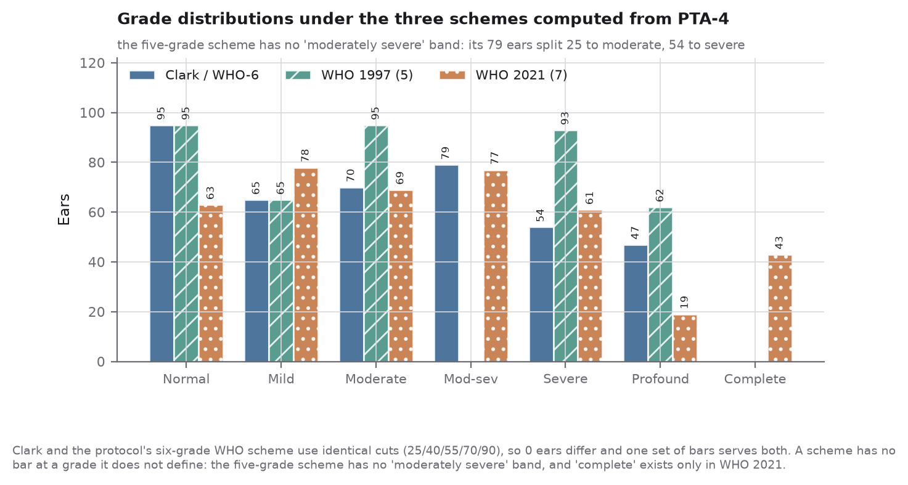

**Figure 30 (fig29).** The three computed schemes side by side, with the bands each one defines. The five-grade scheme has no moderately severe band; WHO 2021 adds a complete band above 95 dB that holds 43 ears.

### 6.3 The FAI against each scheme

Run on the 390 classifiable ears:

| Metric | FAI vs Clark (6) | FAI vs WHO 1997 (5) | FAI vs WHO 2021 (7) |
|---|---|---|---|
| n | 390 | 327 | 390 |
| Quadratic weighted kappa | **0.947** (95% CI 0.935 to 0.958) | 0.975 (0.967 to 0.983) | 0.932 (0.922 to 0.940) |
| Exact agreement | **69.5%** | 89.0% | 55.9% |
| Within one grade | 99.5% | 100% | 99.7% |
| Mean absolute grade error | 0.31 | 0.11 | 0.44 |
| Ears graded higher by the FAI | 107 | 10 | 63 |
| Ears graded lower by the FAI | 12 | 26 | 109 |
| Design effect (patient clustering) on the kappa SE | 1.16 | 1.04 | 1.13 |

The WHO 1997 column covers only 327 ears, because 63 ears carry a label that the five-grade scheme does not define (moderately severe or complete) and cannot be scored against it. That is one reason the five-grade comparison looks better than it is: the ears it excludes are precisely the ones the FAI handles badly.

**Read the kappa with the exact agreement beside it.** Quadratic weighting charges a one-step disagreement only 1/25 of a full penalty, so kappa 0.947 coexists with 30.5% disagreement. For contrast, on the same data: linear-weighted kappa 0.844, unweighted kappa **0.632**. The paper should report the weighted kappa as pre-specified but state the unweighted figure too, or a reviewer will compute it.

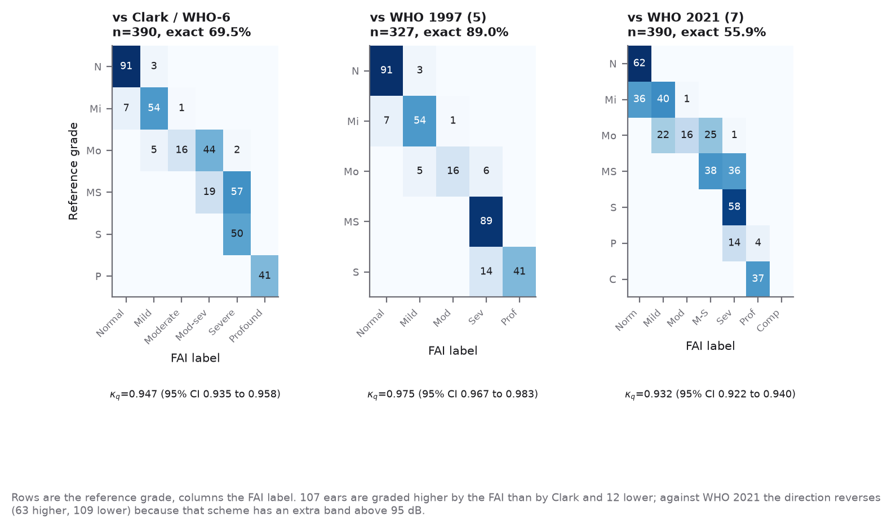

**Figure 31 (fig30).** Confusion matrices for the FAI against all three schemes, with counts and the quadratic-weighted kappa printed on each panel. Against Clark: 107 ears graded higher, 12 lower. Against WHO 2021 the direction reverses (63 higher, 109 lower) because that scheme has an extra band above 95 dB.

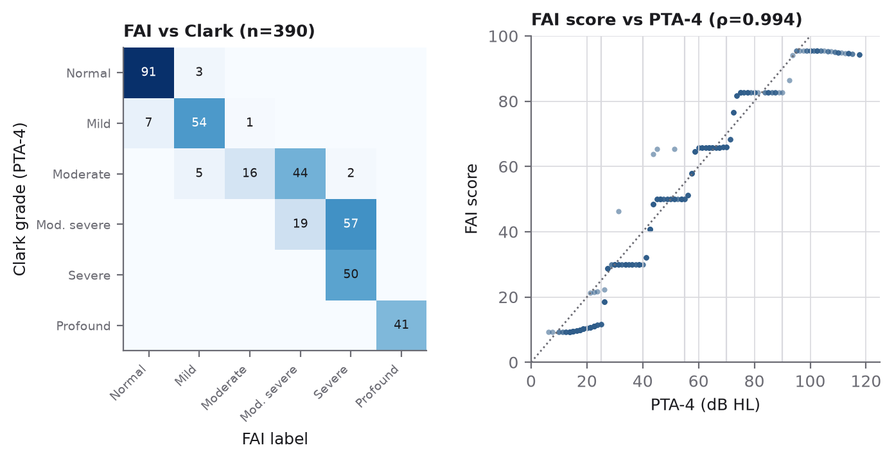

**Figure 32 (fig09).** The FAI against Clark as a confusion matrix, and the FAI score against PTA-4 with the identity line.

### 6.4 Where the disagreement sits

| Clark grade | n | Exact agreement | 95% CI | Mean signed error | Graded higher | Graded lower | Off by ≥2 |
|---|---|---|---|---|---|---|---|
| normal | 94 | 96.8% | 91.0 to 98.9 | +0.03 | 3 | 0 | 0 |
| mild | 62 | 87.1% | 76.6 to 93.3 | −0.10 | 1 | 7 | 0 |
| moderate | 67 | **23.9%** | 15.3 to 35.3 | +0.64 | 46 | 5 | 2 |
| moderately severe | 76 | **25.0%** | 16.6 to 35.8 | +0.75 | 57 | 0 | 0 |
| severe | 50 | 100% | 92.9 to 100 | 0.00 | 0 | 0 | 0 |
| profound | 41 | 100% | 91.4 to 100 | 0.00 | 0 | 0 | 0 |

Two thirds of all disagreement (107 of 119 off-grade ears) is concentrated in `moderate` and `moderately severe`: the FAI calls 44 of 67 moderate ears and 57 of 76 moderately severe ears one grade worse. Agreement is at or near 100% at both ends of the scale.

The FAI's centroid therefore sits high in the middle of the range. This is a **calibration offset**, not noise, and it is the most actionable finding in this section: a recalibration of the score-to-label thresholds (not the rule base) would likely recover most of the 30.5% disagreement.

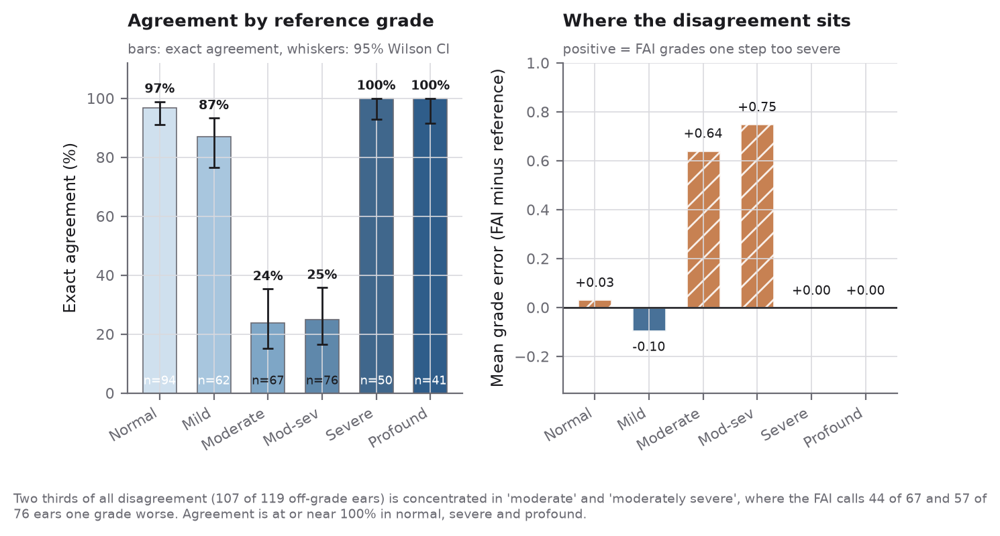

**Figure 33 (fig32).** Exact agreement by reference grade with 95% Wilson intervals, and the mean signed grade error. Agreement falls to 24% and 25% in the two middle bands while staying at 100% at both ends.

Borderline stratification, which is the protocol's key claim:

| Group | n | Exact agreement | Kappa | MAE |
|---|---|---|---|---|
| Clear (≥6 dB from boundary) | 164 | 77.4% | 0.973 | 0.23 |
| Borderline (±5 dB) | 226 | 63.7% | 0.909 | 0.37 |

The FAI does degrade at boundaries, as designed, but only from 77.4% to 63.7%, and it stays within one grade for about 99% of borderline ears. That is a defensible result; the framing in the manuscript should be "degrades gracefully", not "excels at boundaries".

### 6.5 Calibration: the offset in dB

| Quantity | Value |
|---|---|
| n | 390 |
| Mean difference, FAI score minus PTA-4 (bias) | **−2.94 dB** |
| SD of the difference | 6.52 dB |
| 95% limits of agreement | **−15.7 to +9.8 dB** |
| Median difference | −2.88 dB (IQR −7.47 to +1.29) |
| Within ±5 dB | 57.0% |
| FAI above PTA-4 | 32.6% of ears |
| Trend in the difference against the mean | +0.031 dB per dB (95% CI +0.008 to +0.054), p = 0.008 |

The trend is the interesting part: the difference is not constant. It runs from about −7 dB in the normal band, through zero in the moderate band, to +3 dB in severe, and then falls sharply to −11 dB in profound, where the score saturates at **95.51** and can no longer follow PTA-4 upward. That is the calibration offset the directional grade disagreement implies, expressed in dB: the FAI is **too lenient in the middle of the range and too generous at the top of it**.

| Clark band | n | Mean bias (dB) | Median bias (dB) |
|---|---|---|---|
| normal | 94 | −7.4 | −7.5 |
| mild | 62 | −3.6 | −4.4 |
| moderate | 67 | +0.4 | +1.2 |
| moderately severe | 76 | +0.9 | +0.6 |
| severe | 50 | +2.6 | +2.5 |
| profound | 41 | −10.9 | −9.6 |

Excluding the 54 ears that carry a 120 dB ceiling value narrows the limits of agreement to −13.3 to +8.9 dB (n = 341) and the bias to −2.21 dB, so about a fifth of the total disagreement comes from the ceiling rather than from the index.

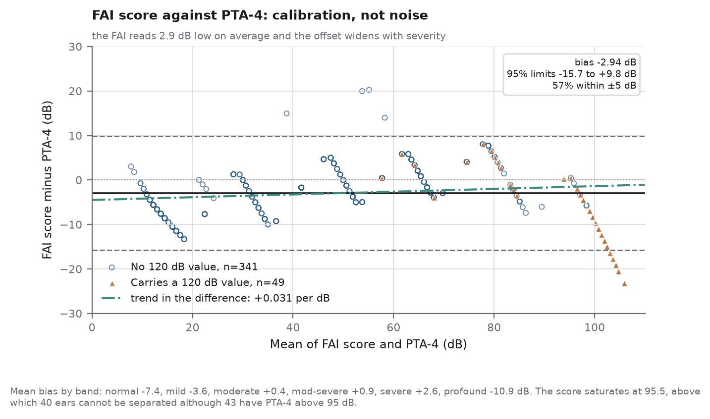

**Figure 34 (fig31).** FAI score minus PTA-4 against the mean of the two. Bias −2.94 dB, limits of agreement −15.7 to +9.8 dB, with a positive trend of +0.031 dB per dB and a collapse in the profound band where the score saturates at 95.5.

### 6.6 Precision of kappa across sample sizes

Estimated by resampling the observed FAI-versus-Clark agreement matrix, blended toward independence to span the plausible kappa range, so the interval reflects this sample's actual error structure and grade marginals rather than an assumed one:

| True kappa | 95% CI width at n = 410 | Half-width | Bootstrap SE |
|---|---|---|---|
| 0.60 | 0.152 | ±0.076 | 0.043 |
| 0.70 | 0.135 | ±0.067 | 0.036 |
| **0.80** | **0.106** | **±0.053** | **0.029** |
| 0.90 | 0.064 | ±0.032 | 0.019 |

The same estimator applied across plausible sample sizes, which is what a protocol revision or an extension would need:

| Ears | Width at kappa 0.6 | at 0.7 | at 0.8 | at 0.9 |
|---|---|---|---|---|
| 150 | 0.251 | 0.221 | 0.169 | 0.103 |
| 205 | 0.214 | 0.193 | 0.148 | 0.086 |
| 300 | 0.177 | 0.157 | 0.124 | 0.070 |
| **410** | **0.151** | **0.134** | **0.107** | **0.064** |
| 600 | 0.128 | 0.110 | 0.087 | 0.053 |
| 800 | 0.109 | 0.096 | 0.077 | 0.046 |
| 1200 | 0.088 | 0.078 | 0.062 | 0.037 |

The protocol assumed "a standard error of approximately 0.03" at about 400 ears. At kappa 0.8 that is almost exactly right (SE 0.029). The assumption is sound. Doubling the sample to 800 ears buys about 0.03 of precision at kappa 0.8; tripling it buys 0.045. Precision improves as the square root of n, so the marginal return is steep at 150 ears and shallow past 600.

Because 205 patients contribute 2 ears each, the effective sample size is below 410. Measured design effect on the kappa: **1.12** (cluster-bootstrap SE 0.0064 vs i.i.d. 0.0058; a re-run for this version gave 1.16), far lower than the theoretical 2.0 because the two ears of a patient usually receive the same grade. Applying it, the patient-level CI at kappa 0.8 is roughly ±0.06 rather than ±0.05. This is a modest penalty and the paper should simply state that the interval accounts for pairing.

**Figure 35 (fig10).** Expected 95% CI width for quadratic-weighted kappa at n = 410 (left) and against sample size at kappa 0.8 (right).

---

## 7. Feasibility for the validation

### 7.1 Precision of kappa at n = 410 ears

Covered in Section 6.6. At kappa 0.8 the 95% interval is ±0.05, or ±0.06 once patient pairing is accounted for, which distinguishes "good agreement" from "moderate agreement" without ambiguity.

### 7.2 What the sample supports

| Analysis | Units available | Verdict |
|---|---|---|
| Primary kappa (FAI vs WHO/Clark PTA-4) | 410 ears / 205 patients | **Supported.** CI ±0.05 at kappa=0.8 |
| Borderline vs clear stratification | 226 / 164 ears | **Supported.** Both arms large |
| Grade-level agreement table | 47–95 per grade | **Supported** |
| Continuous agreement, Bland-Altman | 390 ears | **Supported** |
| Configuration agreement | 389 ears | Supported statistically; validity depends on the shape query |
| Subgroup: sex | 158 / 252 ears (79 / 126 patients) | **Marginal.** CI about ±0.09 / ±0.06 at kappa=0.8, enough to detect a large difference only |
| Subgroup: age band | 94 / 108 / 208 ears | **Marginal.** CI about ±0.11 / ±0.10 / ±0.07 |
| Subgroup: presbyacusis | 76 ears | **Weak.** CI about ±0.12 |
| Subgroup: other | 137 ears | Descriptive only, heterogeneous residual bin |
| Subgroup: meniere / ototoxicity / otosclerosis | 32 / 24 / 20 ears | **Not supported.** CI about ±0.19 to ±0.24 |
| Subgroup: csom / nihl | 15 / 10 ears | **Not supported.** CI about ±0.28 / ±0.34 |
| Subgroup: ssnhl | 4 ears | **Not possible.** CI would exceed the parameter space |
| Exclusion sensitivity analyses | 10–30 ears | Descriptive only |

Subgroup widths are derived from the measured n-versus-width curve (width about 0.106 x sqrt(410/n) at kappa=0.8) and should be quoted as approximate.

### 7.3 Is 205 patients enough?

**For the primary analysis, yes, comfortably.** The protocol's own minimum (250 ears) is exceeded by 64%, the grade distribution is close to the best case for an ordinal kappa, and the borderline stratum is more than large enough to carry the paper's central claim. n=205 patients is not the limiting factor. The limiting factor is the 20 ears the index cannot grade (Section 1.9).

**For the protocol as written, no: two of its six objectives are not deliverable.**

- **Objective 5 (subgroup analyses by age, sex and aetiology).** Age and sex are workable but underpowered for anything but large effects. Aetiology is the real casualty: five of nine categories have fewer than 25 ears, and the two largest categories are `other` and `not_documented`. The protocol promises aetiology-stratified performance; the data can support it for presbyacusis only, and marginally at that. Either drop aetiology subgroups to a descriptive table or expand the sample.
- **Objective 4 (configuration).** Needs the `documented_shape` provenance resolved first. At 42.7% agreement the current comparison is either a negative result or a circular one, and the protocol does not say which it expects. Section 5.2 shows that a second, independent rule gives the same 42.3%, which tilts the interpretation towards "the documented shapes are not a function of the thresholds" rather than "the FAI is bad at shape".

To make aetiology subgroups real, the sample would need roughly 100 ears per category of interest, realistically 600 to 900 ears, or a deliberate over-sampling of csom, nihl and otosclerosis. The extraction yields 410 ears from 40 of the 78 months in the window, about 10 ears per covered month; completing every month would give roughly 800, and closing that gap is a better route than extending the window (which would also not recover the missing 2023 archive).

**Recommendation:** proceed with 410 ears for the primary analysis and the borderline claim; report age and sex subgroups with explicit confidence intervals and no significance testing; demote aetiology to descriptive; fix the FAI's missing-output crash before any agreement number is published; and either re-scope the configuration objective or drop it.

---

## 8. Reconciliation with the previous version

Nothing in the findings of the previous report has been reversed. Where a number moved, the reason is given here rather than edited into the text silently.

**One substantive conflict.** Section 2.3 of the previous version said the BC − AC distribution is "centred slightly below zero (median −5 to 0 dB)". That is true at 1 and 2 kHz but not at 500 Hz (`−10`) or 4 kHz (`−15`), and the pooled cell median is `−10`. The qualitative finding is unchanged (the bulk of the mass is negative, with a positive tail), but the quoted range is too narrow. **Flagged for the author**: either quote per-frequency medians, as Section 4.1 now does, or widen the range.

**Arithmetic and estimator differences**, all recomputed from the same scripts on the same 410 records:

| Quantity | Previous text | This version | Reason |
|---|---|---|---|
| WHO 1997 "within one grade" | 99.4% | 100% | recomputed on the same 327 ears; the previous figure is not reproducible from `stage2.json` |
| WHO 1997 mean absolute grade error | 0.13 | 0.11 | same recomputation |
| WHO 2021 mean absolute grade error | 0.47 | 0.44 | same recomputation |
| Kappa design effect | 1.12 | 1.12 (1.16 on re-run) | Monte Carlo, 1,500 bootstrap replicates; both values inside the noise |
| Kappa CI width at 0.8, n=410 | 0.106 | 0.106 (0.105 on an independent run) | same estimator, different seed |
| AC threshold range | "−5 to 120 (section 2.2)" | 0 to 120 air conduction; −5 appears only in bone conduction | the −5 values are `bc_*`, not `th_*` |
| "120 and 115 co-occur" | 21 ears | 21 ears (29 cells at 115, 143 at 120) | unchanged; clarified as ears rather than cells |
| Age by ear / laterality | not reported | 0 dB difference, p = 1.000 | new |

**Findings that new figures support rather than contradict:** the 42.7% configuration agreement (Section 5.2 now adds an independent 42.3%), the 57.6% boundary proportion, the directional 107-versus-12 disagreement, the −2.94 dB bias, and the 20 unclassifiable ears. No new chart in this version disagrees with an existing finding.

**New results with no previous counterpart**, listed so the author can decide which belong in the paper: age is non-monotone across grade (Section 2.2); aetiology explains 33% of the rank variance in age (Section 2.3); 32.2% of patients are asymmetric by 15 dB or more (Section 2.5); PTA-3 versus PTA-4 moves 17.8% of grades (Section 3.5); the threshold profile clusters by slope rather than by documented shape (Section 3.4); 44.1% of ears carry a named diagnosis (Section 5.1).

---

## 9. Reproducibility

| File | Role |
|---|---|
| `raw_export.csv` | Source data. **Never modified, never committed** (clinical data; git-ignored). |
| `clean.py` | Non-destructive cleaning. Writes `derived/analysis_clean.csv`, plus `derived/cleaning_log.csv` recording all 73 changes with study_id, field, old value, new value, rule and action. Thresholds are never altered; suspect records are flagged, not dropped. |
| `stage1_audit.py` | Audit and descriptive statistics → `stage1.json` |
| `stage2_fai.py` | Runs the frozen FAI once per ear (cached to `derived/fai_runs.csv`), agreement and kappa precision → `stage2.json` |
| `stage3_checks.py` | Alternative weightings, uncached verification, subgroup counts → `stage3.json` |
| `stage4_descriptive.py` | Every statistic behind the new charts → `descriptive.json`, `derived/clusters.csv` |
| `statlib.py` | Interval, effect-size, clustering and smoothing helpers (NumPy/SciPy only; no statsmodels) |
| `figures.py` | The original ten, `fig01` to `fig10`, at 200 dpi |
| `figures_extended.py` | The new twenty-five, `fig11` to `fig35`, at 200 dpi |
| `figstyle.py` | Shared palette, markers, line styles and hatches |

`derived/`, `stage*.json` and `stage*_out.txt` are git-ignored: they contain patient-level rows, study IDs and the cleaning log. Two independent runs of `stage2_fai.py` (cached and fully uncached) produce identical scores and labels on all 410 ears.

**Environment.** The pinned stack from `requirements.txt` (NumPy 2.4.6, SciPy 1.18.0, scikit-fuzzy 0.5.0). `stage2_fai.py` memoises the FIS *build* and deep-copies it per ear; reusing one `ControlSystemSimulation` across ears leaks `sim.output` between calls and silently returns a previous ear's score when a compute produces no output, a real trap, and one that produced a plausible-looking 9.66/"normal" for studies 83/84 before it was caught. The deep-copy path was verified against a fully uncached run on 15 random ears: 15/15 identical scores and labels.

**On the grading-scheme discrepancy.** `scripts/validate_oatuhc.py` hard-codes `WHO_BOUNDS = [25, 40, 60, 80]` and a five-grade `who_grade()`. The protocol (§12.3) specifies six grades at 25/40/55/70/90. This EDA uses the protocol definition throughout. The shipped script should be corrected before it is used, or every agreement figure it produces will be against the wrong reference.

**Figure QA.** Every figure is 200 dpi at 7.2 to 7.8 in wide. The twenty-five new figures pass an automated text-collision check at render time (bounding-box overlap of every non-tick text artist, threshold 25% of the smaller box), which is part of `figures_extended.py`; the original ten were reviewed visually and two layout collisions were corrected in `figures.py` (the `fig05` panel titles and the `fig06` grade labels). The palette is chosen to survive greyscale, and each series carries a marker, a line style or a hatch in addition to its colour.

---

## 10. Bottom line

- **Ship-ready after three fixes:** patch the FAI's missing-output crash (20 ears), correct the batch script's grading scheme, and resolve whether `consultant_grade` and `documented_shape` were transcribed or inferred. Everything else is either mechanical or declarable.
- **The sample is fit for purpose.** 410 ears, all six grades represented, 57.6% within ±5 dB of a boundary, and ±0.05 precision at kappa=0.8. This is a better validation sample than the development cohort was.
- **The validation is a boundary problem, not a clean-case problem.** With 42% of ears inside a ±5 dB window, the choice of pure-tone average alone moves 18% of grades. Any comparison between studies must state its average and its cuts.
- **The configuration objective is the weak one.** Two independent automatic schemes both agree with `documented_shape` at about 42%, which suggests the field and the thresholds are measuring different things. Resolve provenance or drop the objective.
- **The aetiology objective will not survive review as written.** Say so in the protocol amendment rather than discovering it at analysis time.
- **Two findings are worth flagging to the site lead now**, because they change what the data means: 2023 is entirely missing, and the sampling looks batched rather than consecutive.
