# OAUTHC Fuzzy Audiometric Index Validation

**A visual exploratory analysis and data-quality audit**

410 ear records · 205 patients · OAUTHC Department of Otorhinolaryngology · 15 November 2026

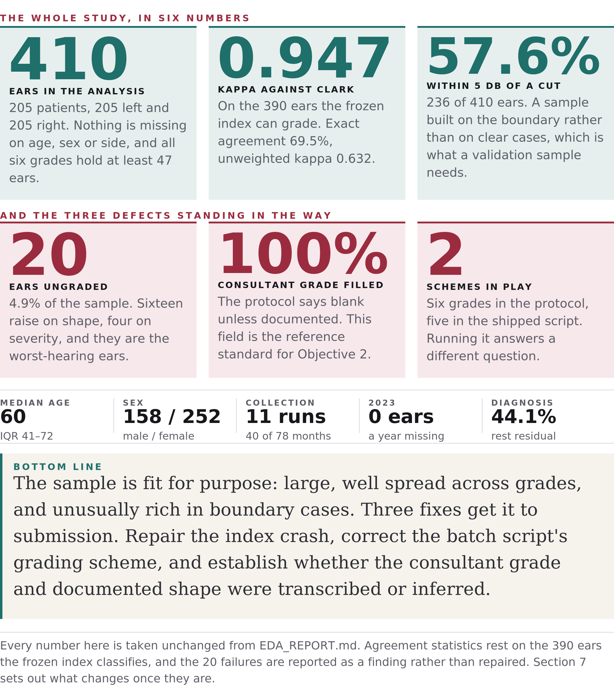

<table border="0" cellpadding="0" cellspacing="0" width="100%"><tr><td bgcolor="#F5F3EC">
<b>STATUS.</b> This re-presents <i>EDA_REPORT.md</i> without changing a number. The index crash is fixed in FAI 0.3.1 and agreement re-run on 410 ears (<i>AGREEMENT_RERUN.md</i>); everything below still reports the 390-ear run.
</td></tr></table>

## 1 · Sample and collection

205 patients, both ears each, drawn across six and a half years. The sample is large and unusually well spread. How it was drawn is the first thing to doubt.

### Eleven runs, not one consecutive series

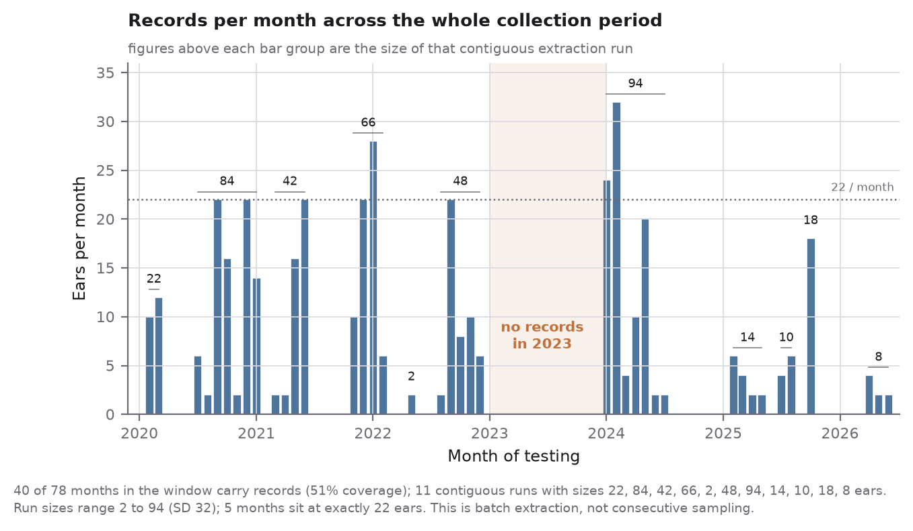

<table border="0" cellpadding="0" cellspacing="0" width="100%"><tr><td bgcolor="#E6EFED">
<b>11</b>

<b>CONTIGUOUS EXTRACTION RUNS, RATHER THAN ONE SERIES</b>

Run sizes 2 to 94 ears · SD 32 · five months at exactly 22 · no month above 32
</td></tr></table>

The 410 records fall into eleven contiguous runs of months, and the sizes vary from 2 to 94 ears. Five months sit at exactly 22 ears and the monthly maximum is 32, which is what a series of separate extraction passes to a target looks like. Protocol §10 states the records were drawn consecutively, and this pattern does not support that. It is a query, and a limitation to declare either way, because it bears directly on whether the sample represents the clinic.

### The calendar, cell by cell

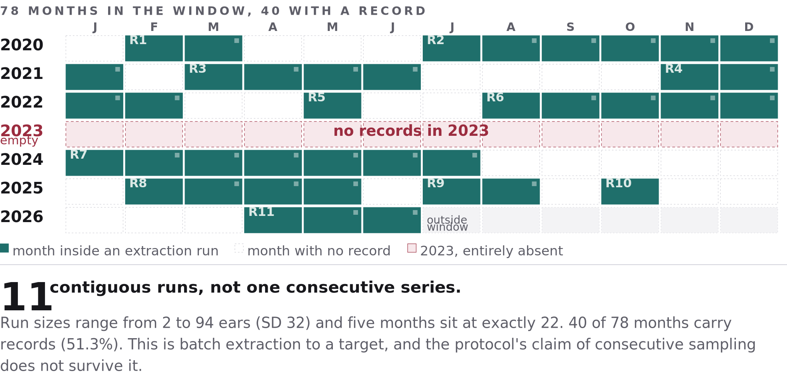

<table border="0" cellpadding="0" cellspacing="0" width="100%"><tr><td bgcolor="#E6EFED">
<b>40 of 78</b>

<b>MONTHS IN THE WINDOW CARRY A RECORD (51.3%)</b>

2023 is entirely absent · 11 contiguous runs · 8 ears in 2026, on the final permitted month
</td></tr></table>

Read as a calendar, the gap is one whole year: 2023 carries nothing, though it sits inside a window running from January 2020 to June 2026. A complete calendar-year hole in a six-and-a-half-year window is not a sampling fluctuation. The 2026 records are inside the window and need confirming as real testing dates rather than excluding, but they sit at the extreme edge of it.

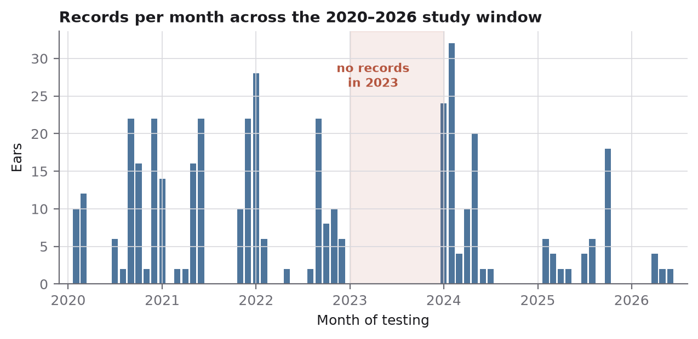

By year the counts are 92, 88, 84, 0, 94, 42 and 8 ears from 2020 to 2026. The archive is therefore not thinned at its edges; it is missing from its middle.

### Who was tested

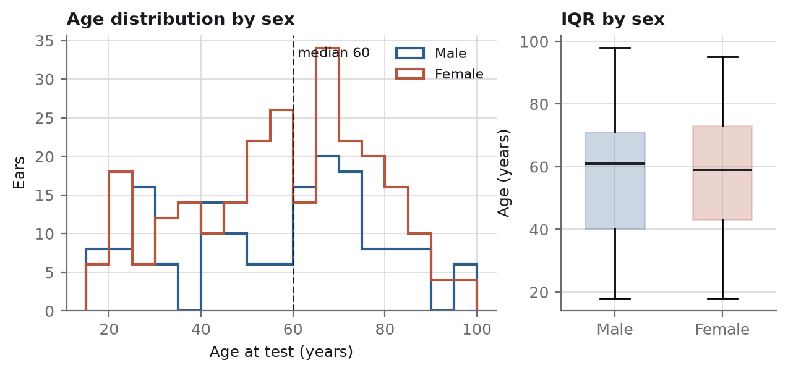

<table border="0" cellpadding="0" cellspacing="0" width="100%"><tr><td bgcolor="#E6EFED">
<b>60</b>

<b>MEDIAN AGE, IQR 41 TO 72</b>

Range 18 to 98 · mean 56.6 (SD 20.6) · 30.2% of ages end in 0 or 5
</td></tr></table>

Age runs from 18 to 98, nothing sits outside the protocol's 18 to 110, and the spread is wide enough to carry subgroup work. One mild artefact: 30.2% of ages end in 0 or 5 against an expected 20% under no heaping (124 of 410, exact binomial p < 0.001), which suggests ages recorded from memory or from the chart rather than calculated from date of birth. Low impact, since age is a subgroup variable only.

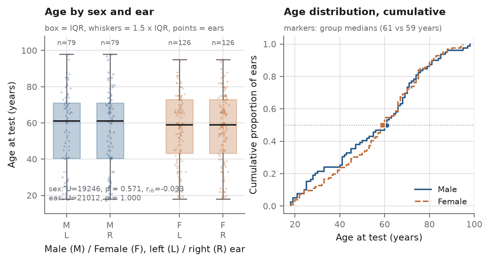

Male median is 61 and female 59, a difference not distinguishable from zero (Mann-Whitney U = 19,246, p = 0.571, rank-biserial −0.03, median difference +2.0 years, 95% CI −7.5 to 6.5). Left against right gives U = 21,012.5 and p = 1.000, which is a formality confirming the file is internally consistent.

### Age is not monotone in severity

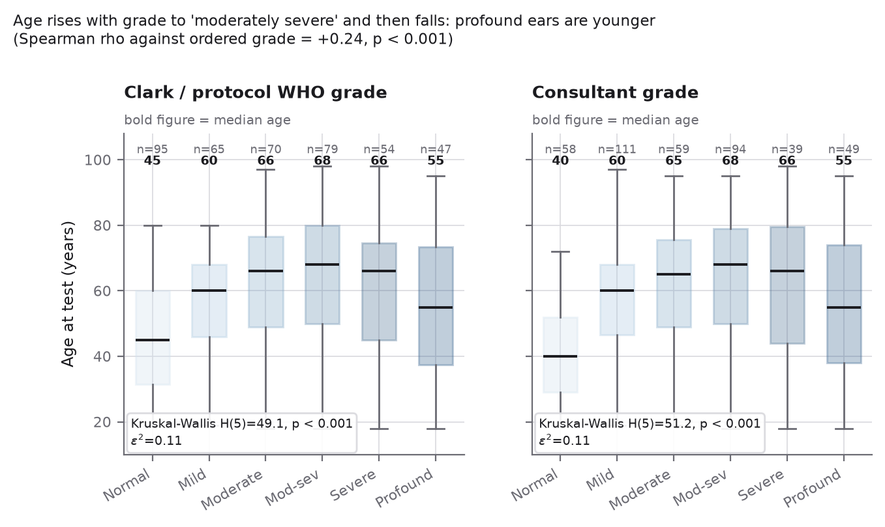

<table border="0" cellpadding="0" cellspacing="0" width="100%"><tr><td bgcolor="#E6EFED">
<b>68 then 55</b>

<b>MEDIAN AGE AT MODERATELY SEVERE, THEN AT PROFOUND</b>

Kruskal-Wallis H(5) = 49.1 · p &lt; 0.001 · epsilon-squared 0.11
</td></tr></table>

The median age rises from 45 in the normal band to 68 in the moderately severe band and then falls to 55 in the profound band. The same shape appears under the consultant grade (40, 60, 65, 68, 66, 55), so it belongs to the sample rather than to one scheme. It is not noise either: epsilon-squared is 0.11 in both panels, and the monotone trend across ordered grades is rho +0.235.

### Aetiology explains a third of the age variance

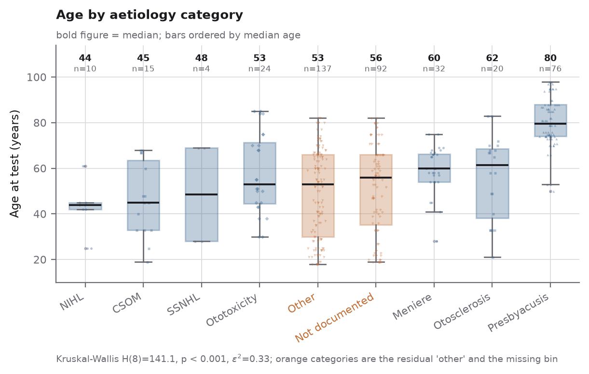

<table border="0" cellpadding="0" cellspacing="0" width="100%"><tr><td bgcolor="#E6EFED">
<b>0.33</b>

<b>EPSILON-SQUARED, AETIOLOGY AGAINST AGE</b>

H(8) = 141.1 · p &lt; 0.001 · presbyacusis 79.5 years against NIHL 44.0
</td></tr></table>

This is the largest effect size anywhere in the report: aetiology carries a third of the rank variance in age. Presbyacusis sits at a median of 79.5 years and NIHL at 44.0, a 35-year gap that matches what the labels mean. It also explains the fall in the profound band, since the young severe ears are the acquired ones and not the age-related ones.

### Two ears, one person

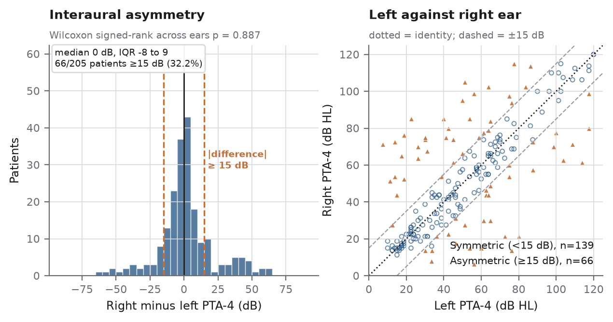

<table border="0" cellpadding="0" cellspacing="0" width="100%"><tr><td bgcolor="#E6EFED">
<b>32.2%</b>

<b>OF PATIENTS ARE ASYMMETRIC BY 15 DB OR MORE</b>

66 of 205 (95% CI 26.2 to 38.9) · 35 at 30 dB or more · ICC 0.733
</td></tr></table>

There is no systematic side preference (Wilcoxon W = 9,154.5, p = 0.887), but the asymmetry is symmetric noise with a heavy tail. Median right minus left is 0.0 dB (IQR −7.5 to 8.8) and the median absolute difference is 7.5 dB, yet 66 patients differ by 15 dB or more and 35 by 30 dB or more. Asymmetry is not associated with aetiology (chi-square(8) = 9.0, p = 0.344, V = 0.21), and the intraclass correlation of 0.733 between paired ears sets the design effect for an ear-level proportion at 1.73, so 410 ears carry roughly what 237 independent observations would. The design effect for the kappa is a different and much smaller number, 1.12 to 1.16, because a patient's two ears usually receive the same grade.

### Age barely predicts hearing

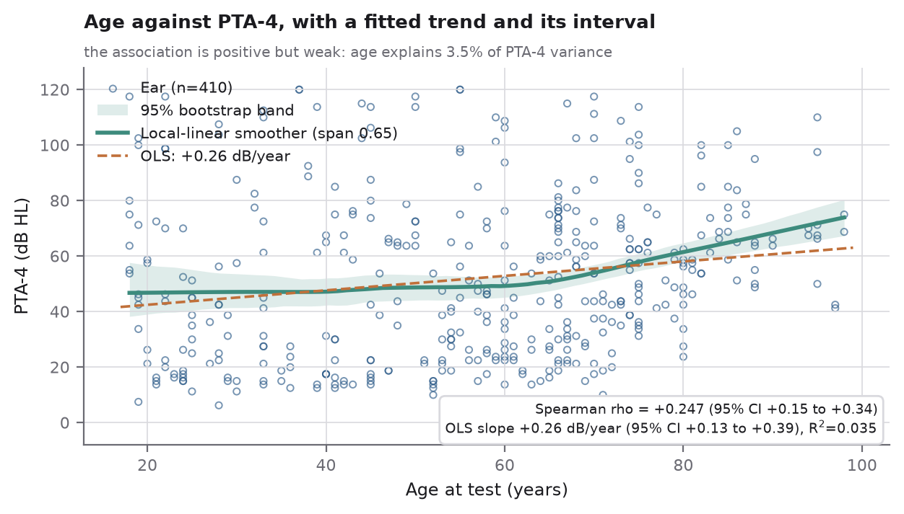

<table border="0" cellpadding="0" cellspacing="0" width="100%"><tr><td bgcolor="#E6EFED">
<b>3.5%</b>

<b>OF THE VARIANCE IN PTA-4 IS EXPLAINED BY AGE</b>

rho +0.247 (95% CI +0.152 to +0.341) · OLS slope +0.260 dB per year · R-squared 0.035
</td></tr></table>

A local-linear smoother with span 0.65 tracks the same shallow gradient. The association is positive, statistically unambiguous and small. Applied across the 80-year age range the slope is worth about 21 dB, which is how a large sample makes a small gradient significant. For the validation that is good news: PTA-4 is not a proxy for age, and this is not a narrow presbyacusis cohort. Counting patients once rather than ears moves the correlation from +0.247 to +0.272 and nothing else.

### Sex is uneven where it matters

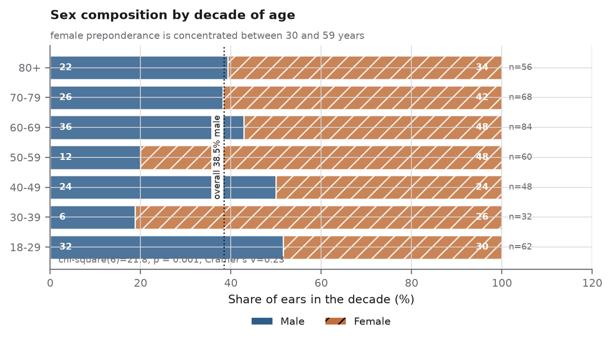

<table border="0" cellpadding="0" cellspacing="0" width="100%"><tr><td bgcolor="#E6EFED">
<b>252</b>

<b>FEMALE EARS AGAINST 158 MALE</b>

chi-square(6) = 21.8 · p = 0.0013 · Cramer's V = 0.23
</td></tr></table>

At 38.5% male the sample is unbalanced but not pathologically so for an ENT referral population. The imbalance is not spread evenly: it concentrates between 30 and 59 years, with 6 male against 26 female at 30 to 39 and 12 against 48 at 50 to 59, and it disappears below 30 and above 60. This is a composition fact about the clinic rather than a data defect, but it means sex and age are not independent in any subgroup analysis.
## 2 · Thresholds

Eight frequencies, quantised to 5 dB, bounded at 120. The vector behaves the way an audiogram should, and the place where it stops behaving is the ceiling.

### The shape of a presbyacusis-heavy clinic sample

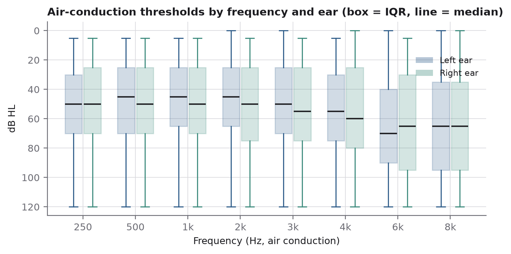

<table border="0" cellpadding="0" cellspacing="0" width="100%"><tr><td bgcolor="#E6EFED">
<b>65 dB HL</b>

<b>MEDIAN AT 6 AND 8 KHZ, AGAINST 50 AT 250 HZ</b>

3 kHz holds 210 ears · every value a multiple of 5 · smallest left-against-right p = 0.062
</td></tr></table>

Medians climb with frequency and the interquartile range widens at the top, partly because the 120 ceiling compresses the upper tail. The two ears are indistinguishable at every frequency: the smallest of eight paired Wilcoxon tests is p = 0.062 at 6 kHz, which survives no correction at all. Laterality is therefore not a source of confounding and an ear-level analysis needs no adjustment for side.

### Where the ceiling begins to accumulate

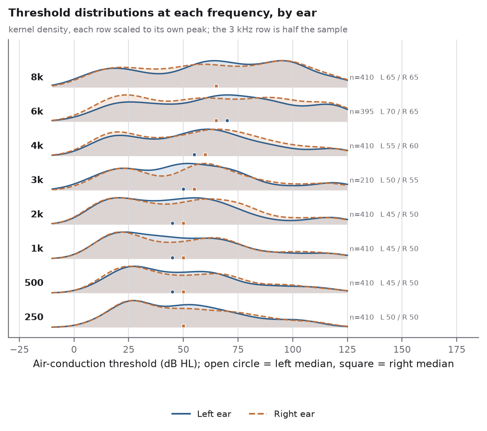

<table border="0" cellpadding="0" cellspacing="0" width="100%"><tr><td bgcolor="#E6EFED">
<b>4 kHz</b>

<b>AND ABOVE, THE DISTRIBUTION BECOMES BIMODAL</b>

Rows scaled to their own peak · medians marked · 3 kHz covers half the sample
</td></tr></table>

At 250 and 500 Hz the densities are single-peaked. From 4 kHz up a second mode appears at the top of the scale, and it is not a clinical population: it is the 120 dB ceiling piling mass. The ridgeline is the clearest argument for treating 120 as censored rather than measured, because the artefact is visible without any statistic.

### Ninety decibels separates normal from profound

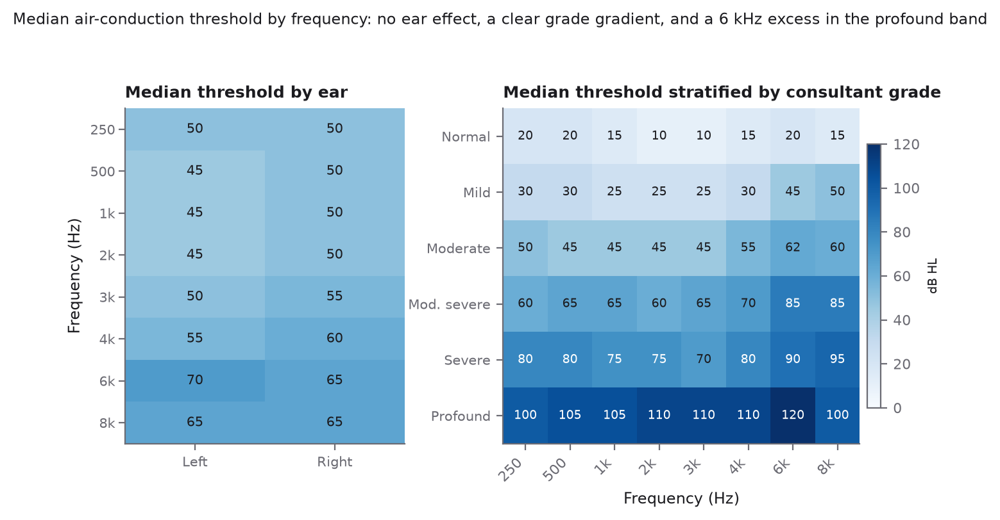

<table border="0" cellpadding="0" cellspacing="0" width="100%"><tr><td bgcolor="#E6EFED">
<b>90 dB</b>

<b>OF GRADIENT FROM NORMAL TO PROFOUND AT 250 HZ</b>

Both ears identical cell by cell · profound 6 kHz 120 above its 8 kHz neighbour 100
</td></tr></table>

The ear panel is flat: not one cell differs between left and right. The grade panel is the opposite, rising monotonically at every frequency, and the only break in the order is the profound band at 6 and 8 kHz, where 6 kHz reads 120 and 8 kHz reads 100. A patient cannot fail to respond at 120 dB at one frequency and respond at 100 dB at the next.

### One severity factor, one slope

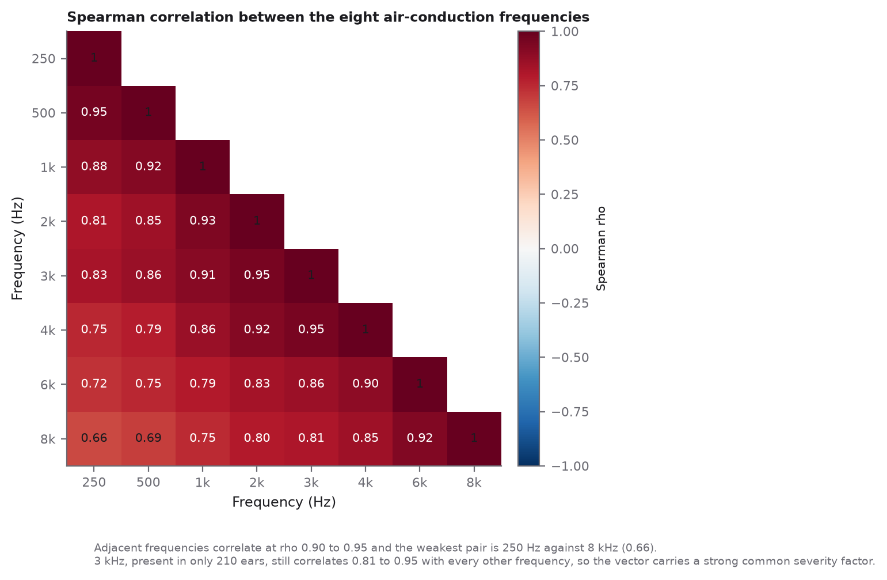

<table border="0" cellpadding="0" cellspacing="0" width="100%"><tr><td bgcolor="#E6EFED">
<b>0.90</b>

<b>IS THE FLOOR FOR EVERY ADJACENT PAIR OF FREQUENCIES</b>

Weakest pair 0.66 at 250 Hz against 8 kHz · 3 kHz still 0.81 to 0.95
</td></tr></table>

Every adjacent pair correlates at 0.90 or above, so the threshold vector carries a strong common severity factor. That is exactly why the index can work from eight numbers, and why a single pure-tone average is a defensible summary of the whole audiogram. The weakest pair is the two ends of the scale, 250 Hz against 8 kHz at 0.66, which is the classic slope signature.

### Configuration does not survive clustering

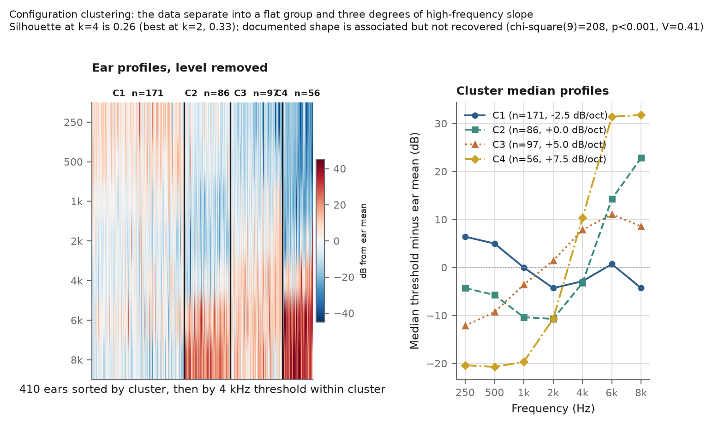

<table border="0" cellpadding="0" cellspacing="0" width="100%"><tr><td bgcolor="#E6EFED">
<b>53.8%</b>

<b>CLUSTER PURITY AGAINST THE DOCUMENTED SHAPE</b>

V = 0.41 · chi-square(9) = 207.7 · p &lt; 0.001 · silhouette 0.263 at k = 4
</td></tr></table>

With the level removed, four clusters separate into one flat group and three degrees of high-frequency slope. Silhouette is maximised at k = 2 (0.332), which splits only better from worse hearing and says nothing about configuration, so k = 4 is a weak solution and is reported as one. Documented shape is associated with the clusters but not recovered by them: 64 of the 116 notched ears land in the flat cluster and only 3 in the steepest.

### The choice of average is not innocuous

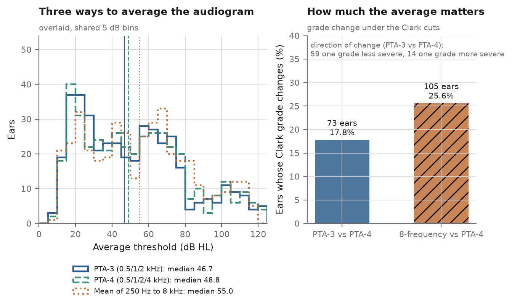

<table border="0" cellpadding="0" cellspacing="0" width="100%"><tr><td bgcolor="#E6EFED">
<b>17.8%</b>

<b>OF EARS CHANGE CLARK GRADE BETWEEN PTA-3 AND PTA-4</b>

73 ears · 25.6% for the eight-frequency mean (105 ears) · the three averages correlate at 0.98 to 0.99
</td></tr></table>

The three averages rank ears almost identically and still disagree about the grade of a sixth to a quarter of them. Switching from PTA-3 to PTA-4 moves 73 ears, 59 one grade less severe and 14 one more; the eight-frequency mean moves 105, of which 92 go one grade more severe. Where 42% of ears sit within ±5 dB of a boundary, a 1.25 dB shift is enough. The protocol fixes PTA-4, so this is not a decision the study makes, but it is one the field makes every time it compares studies.

## 3 · Air–bone conduction

Bone conduction is recorded at four frequencies and sits where it should, except in a tail that the protocol expects and a small group it does not.

### A reversed gap is not an error until it is 10 dB

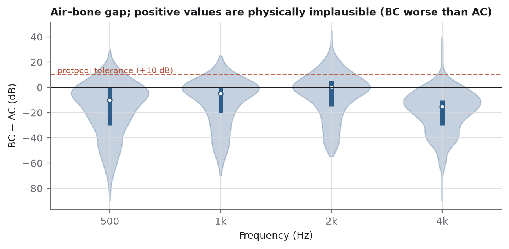

<table border="0" cellpadding="0" cellspacing="0" width="100%"><tr><td bgcolor="#E6EFED">
<b>+10 dB</b>

<b>IS THE PROTOCOL'S TOLERANCE FOR A REVERSED GAP</b>

59 ears exceed it (14.4%) · 43 of those at 2 kHz · maximum +45 dB
</td></tr></table>

Dictionary rule 10 is explicit: bone conduction may exceed air by 5 to 10 dB from test-retest variability, bone-vibrator output limits, unmasked bone reflecting the other ear, and vibrotactile responses at high levels. The automated check for a negative gap was removed for that reason, and the audit threshold is therefore >10 dB. Medians are −10, −5, 0 and −15 dB at 500 Hz, 1 kHz, 2 kHz and 4 kHz, and the reversals concentrate at 2 kHz.

### Bone tracks air, fifteen decibels better

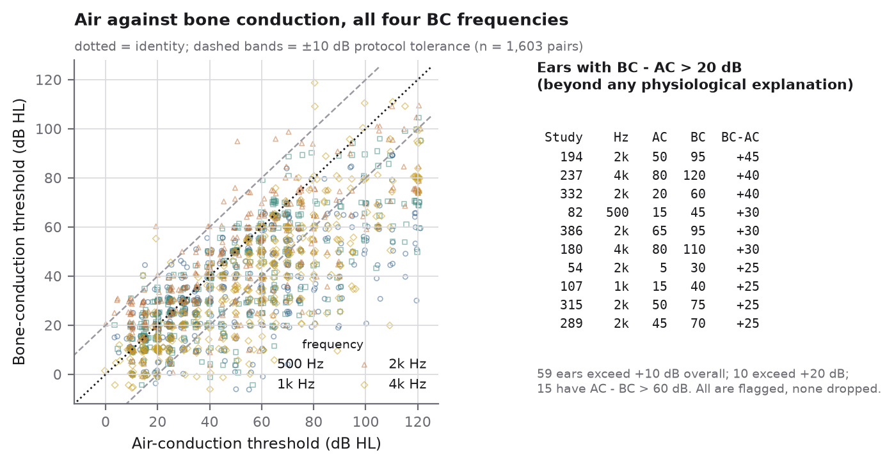

<table border="0" cellpadding="0" cellspacing="0" width="100%"><tr><td bgcolor="#E6EFED">
<b>1,603</b>

<b>AIR–BONE PAIRS, OF WHICH 17.8% ARE POSITIVE</b>

4.6% exceed +10 dB · rho 0.776 at 1 kHz · ten ears above +20 dB listed by study
</td></tr></table>

At 1 kHz, where the comparison is cleanest, median air is 45 dB and median bone 30 dB (Wilcoxon p < 0.001): the same ear's bone conduction, tracking it at 0.776 and sitting 15 dB better, which is the conductive component of this clinic population. Per ear the mean gap is −8.75 dB (IQR −23.75 to −1.25, n = 401). The positive tail is the part the audit adjudicates.

### The grade gradient is real and confounded

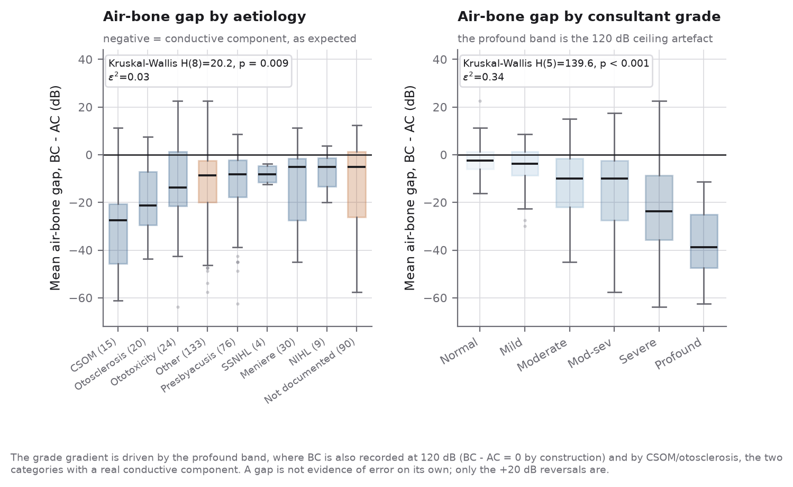

<table border="0" cellpadding="0" cellspacing="0" width="100%"><tr><td bgcolor="#E6EFED">
<b>0.40</b>

<b>EPSILON-SQUARED, MEAN GAP AGAINST CLARK GRADE</b>

H(5) = 161.7 · aetiology H(8) = 20.2, p = 0.009, epsilon-squared 0.03
</td></tr></table>

By aetiology the ordering is clinically sensible at the top, with CSOM at −27.5 dB and otosclerosis at −21.3, but eight of the nine categories sit within 9 dB of each other and the effect is small. By grade the gradient is large and must not be read as worsening conduction: in the severe and profound bands the air thresholds are pinned at or near 120 while bone is recorded lower, so much of the gap is where the scale stops. The honest statement is that mean gap and severity are strongly associated in this file, and that the association is confounded by the ceiling.

## 4 · Categorical variables

Three fields carry most of the clinical meaning, and each of them has a provenance problem.

### Most ears have no usable diagnosis

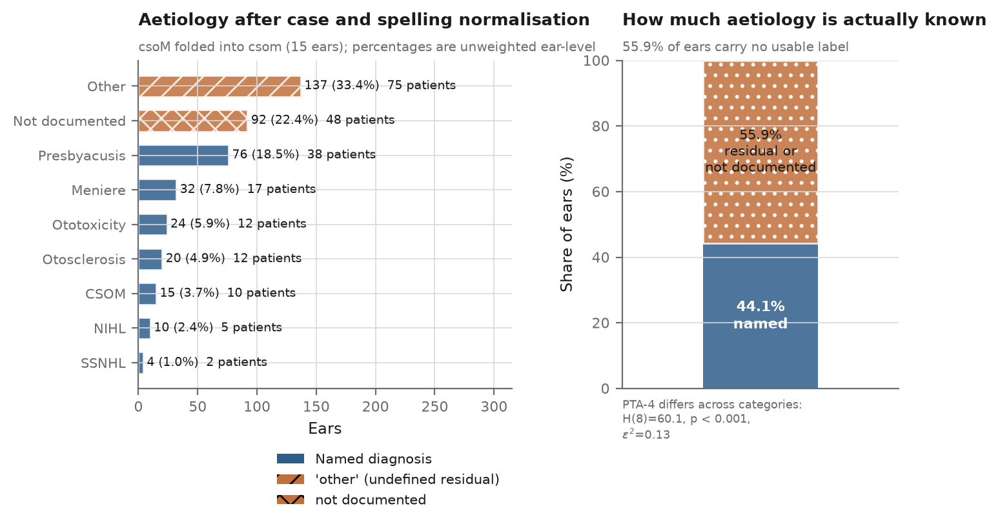

<table border="0" cellpadding="0" cellspacing="0" width="100%"><tr><td bgcolor="#E6EFED">
<b>44.1%</b>

<b>OF EARS CARRY A NAMED DIAGNOSIS</b>

137 other · 92 not documented · H(8) = 60.1 · epsilon-squared 0.13
</td></tr></table>

Two-thirds of the sample sits in `other` or `not_documented`, and `other` is the largest single category while being defined nowhere in the protocol. It is a residual bin, so a subgroup analysis on it means very little. PTA-4 does differ across categories (H(8) = 60.1, p < 0.001, epsilon-squared 0.13), but five of the nine categories hold fewer than 25 ears, so the interesting comparison cannot be powered. That 44.1% is the number to quote when the protocol promises aetiology-stratified performance.

### Two independent schemes agree at 42 per cent

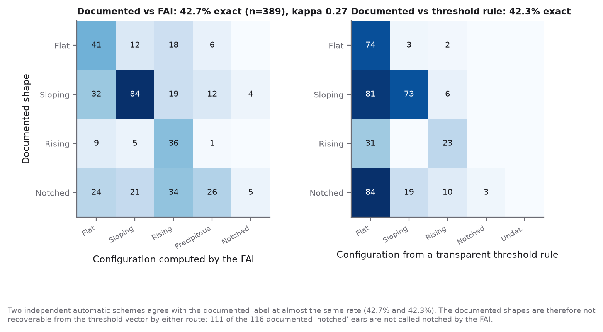

<table border="0" cellpadding="0" cellspacing="0" width="100%"><tr><td bgcolor="#E6EFED">
<b>42.7 and 42.3</b>

<b>EXACT AGREEMENT, INDEX AND THRESHOLD RULE</b>

n = 389 and 409 · kappa 0.267 · 111 of 116 notched ears not recovered · 271 of 409 called flat by rule
</td></tr></table>

Against the index, exact agreement is 42.7% (166 of 389, 95% CI 37.9 to 47.6) with unweighted kappa 0.267. A second check removes the index from the question: a transparent rule applied to the numbers alone (notch if 3 kHz exceeds 4 kHz by 15 dB, sloping if 4 kHz exceeds 500 Hz by 20 dB, rising if the reverse) gives 42.3% (173 of 409). Two unrelated automatic schemes agreeing with the documented label at within a percentage point of each other is the strongest single piece of evidence that the documented shapes are not a function of the threshold vector. It does not prove the field is wrong, but it does mean Objective 4 cannot be settled by counting agreement.

### The consultant grade is the reference, and is unverified

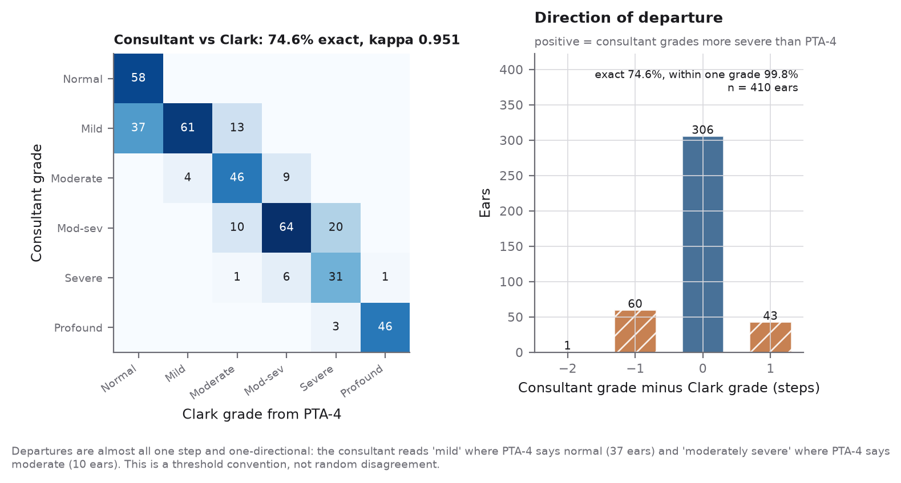

<table border="0" cellpadding="0" cellspacing="0" width="100%"><tr><td bgcolor="#E6EFED">
<b>99.8%</b>

<b>OF EARS AGREE WITHIN ONE GRADE</b>

74.6% exact · quadratic kappa 0.951 · 37 ears mild by the consultant, normal by PTA-4
</td></tr></table>

The disagreement is almost entirely one step: 306 exact, 60 one grade lower, 43 one higher and 1 two lower. That is why quadratic kappa reads 0.951 while exact agreement is 74.6%, and why the paper should report both. Each grade's PTA-4 range overlaps its neighbours by 7.5 to 20 dB, so no single average reproduces the field: the best of three, PTA-3, matches 78.0% exactly, against 74.6% for PTA-4 and 65.1% for the eight-frequency mean. That is consistent with genuine clinician judgement and equally consistent with a semi-derived field, and the difference matters, because Objective 2 rests on this variable being an independent human read.

## 5 · The three grade schemes

The same thresholds, read three ways. One of the three is not the scheme the protocol describes.

### One definitional choice moves 94 ears

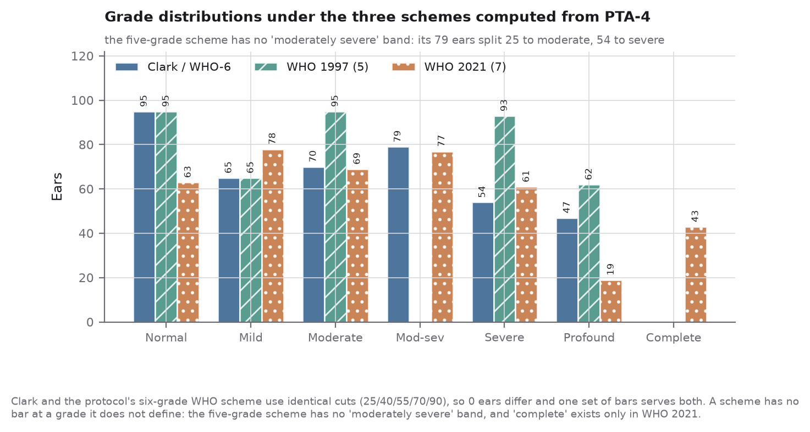

<table border="0" cellpadding="0" cellspacing="0" width="100%"><tr><td bgcolor="#E6EFED">
<b>94 ears</b>

<b>CHANGE GRADE ON THE FIVE-GRADE SCHEME ALONE</b>

22.9% of the sample · 79 moderately severe absorbed · 15 severe move to profound
</td></tr></table>

The five-grade scheme has no moderately severe band, so the 79 ears Clark places there are absorbed into moderate (25) and severe (54), and 15 ears Clark calls severe move up to profound. One definitional choice moves 94 of 410 ears. The shipped script hard-codes `WHO_BOUNDS = [25, 40, 60, 80]` against the protocol's 25/40/55/70/90, so running it would silently answer a different question from the one the protocol poses.

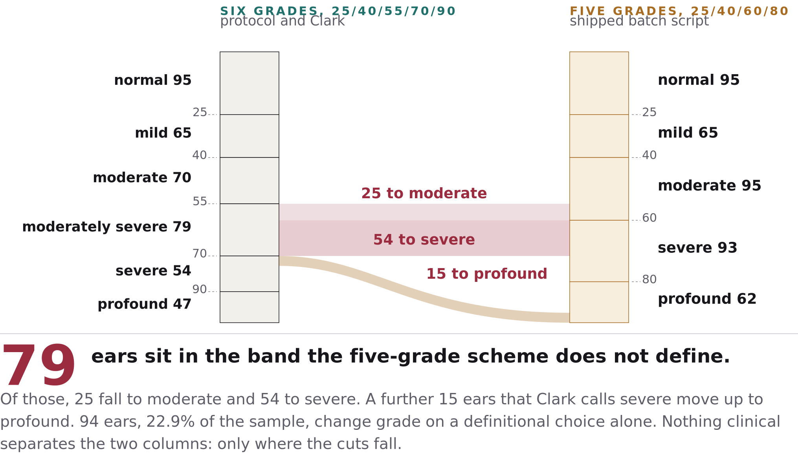

Follow one band across: the moderately severe column has nowhere to go on the right. Twenty-five ears fall to moderate, fifty-four to severe, and the severe band on the right is further thinned by fifteen ears that move up to profound. Nothing clinical separates the two columns. Only where the cuts fall.

### No grade holds more than a quarter of the sample

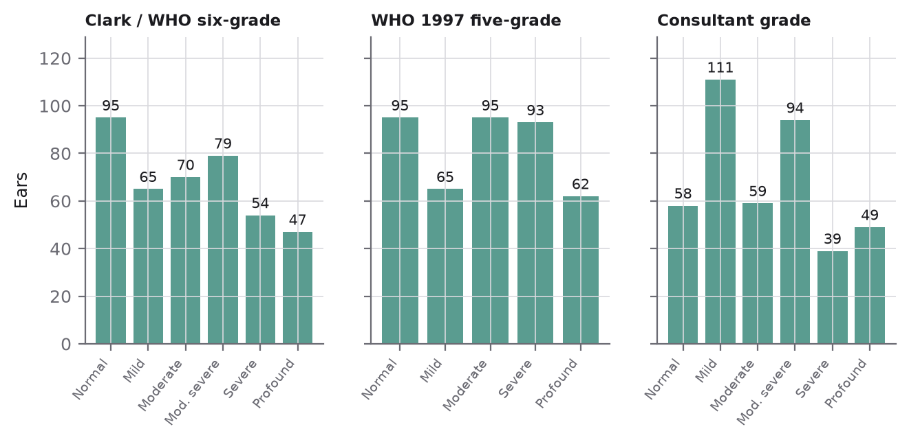

<table border="0" cellpadding="0" cellspacing="0" width="100%"><tr><td bgcolor="#E6EFED">
<b>23.2%</b>

<b>IS THE LARGEST BAND UNDER ANY SCHEME</b>

Consultant mild 27.1% · the development cohort was 88 to 89% normal · 32/27/35/41/38/32 by patient
</td></tr></table>

No grade holds most of the ears under any scheme, which is the single most important property of this sample. The NHANES development cohort was 88 to 89% normal; here the largest band is 23.2%. Counting each patient once by their worse ear gives 32, 27, 35, 41, 38 and 32 across the six bands, close enough to the ear-level shares that no conclusion turns on the unit of analysis.

| Grade | Clark and protocol (6) | WHO 1997 (5, shipped script) | Consultant |
|---|---|---|---|
| normal | 95 (23.2%) | 95 (23.2%) | 58 (14.1%) |
| mild | 65 (15.9%) | 65 (15.9%) | 111 (27.1%) |
| moderate | 70 (17.1%) | **95 (23.2%)** | 59 (14.4%) |
| moderately severe | 79 (19.3%) | not defined | 94 (22.9%) |
| severe | 54 (13.2%) | **93 (22.7%)** | 39 (9.5%) |
| profound | 47 (11.5%) | 62 (15.1%) | 49 (12.0%) |
## 6 · The validation against each scheme

What the index does on 390 ears, read against three references. The kappa is high, the exact agreement is not, and the disagreement has a shape.

### The sample is built on the boundary

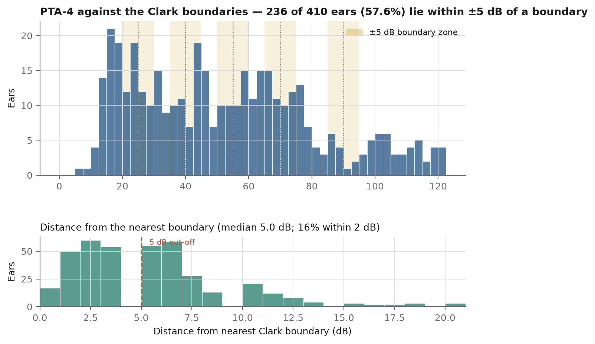

<table border="0" cellpadding="0" cellspacing="0" width="100%"><tr><td bgcolor="#E6EFED">
<b>57.6%</b>

<b>OF EARS SIT WITHIN 5 DB OF A CLARK BOUNDARY</b>

236 of 410 (95% CI 52.7 to 62.3) · 67 within 2 dB (16.3%) · 357 within 10 dB (87.1%)
</td></tr></table>

This is three times the 18.7% seen in the NHANES work, and the reason is case mix rather than a defect. The ±5 dB windows around five boundaries cover 50 dB of the PTA-4 axis; in NHANES 88% of ears were normal and clustered below 20 dB HL, outside every window. Here PTA-4 has an interquartile range of 26.6 to 70.0 dB, spread across all five bands, so most ears are by construction near a boundary. Per boundary the counts within ±5 dB are 62 at 25 dB, 54 at 40, 49 at 55, 56 at 70 and 15 at 90, the density falling at the top because the ceiling pulls ears well above 90.

### Every scheme has more borderline ears than the last

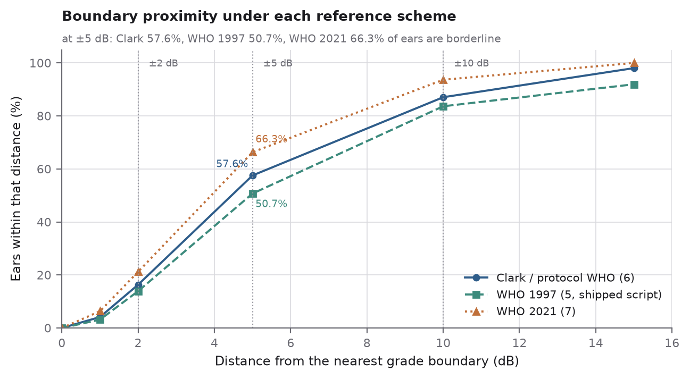

<table border="0" cellpadding="0" cellspacing="0" width="100%"><tr><td bgcolor="#E6EFED">
<b>66.3%</b>

<b>WITHIN 5 DB UNDER WHO 2021, AGAINST 57.6% UNDER CLARK</b>

50.7% under WHO 1997 · 21.2% within 2 dB under WHO 2021 · Clark and protocol are the same cuts
</td></tr></table>

Clark and the protocol's six-grade scheme use identical cuts at 25, 40, 55, 70 and 90, so they produce identical numbers on every ear and there is no separate six-grade WHO column to report. Moving to seven WHO 2021 bands raises the borderline share to 66.3% because there are more cuts to be near. This strengthens the paper's central claim rather than threatening it: 226 of the 390 classifiable ears (57.9%) are borderline and 164 (42.1%) are clear, so the sample is not dominated by the easy cases.

### Weighted kappa is high; exact agreement is not

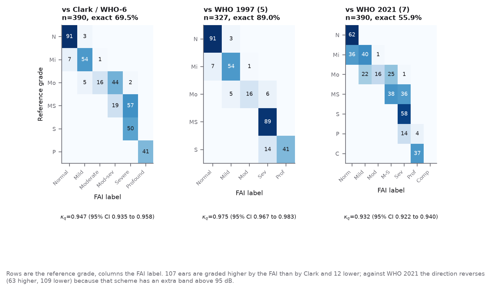

<table border="0" cellpadding="0" cellspacing="0" width="100%"><tr><td bgcolor="#E6EFED">
<b>0.947</b>

<b>QUADRATIC-WEIGHTED KAPPA, INDEX AGAINST CLARK</b>

95% CI 0.935 to 0.958 · exact agreement 69.5% · unweighted 0.632 · 107 ears graded higher, 12 lower
</td></tr></table>

Quadratic weighting charges a one-step disagreement a twenty-fifth of a full penalty, so 0.947 coexists with 30.5% disagreement. Read the two together. On the same data linear-weighted kappa is 0.844 and unweighted is 0.632, and the paper should report the weighted figure as pre-specified while stating the unweighted one, or a reviewer will compute it.

| Metric | Index against Clark (6) | WHO 1997 (5) | WHO 2021 (7) |
|---|---|---|---|
| n | 390 | 327 | 390 |
| Quadratic-weighted kappa | **0.947** (0.935 to 0.958) | 0.975 (0.967 to 0.983) | 0.932 (0.922 to 0.940) |
| Exact agreement | **69.5%** | 89.0% | 55.9% |
| Ears graded higher / lower | 107 / 12 | 10 / 26 | 63 / 109 |
| Design effect on the kappa SE | 1.16 | 1.04 | 1.13 |

The WHO 1997 column covers only 327 ears, because 63 ears carry a label the five-grade scheme does not define and cannot be scored against it. That is one reason the five-grade comparison flatters the index: the ears it excludes are precisely the ones the index handles badly.

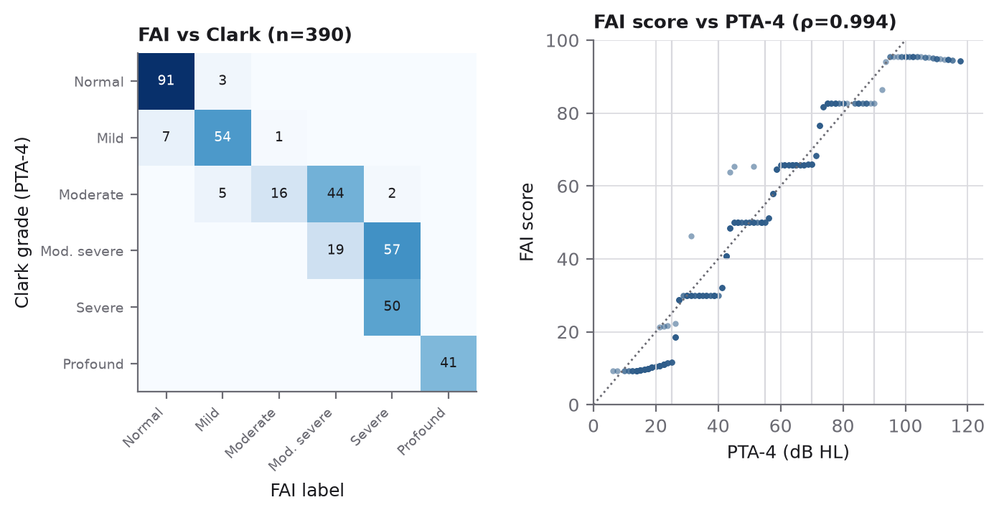

Plotted against PTA-4 the score tracks the identity line closely through the middle of the range and then flattens above about 90 dB, where the centroid can no longer follow. That flat top is the first visual sign of the calibration problem the next two figures quantify.

### Two thirds of the error sits in two bands

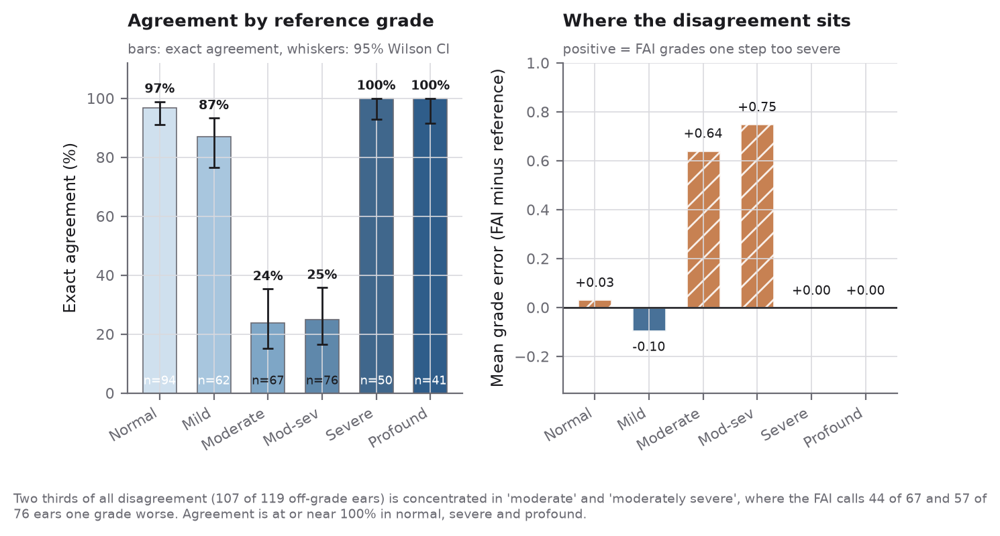

<table border="0" cellpadding="0" cellspacing="0" width="100%"><tr><td bgcolor="#E6EFED">
<b>23.9%</b>

<b>EXACT AGREEMENT IN THE MODERATE BAND</b>

25.0% in moderately severe · 100% in severe and profound · 107 of 119 off-grade ears in those two bands
</td></tr></table>

Agreement is at or near 100% at both ends of the scale and collapses in the middle, where the index calls 44 of 67 moderate ears and 57 of 76 moderately severe ears one grade worse. That is a calibration offset rather than noise, and it is the most actionable finding in this section: recalibrating the score-to-label thresholds, not the rule base, would likely recover most of the 30.5% disagreement. At the boundary the index degrades from 77.4% exact (164 clear ears, kappa 0.973, MAE 0.23) to 63.7% (226 borderline ears, kappa 0.909, MAE 0.37), and stays within one grade for about 99% of borderline ears. The manuscript should say it degrades gracefully, not that it excels at boundaries.

### The offset is minus three decibels, and it is not constant

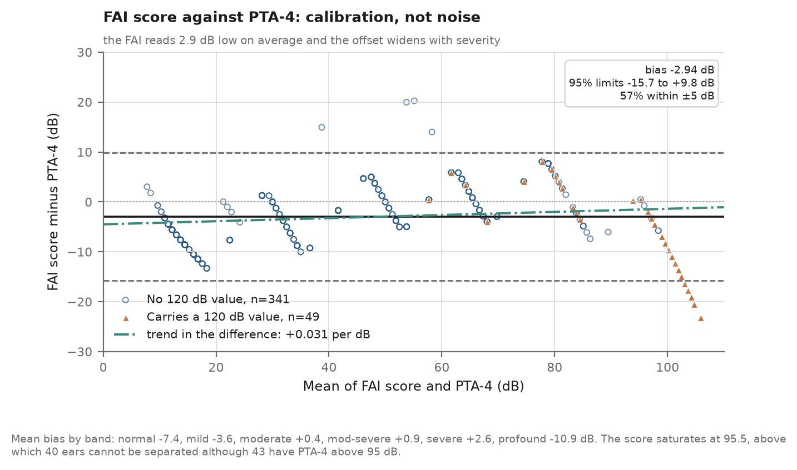

<table border="0" cellpadding="0" cellspacing="0" width="100%"><tr><td bgcolor="#E6EFED">
<b>−2.94 dB</b>

<b>MEAN BIAS, WITH LIMITS OF AGREEMENT −15.7 TO +9.8 dB</b>

SD 6.52 · 57.0% within ±5 dB · trend +0.031 dB per dB · saturates at 95.51
</td></tr></table>

The difference runs from about −7.4 dB in the normal band, through +0.4 in moderate, to about +3 dB in severe, and then falls sharply to −10.9 in profound where the score saturates at 95.51. So the index is too lenient in the middle of the range and too generous at the top of it, which is the same offset the directional grade disagreement implies, expressed in dB. Excluding the 54 ears that carry a 120 dB ceiling narrows the limits to −13.3 to +8.9 dB (n = 341) and the bias to −2.21, so about a fifth of the total disagreement comes from the ceiling rather than from the index.

### Four hundred and ten ears will pin a kappa to about five points

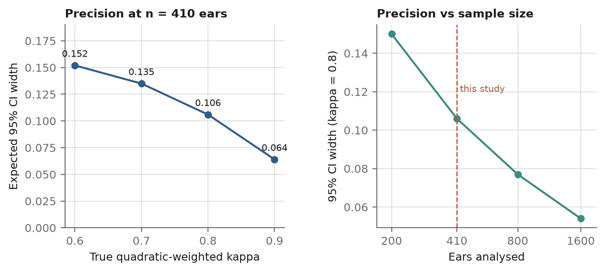

<table border="0" cellpadding="0" cellspacing="0" width="100%"><tr><td bgcolor="#E6EFED">
<b>±0.053</b>

<b>HALF-WIDTH AT KAPPA 0.80, n = 410</b>

Interval width 0.106 · bootstrap SE 0.029 · design effect 1.12 (1.16 on a re-run)
</td></tr></table>

The protocol assumed a standard error of about 0.03 at roughly 400 ears, and at kappa 0.8 that is almost exactly right, so the assumption is sound. Precision improves as the square root of n: doubling to 800 ears buys about 0.03 and tripling to 1,200 buys 0.045, so the marginal return is steep at 150 ears and shallow past 600. Because 205 patients contribute two ears each, the patient-level interval at kappa 0.8 is roughly ±0.06 rather than ±0.05, and the paper should simply state that the interval accounts for pairing.

## 7 · Data quality

Eighteen findings, three of which block a submission. The panel below is the whole audit in one view, grouped by what has to happen next rather than by how large the problem is.

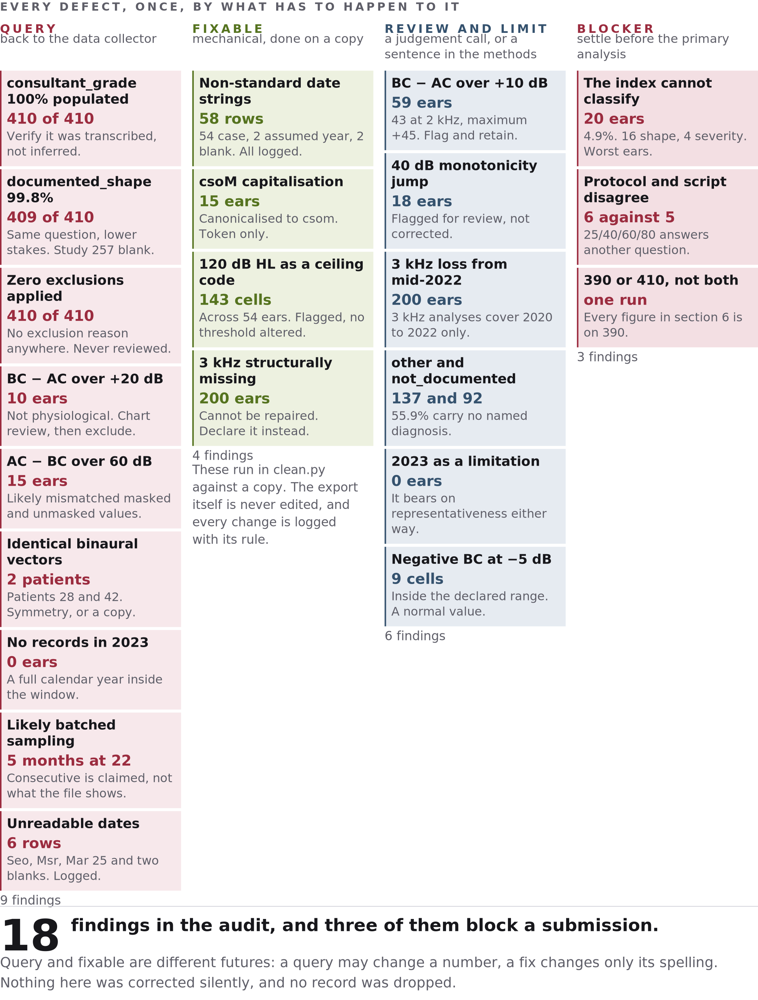

Fixable means mechanical and done on a copy; query means it must go back to the data collector, because the answer may change a number; review and limitation are judgement calls and declarations. Nothing is dropped and no threshold is altered.

### Ten per cent of the sample never reaches the index

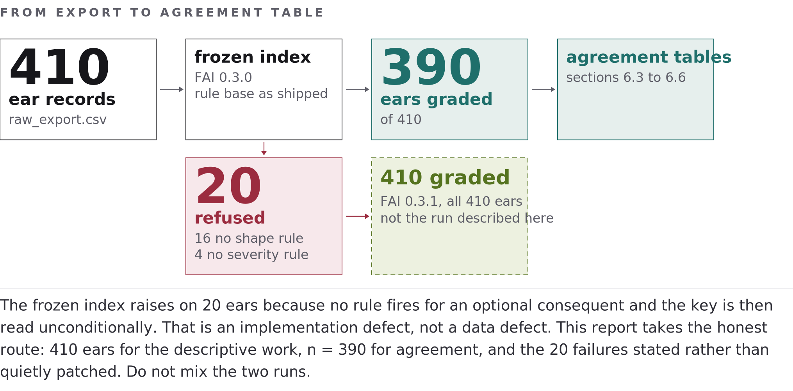

<table border="0" cellpadding="0" cellspacing="0" width="100%"><tr><td bgcolor="#F7E8EB">
<b>20 ears</b>

<b>RAISE AN EXCEPTION: 16 HAVE NO SHAPE RULE, 4 NO SEVERITY RULE</b>

4.9% of 410 · median PTA-4 67.5 dB against 48.1 for the ears that classify · 5 carry a 120 dB value
</td></tr></table>

For those input combinations no rule in the consequent fires, so scikit-fuzzy never populates that key in the simulation output and `core.py` reads it unconditionally at lines 378 and 379. Study 13 returns a valid severity score and still dies on shape: a missing optional output is being treated as a total failure. It reproduces on the pinned stack (NumPy 2.4.6, SciPy 1.18.0, scikit-fuzzy 0.5.0) and reproduced a third time from a fresh clone with an empty cache, giving the same 20 study IDs and zero score or label differences against the cached run.

The important part is not the crash but who it removes. The failures are skewed severe, with a median PTA-4 of 67.5 dB against 48.1 dB for the ears that classify, and five of them carry a 120 dB ceiling. The index is losing precisely the worst-hearing ears, which biases any agreement statistic upward. Only study 305 appears in both this set and the monotonicity set.

**Disposition: fixable in code, and must not be fixed silently.** Either patch the classifier to return the severity score with no shape when the shape consequent is empty and re-freeze with a documented version bump, or report n = 390 and declare the 20 ears including their severity distribution. The first is better science. This report takes the second, because the fix is not in the commit it is built on.

### Everything the audit found, at one scale

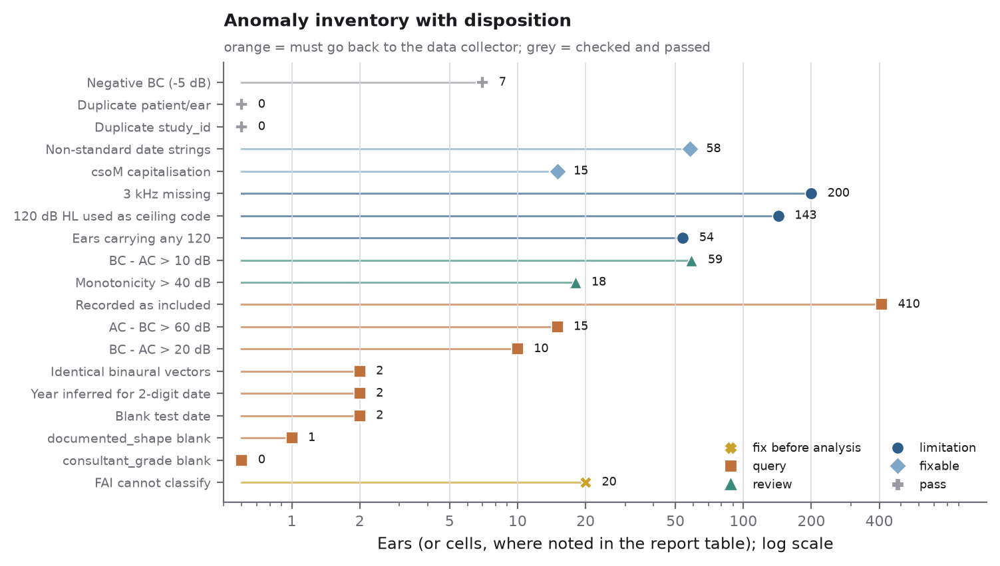

The inventory is drawn on a log scale so a two-ear problem remains visible beside a 410-ear one. The largest single item is `th_3k`, missing for 200 ears; the smallest genuine defects are two duplicated binaural vectors and two year-inferred dates. Full counts and study IDs are in appendix A.

### One hundred and twenty is a ceiling, not a threshold

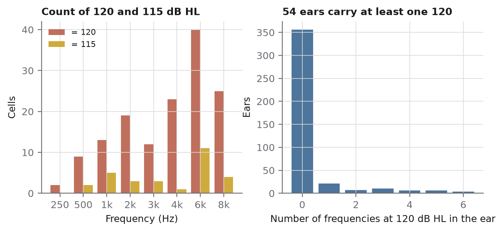

<table border="0" cellpadding="0" cellspacing="0" width="100%"><tr><td bgcolor="#E6EFED">
<b>143 cells</b>

<b>EXACTLY 120.0, ACROSS 54 EARS (13.2%)</b>

4.7% of 3,065 threshold cells · 40 at 6 kHz, 25 at 8 kHz · 21 ears carry both 120 and 115
</td></tr></table>

Three pieces of evidence say these are saturation values. A clinical audiometer typically cannot deliver 120 dB HL at 8 kHz, where output ceilings are usually 90 to 110, yet 120 appears there 25 times. Twenty-seven ears carry 120 at 6 kHz and a lower value at 8 kHz, and 16 of those also carry 120 at 4 kHz, which a monotone threshold cannot produce. And the scale runs past 115, so 120 is the recorded endpoint of the instrument with nothing above it.

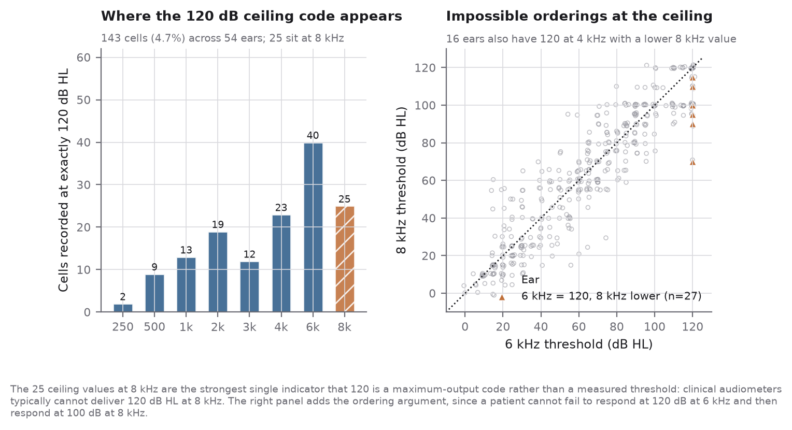

Because 120 is the top of the permitted range, treating it as a number rather than a censored value changes no WHO grade: recomputing PTA-4 with 120 replaced by 121 changes 0 grades and moves PTA-4 by at most 1.0 dB. Two things are not safe. Twenty-eight ears carry at least one 120 among the four PTA-4 frequencies and 4 ears (studies 55, 56, 83 and 84) are 120 at all four. And the index uses all eight thresholds, so 120 at 6 and 8 kHz feeds the slope and notch features; five of the 54 ears carrying a 120 are among the 20 the index cannot classify at all.

**Disposition:** declare 120 as a censored ceiling in the methods, add the `threshold_120` flag (done in `clean.py`), and do not re-code it to 130 or drop those ears without a protocol amendment.

### Three kilohertz disappears halfway through

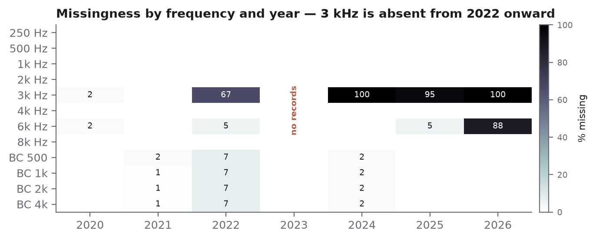

<table border="0" cellpadding="0" cellspacing="0" width="100%"><tr><td bgcolor="#E6EFED">
<b>48.8%</b>

<b>OF EARS HAVE NO 3 KHZ THRESHOLD</b>

200 ears · 56 of 84 in 2022, 94 of 94 in 2024, 40 of 42 in 2025, 8 of 8 in 2026
</td></tr></table>

This is not random missingness but a change in recording practice: 2% missing in 2020, none in 2021, 67% in 2022, and total from 2024. It splits evenly by ear (100 left, 100 right, chi-square p = 1.000) so it is a chart or format change rather than an ear-specific problem. The other fields are near-complete: 6 kHz is missing for 15 ears (3.7%, nine of them the 2025 and 2026 batch) and the four bone frequencies for 9 or 10 ears each, about 2.4%. No ear is incomplete on the PTA-4 frequencies.

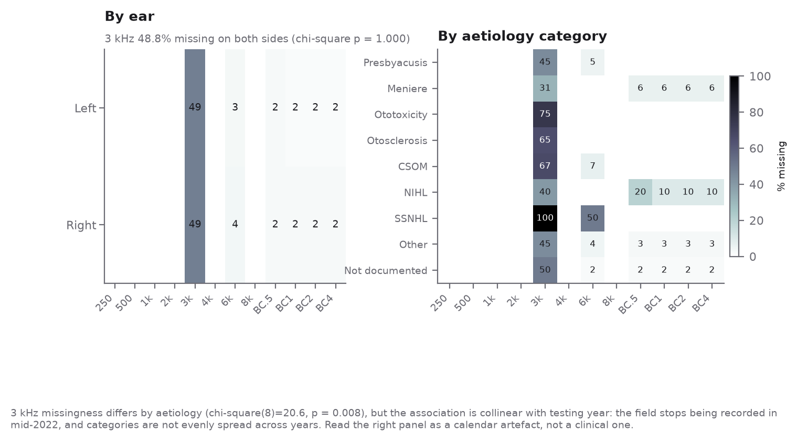

The aetiology panel is a warning rather than a finding: 3 kHz missingness varies from 31% in Meniere to 100% in SSNHL, an association (chi-square(8) = 20.6, p = 0.008, V = 0.22) that is collinear with testing year and must not be read as clinical. Per dictionary rule 8, blanks at 3 and 6 kHz are expected and are not completeness defects, but the step change means any analysis using 3 kHz is effectively restricted to the 2020 to 2022 third of the sample.

### The reference standard may not be a reference

`consultant_grade` is populated for all 410 ears with no blanks, against a dictionary that says the field records a grade only where explicitly documented and blank otherwise. The distribution is 58, 111, 59, 94, 39 and 49, suspiciously even for a chart review, and each grade's PTA-4 range overlaps its neighbours by 7.5 to 20 dB. A 100% fill rate from retrospective chart review is not credible on its face. This is the reference standard for Objective 2, so the question is not academic: was it transcribed from a written consultant opinion, or inferred by the extractor from the audiogram? If the latter, Objective 2 has no independent human reference and cannot be reported as agreement with a clinician.

`documented_shape` raises the same question at lower stakes: 409 of 410 populated (study 257 left is blank), against a protocol that says the field is documented only where explicitly stated. There is no `normal` option in the field, so it cannot be missing by design for normal ears.

### The protocol and the script disagree

The protocol specifies six grades at 25, 40, 55, 70 and 90 dB. `scripts/validate_oatuhc.py` hard-codes `WHO_BOUNDS = [25, 40, 60, 80]` and a five-grade `who_grade()`. Running the shipped batch script would silently answer a different question from the one the protocol poses, moving 94 ears. This EDA uses the protocol definition throughout. The script should be corrected before it is used, or every agreement figure it produces will be against the wrong reference.

### Smaller findings, none of them silent

Fifty-eight date rows (14.1%) are not in the `Mon YYYY` form the dictionary specifies, across 50 distinct raw strings for 39 months of data. Fifty-four are case or abbreviation and are mapped mechanically; `Seo 2020`, `Msr 2020`, `Mar 25` and two blanks are inferences, logged under `DATE_ASSUMED_YEAR` or `DATE_MISSING` so they remain visible and reversible, and they should be confirmed against the charts. Fifteen rows use `csoM` for `csom` and are canonicalised without changing a value. All 410 ears are flagged `ear_included = 1` with no exclusion reason anywhere, which is mechanically defensible but means the protocol's exclusion for unresolvable transcription errors was never applied: 10 ears have physiologically impossible bone reversals and 15 have conductive gaps of 70 dB or more. Eighteen ears exceed the 40 dB monotonicity rule and are flagged for review rather than corrected. Nine cells carry a bone conduction of −5 dB, which is inside the declared −10 to 120 range and is a normal audiometric value, not an error. Two patients (28 and 42, studies 55/56 and 83/84) have identical air-conduction vectors in both ears and are all-120 or near-120 ears the index cannot classify; either they are genuinely symmetric profound losses or one record was copied, and only the source charts can settle it.

## 8 · What the sample can carry

| Analysis | Units available | Verdict |
|---|---|---|
| Primary kappa, index against PTA-4 | 410 ears, 205 patients | **Supported.** ±0.05 at kappa 0.8 |
| Borderline against clear | 226 / 164 ears | **Supported.** Both arms large |
| Grade-level agreement | 47 to 95 per grade | **Supported** |
| Continuous agreement, Bland-Altman | 390 ears | **Supported** |
| Configuration agreement | 389 ears | Supported statistically; validity depends on the shape query |
| Sex, age band | 158 / 252 ears; 94 / 108 / 208 | **Marginal.** ±0.06 to ±0.11 at kappa 0.8 |
| Presbyacusis | 76 ears | **Weak.** ±0.12 |
| Meniere, ototoxicity, otosclerosis | 32 / 24 / 20 ears | **Not supported.** ±0.19 to ±0.24 |
| CSOM, NIHL | 15 / 10 ears | **Not supported.** ±0.28 to ±0.34 |
| SSNHL | 4 ears | **Not possible** |

For the primary analysis 205 patients is comfortably enough: the protocol's own minimum of 250 ears is exceeded by 64%, the grade distribution is close to the best case for an ordinal kappa, and the borderline stratum is larger than the paper needs. The limiting factor is not the patient count, it is the 20 ears the index cannot grade.

For the protocol as written, two of its six objectives are not deliverable. Objective 5 needs aetiology subgroups, and five of nine categories hold fewer than 25 ears while the two largest are the residual bin and the missing bin: the data support presbyacusis only, and marginally. Objective 4 needs the shape provenance resolved first, because at 42.7% the comparison is either a negative result or a circular one and the protocol does not say which it expects. To make aetiology real the sample would need roughly 100 ears per category, realistically 600 to 900, or deliberate over-sampling of CSOM, NIHL and otosclerosis. The extraction yields 410 ears from 40 of 78 months, about 10 ears per covered month; completing every month would give roughly 800, and closing that gap is a better route than extending the window, which would not recover 2023 either.

## 9 · Reconciliation with the previous version

Nothing in the previous report has been reversed, and where a number moved the reason is given rather than edited in silently.

**One substantive conflict.** The previous version said the air–bone distribution is "centred slightly below zero (median −5 to 0 dB)". That holds at 1 and 2 kHz but not at 500 Hz (−10) or 4 kHz (−15), and the pooled cell median is −10. The qualitative finding is unchanged, but the quoted range is too narrow and the author should either quote per-frequency medians, as section 3 does, or widen the range.

| Quantity | Previous text | This version | Reason |
|---|---|---|---|
| WHO 1997 within one grade | 99.4% | 100% | recomputed on the same 327 ears; the previous figure is not reproducible from `stage2.json` |
| WHO 1997 mean absolute grade error | 0.13 | 0.11 | same recomputation |
| WHO 2021 mean absolute grade error | 0.47 | 0.44 | same recomputation |
| Kappa design effect | 1.12 | 1.12 (1.16 on re-run) | Monte Carlo, 1,500 replicates; both inside the noise |
| Kappa CI width at 0.8, n = 410 | 0.106 | 0.106 (0.105 on an independent run) | same estimator, different seed |
| AC threshold range | −5 to 120 | 0 to 120 air; −5 is bone only | the −5 values are `bc_*`, not `th_*` |
| 120 and 115 co-occurrence | 21 ears | 21 ears (29 cells at 115, 143 at 120) | unchanged; clarified as ears |
| Age by ear and laterality | not reported | 0 dB difference, p = 1.000 | new |

Everything the new figures support rather than contradict stands: the 42.7% configuration agreement, now with an independent 42.3%; the 57.6% boundary proportion; the 107 against 12 directional disagreement; the −2.94 dB bias; and the 20 unclassifiable ears. Six results have no previous counterpart and are the author's to place: age is non-monotone across grade, aetiology explains 33% of the rank variance in age, 32.2% of patients are asymmetric by 15 dB or more, PTA-3 against PTA-4 moves 17.8% of grades, the profiles cluster by slope rather than by documented shape, and 44.1% of ears carry a named diagnosis.

## 10 · Reproducibility

The analysis behind every figure was built on commit `f9893a9`. `raw_export.csv` is the source and is never modified or committed. `clean.py` writes `derived/analysis_clean.csv` and a log of all 73 changes with study, field, old value, new value, rule and action; no threshold is altered and no record is dropped. `stage1_audit.py`, `stage2_fai.py`, `stage3_checks.py` and `stage4_descriptive.py` produce the statistics behind every figure, `statlib.py` holds the interval, effect-size and clustering helpers, and `figures.py` and `figures_extended.py` hold the figures themselves at 200 dpi. `derived/`, the `stage*.json` files and the logs are git-ignored because they contain patient-level rows.

Two independent runs of `stage2_fai.py`, one cached and one fully uncached, produce identical scores and labels on all 410 ears. The environment is the pinned stack (NumPy 2.4.6, SciPy 1.18.0, scikit-fuzzy 0.5.0). One trap is worth recording: `stage2_fai.py` memoises the build and deep-copies the system per ear, because reusing one simulation across ears leaks `sim.output` and silently returns a previous ear's score when a compute produces no output, which produced a plausible-looking 9.66 and "normal" for studies 83 and 84 before it was caught.

The five panels in this document are drawn by `make_visuals.py` from the numbers above and carry no computation of their own; `build_visual_pdf.py` renders the print PDF with every figure embedded as a data URI.
## Appendix A · Full tables

Every table the body compresses, at its original width. Nothing here is new; it is the same analysis, kept so that no finding depends on a summary.

### A1 Structural checks

| Check | Result | Disposition |
|---|---|---|
| Rows | 410 | pass |
| Patients | 205, all contributing exactly 2 ears | pass |
| Left / right | 205 / 205 | pass |
| Duplicate `study_id` | 0 | pass |
| Duplicate (`patient_id`, `ear`) | 0 | pass |
| Patients with two different ages | 0 | pass |
| `ear_included` = 1 | 410 (100%) | see A2 |
| `exclusion_reason` populated | 0 | see A2 |
| Identical AC vector in both ears | 2 patients (28, 42; studies 55/56, 83/84) | query |

`study_id` runs 1 to 410 with no gaps and in test order, so row order is extraction order and the collection pattern can be read directly from it.

### A2 Inclusion and the analysis set

All 410 ears are flagged `ear_included = 1` and no `exclusion_reason` is populated anywhere. No automatic protocol exclusion fires: every ear has all four PTA-4 frequencies, no threshold lies outside −10 to 120, and there are no duplicates. But protocol §9.3 also excludes records with obvious transcription errors that cannot be resolved from the chart, and this file contains 10 physiologically impossible bone reversals and 15 extreme conductive gaps. A 100% inclusion rate means that judgement was never applied. The analysis set is 410 ears, with 20 unclassifiable by the index, leaving 390 for the primary agreement analysis.

### A3 Non-standard date strings

50 distinct raw strings for 39 months; 58 rows (14.1%) are not in the `Mon YYYY` form.

| Raw form | Rows | Studies | Rule |
|---|---|---|---|
| `Sept 2022` | 20 | 319–336, 339–340 | fixable (abbreviation) |
| `dec 2020` | 10 | | fixable (case) |
| `oct 2020` | 6 | | fixable (case) |
| `sep 2020` | 4 | | fixable (case) |
| `feb 2020` | 4 | | fixable (case) |
| `sept 2020` | 2 | | fixable (abbreviation) |
| `SEP 2020` | 2 | | fixable (case) |
| `Seo 2020` | 2 | 9, 10 | query (misspelling of Sep) |
| `Msr 2020` | 2 | 83, 84 | query (misspelling of Mar) |
| `Mar 25` | 2 | 361, 362 | query (two-digit year) |
| `June 2026` | 2 | | fixable (long month name) |
| blank | 2 | 285, 286 | query |

`Seo` and `Msr` are almost certainly `Sep` and `Mar`, and `Mar 25` almost certainly `Mar 2025`, but these are inferences and not facts. `clean.py` maps them and logs each with rule `DATE_ASSUMED_YEAR` or `DATE_MISSING`.

### A4 The 2026 records and the study window

The protocol window is 1 January 2020 to 30 June 2026 (§9.1).

| Studies | Month | Verdict |
|---|---|---|
| 395–398 | Apr 2026 | inside window |
| 399–400 | May 2026 | inside window |
| 409–410 | Jun 2026 | inside window, on the final permitted month |

No 2026 date is a protocol violation. They should be confirmed as real testing dates but do not require exclusion.

| Year | 2020 | 2021 | 2022 | 2023 | 2024 | 2025 | 2026 |
|---|---|---|---|---|---|---|---|
| Ears | 92 | 88 | 84 | **0** | 94 | 42 | 8 |

Only 40 of the 78 months in the window are represented (51.3%), and several months contain exactly 22 ears (2020-09, 2020-12, 2021-06, 2021-12, 2022-09), with others at 24, 28 and 32.

### A5 Categorical counts

| Category | Ears | Ear % | Patients | Patient % |
|---|---|---|---|---|
| other | 137 | 33.4 | 75 | 36.6 |
| not_documented | 92 | 22.4 | 48 | 23.4 |
| presbyacusis | 76 | 18.5 | 38 | 18.5 |
| meniere | 32 | 7.8 | 17 | 8.3 |
| ototoxicity | 24 | 5.9 | 12 | 5.9 |
| otosclerosis | 20 | 4.9 | 12 | 5.9 |
| csom | 15 | 3.7 | 10 | 4.9 |
| nihl | 10 | 2.4 | 5 | 2.4 |
| ssnhl | 4 | 1.0 | 2 | 1.0 |

Ear percentages sum to 100; patient percentages count each patient once and therefore do not. `consultant_grade` is 410 of 410 populated (58 / 111 / 59 / 94 / 39 / 49). `documented_shape` is 409 of 410 (sloping 160, notched 116, flat 79, rising 54; missing study 257 left). `sex` is 158 male and 252 female with no missing values.

### A6 The 120 dB ceiling by frequency

| Frequency | 250 | 500 | 1k | 2k | 3k | 4k | 6k | 8k |
|---|---|---|---|---|---|---|---|---|
| Cells at 120 | 2 | 9 | 13 | 19 | 12 | 23 | 40 | 25 |
| Cells at 115 | 0 | 2 | 5 | 3 | 3 | 1 | 11 | 4 |

143 of 3,065 cells (4.7%) are exactly 120.0, across 54 ears (13.2%). Twenty-seven ears carry 120 at 6 kHz and a lower value at 8 kHz (studies 1, 2, 55, 56, 64, 67, 83, 84, 93, 94, 121, 129, 131, 132, 138, 176, 207, 220, 240, 257, 287, 292, 298, 305, 306, 357, 364); 16 of those also carry 120 at 4 kHz (studies 1, 2, 55, 56, 67, 83, 84, 93, 94, 131, 132, 176, 207, 240, 305, 357). Twenty-one ears carry both a 120 and a 115, of the 27 that carry a 115 anywhere. Twenty-eight ears carry at least one 120 among the four PTA-4 frequencies; 4 ears (55, 56, 83, 84) are 120 at all four.

### A7 Bone conduction: the checks and their verdicts

| Check | Ears | Studies |
|---|---|---|
| BC − AC > 0 at any frequency | 285 cells | |
| **BC − AC > 10 dB** (beyond protocol tolerance) | **59 (14.4%)** | 21, 43, 44, 54, 57, 78, 82, 96, 107, 108, 110, 119, 137, 141, 142, 146, 147, 153, 154, 155, 160, 180, 184, 194, 214, 216, 221, 222, 226, 232, 237, 239, 246, 248, 254, 256, 265, 267, 270, 272, 289, 290, 295, 296, 309, 311, 315, 316, 323, 324, 332, 343, 344, 353, 354, 370, 379, 386, 393 |
| **BC − AC > 20 dB** (implausible) | **10** | 54, 82, 107, 180, 194, 237, 289, 315, 332, 386 |
| **AC − BC > 60 dB** | **15** | 3, 4, 48, 51, 52, 64, 73, 219, 220, 230, 236, 250, 259, 363, 364 |

Two corrections to the framing in the project brief. Study 237 (AC 70 at 1 kHz, BC 90) is real and is in the >20 dB group: a 20 dB reverse gap at speech frequency is not physiological. Studies 81 and 82 are not one finding: study 81 has BC 40 against AC 30 at 500 Hz, a +10 dB gap exactly at tolerance and not an error, and the "25" in the brief is AC at 250 Hz, so the comparison crossed frequencies. Study 82 does have BC 45 against AC 15 at 500 Hz (+30 dB) and is genuinely implausible. Nine cells at −5.0 dB (studies 29, 30, 38, 81, 82, 243, 351) are inside the declared −10 to 120 range and are normal values, not errors.

### A8 Missingness

| Field | Missing | % | Pattern |
|---|---|---|---|
| th_250, th_500, th_1k, th_2k, th_4k, th_8k | 0 | 0% | complete |
| **th_3k** | **200** | **48.8%** | structural |
| th_6k | 15 | 3.7% | 2026 batch plus 2 pairs |
| bc_500 / 1k / 2k / 4k | 10 / 9 / 9 / 9 | ~2.4% | scattered |
| PTA-4 frequencies | 0 ears incomplete | 0% | all 410 computable |

| Year | 2020 | 2021 | 2022 | 2024 | 2025 | 2026 |
|---|---|---|---|---|---|---|
| Ears | 92 | 88 | 84 | 94 | 42 | 8 |
| 3 kHz missing | 2 (2%) | 0 (0%) | 56 (67%) | **94 (100%)** | 40 (95%) | 8 (100%) |

3 kHz missingness is 100 left and 100 right (chi-square p = 1.000). By aetiology it runs from 31% (Meniere) to 100% (SSNHL), chi-square(8) = 20.6, p = 0.008, V = 0.22, collinear with year. The index's service layer interpolates missing frequencies in log-frequency space, so a blank 3 kHz is silently reconstructed from 2 and 4 kHz; that is defensible but should be stated in the methods.

### A9 Age

| Group | n | Median | IQR | Range | Mean (SD) |
|---|---|---|---|---|---|
| All ears | 410 | 60.0 | 41.0 to 72.0 | 18 to 98 | 56.6 (20.6) |
| Male | 158 | 61.0 | 40.3 to 71.0 | 18 to 98 | |
| Female | 252 | 59.0 | 43.0 to 73.0 | 18 to 95 | |
| Left ear | 205 | 60.0 | 41.0 to 72.0 | 18 to 98 | |
| Right ear | 205 | 60.0 | 41.0 to 72.0 | 18 to 98 | |
| Patients | 205 | 60.0 | 41.0 to 72.0 | 18 to 98 | |

| Comparison | n | Test | Statistic | p | Effect size | Difference (95% CI) |
|---|---|---|---|---|---|---|
| Male vs female | 158 vs 252 | Mann-Whitney U | 19,246 | 0.571 | rank-biserial −0.03 | +2.0 years (−7.5 to 6.5) |
| Left vs right ear | 205 pairs | Mann-Whitney U | 21,012.5 | 1.000 | rank-biserial 0.00 | 0.0 years (−6.0 to 6.0) |

| Clark grade | n | Median | IQR | Range |
|---|---|---|---|---|
| normal | 95 | 45.0 | 31.5 to 60.0 | 18 to 80 |
| mild | 65 | 60.0 | 46.0 to 68.0 | 18 to 94 |
| moderate | 70 | 66.0 | 49.0 to 76.5 | 21 to 92 |
| moderately severe | 79 | 68.0 | 50.0 to 80.0 | 18 to 95 |
| severe | 54 | 66.0 | 45.0 to 74.5 | 18 to 98 |
| profound | 47 | 55.0 | 37.5 to 73.5 | 18 to 91 |

| Comparison | Test | Statistic | p | Effect size |
|---|---|---|---|---|
| Age across the six Clark grades | Kruskal-Wallis | H(5) = 49.1 | < 0.001 | epsilon-squared 0.11 |
| Monotone trend across ordered grades | Spearman rho | +0.235 | < 0.001 | |
| Age across the six consultant grades | Kruskal-Wallis | H(5) = 51.2 | < 0.001 | epsilon-squared 0.11 |

| Aetiology | n | Median | IQR |
|---|---|---|---|
| presbyacusis | 76 | 79.5 | 74.0 to 88.0 |
| otosclerosis | 20 | 61.5 | 38.3 to 68.5 |
| meniere | 32 | 60.0 | 54.0 to 66.3 |
| not documented | 92 | 56.0 | 35.3 to 66.0 |
| ototoxicity | 24 | 53.0 | 44.5 to 71.3 |
| other | 137 | 53.0 | 30.0 to 66.0 |
| ssnhl | 4 | 48.5 | 28.0 to 69.0 |
| csom | 15 | 45.0 | 33.0 to 63.5 |
| nihl | 10 | 44.0 | 42.0 to 45.0 |

Kruskal-Wallis H(8) = 141.1, p < 0.001, epsilon-squared 0.33.

### A10 Sex by decade, and the extraction runs

| Decade | Male | Female | Total |
|---|---|---|---|
| 18–29 | 32 | 30 | 62 |
| 30–39 | 6 | 26 | 32 |
| 40–49 | 24 | 24 | 48 |
| 50–59 | 12 | 48 | 60 |
| 60–69 | 36 | 48 | 84 |
| 70–79 | 26 | 42 | 68 |
| 80+ | 22 | 34 | 56 |

Pearson chi-square(6) = 21.8, p = 0.0013, Cramer's V = 0.23.

| Run | Months | Ears |
|---|---|---|
| 1 | 2020-02 to 2020-03 | 22 |
| 2 | 2020-07 to 2021-01 | 84 |
| 3 | 2021-03 to 2021-06 | 42 |
| 4 | 2021-11 to 2022-02 | 66 |
| 5 | 2022-05 | 2 |
| 6 | 2022-08 to 2022-12 | 48 |
| 7 | 2024-01 to 2024-07 | 94 |
| 8 | 2025-02 to 2025-05 | 14 |
| 9 | 2025-07 to 2025-08 | 10 |
| 10 | 2025-10 | 18 |
| 11 | 2026-04 to 2026-06 | 8 |

### A11 Interaural asymmetry and age against PTA

| Measure | Value |
|---|---|
| Patients with both ears | 205 |
| Median right minus left PTA-4 | 0.0 dB (IQR −7.5 to 8.8) |
| Mean right minus left PTA-4 | +1.26 dB (SD 20.9) |
| Range | −85 to +75 dB |
| Ears identical | 13 patients (6.3%) |
| Right worse / left worse | 93 / 99 patients |
| Median absolute difference | 7.5 dB |
| **Asymmetric by 15 dB or more** | **66 patients (32.2%, 95% CI 26.2 to 38.9)** |
| Asymmetric by 30 dB or more | 35 patients (17.1%) |

Wilcoxon signed-rank W = 9,154.5, p = 0.887. Asymmetry against aetiology: chi-square(8) = 9.0, p = 0.344, V = 0.21.

| Comparison | n | Statistic | p | Effect size | Interval |
|---|---|---|---|---|---|
| Age vs PTA-4 (ears) | 410 | Spearman rho +0.247 | < 0.001 | | 95% CI +0.152 to +0.341 |
| Age vs mean PTA-4 (patients) | 205 | Spearman rho +0.272 | < 0.001 | | |
| Age vs PTA-4 (OLS) | 410 | slope +0.260 dB/year | < 0.001 | R-squared 0.035 | 95% CI +0.128 to +0.393 |

### A12 Threshold quantiles by frequency

| Frequency | n | Median | IQR | Range |
|---|---|---|---|---|
| 250 | 410 | 50 | 30–70 | 5–120 |
| 500 | 410 | 45 | 25–70 | 5–120 |
| 1k | 410 | 45 | 25–70 | 5–120 |
| 2k | 410 | 50 | 25–70 | 0–120 |
| 3k | 210 | 55 | 25–70 | 0–120 |
| 4k | 410 | 60 | 30–80 | 0–120 |
| 6k | 395 | 65 | 35–90 | 0–120 |
| 8k | 410 | 65 | 35–95 | 0–120 |

| Frequency | Left median | Right median | Paired Wilcoxon | p |
|---|---|---|---|---|
| 250 | 50 | 50 | 7,004.5 | 0.882 |
| 500 | 45 | 45 | 7,473.5 | 0.937 |
| 1k | 45 | 45 | 6,284.0 | 0.688 |
| 2k | 50 | 55 | 5,039.0 | 0.118 |
| 3k | 55 | 55 | 1,806.0 | 0.644 |
| 4k | 60 | 60 | 7,411.0 | 0.966 |
| 6k | 65 | 65 | 5,420.0 | 0.062 |
| 8k | 65 | 65 | 5,998.0 | 0.824 |

| Consultant grade | 250 | 500 | 1k | 2k | 3k | 4k | 6k | 8k |
|---|---|---|---|---|---|---|---|---|
| normal | 20 | 20 | 15 | 10 | 10 | 15 | 20 | 15 |
| mild | 30 | 30 | 25 | 25 | 25 | 30 | 45 | 50 |
| moderate | 50 | 45 | 45 | 45 | 45 | 55 | 62 | 60 |
| moderately severe | 60 | 65 | 65 | 60 | 65 | 70 | 85 | 85 |
| severe | 80 | 80 | 75 | 75 | 70 | 80 | 90 | 95 |
| profound | 100 | 105 | 105 | 110 | 110 | 110 | 120 | 100 |

| Pair | rho | n | Pair | rho | n |
|---|---|---|---|---|---|
| 250 vs 500 | 0.95 | 410 | 3k vs 4k | 0.95 | 210 |
| 500 vs 1k | 0.92 | 410 | 4k vs 6k | 0.90 | 395 |
| 1k vs 2k | 0.93 | 410 | 6k vs 8k | 0.92 | 395 |
| 2k vs 3k | 0.95 | 210 | 250 vs 8k | 0.66 | 410 |

### A13 Configuration clusters

Silhouette by k on level-normalised profiles: 0.332 (k=2), 0.278 (k=3), **0.263 (k=4)**, 0.236 (k=5), 0.185 (k=6). Raw un-normalised thresholds give a higher silhouette at every k (0.477 at k=2, 0.372 at k=4) but produce four severity bands with near-identical flat shapes, which is why the level was removed.

| Cluster | n | Slope, 4 kHz minus 250 Hz (dB per octave) | Median PTA-4 | Median level |
|---|---|---|---|---|
| C1 | 171 | −2.5 (flat, slight reverse) | 36.3 | 38.6 |
| C2 | 86 | 0.0, with a sharp 6 to 8 kHz drop (−11 dB at 2 kHz to +23 at 8 kHz, centred) | 49.4 | 60.0 |
| C3 | 97 | +5.0 | 65.0 | 68.6 |
| C4 | 56 | +7.5 | 46.3 | 59.3 |

| Cluster (rows) against documented shape | flat | sloping | rising | notched |
|---|---|---|---|---|
| C1 | 57 | 4 | 45 | 64 |
| C2 | 10 | 44 | 9 | 23 |
| C3 | 11 | 60 | 0 | 26 |
| C4 | 1 | 52 | 0 | 3 |

Pearson chi-square(9) = 207.7, p < 0.001, Cramer's V = 0.41, purity 53.8%.

### A14 Pure-tone averages

| Average | Frequencies | Median | IQR | Range |
|---|---|---|---|---|
| PTA-3 | 500, 1k, 2k | 46.7 | 25.4 to 68.3 | 5.0 to 120 |
| **PTA-4** | 500, 1k, 2k, 4k | **48.75** | 26.6 to 70.0 | 6.25 to 120 |
| Eight-frequency mean | 250 Hz to 8 kHz | 55.0 | 30.6 to 73.7 | 7.9 to 116.4 |

| Contrast | Median difference | IQR of difference | Ears changing Clark grade |
|---|---|---|---|
| PTA-4 minus PTA-3 | +1.25 dB | −0.8 to +3.75 | **73 (17.8%)**: 59 one grade less severe, 14 one more |
| PTA-8 minus PTA-4 | +2.50 dB | −0.3 to +6.8 | **105 (25.6%)**: 12 one less, 92 one more, 1 two more |

The three averages correlate at rho 0.98 to 0.99. WHO 2021 uses 500, 1k, 2k and 4 kHz, identical to the PTA-4 used throughout, so there is no separate WHO average to compute.

### A15 Air–bone gap by frequency and by group

| Frequency | n | Median BC − AC | IQR | Range |
|---|---|---|---|---|
| 500 | 400 | −10 | −30 to 0 | −90 to +30 |
| 1k | 401 | −5 | −20 to 0 | −70 to +25 |
| 2k | 401 | 0 | −15 to 5 | −55 to +45 |
| 4k | 401 | −15 | −30 to −10 | −90 to +40 |
| All cells pooled | 1,603 | −10 | −25 to 0 | −90 to +45 |

Bone conduction medians are 30 dB at 500 Hz (IQR 20 to 50), 30 at 1 kHz (20 to 55), 40 at 2 kHz (25 to 60) and 35 at 4 kHz (15 to 55), n = 400 to 401, against air medians of 45, 45, 50 and 60. Per ear the mean of the four gaps is median −8.75 dB (IQR −23.75 to −1.25, range −63.75 to +22.5, n = 401, mean −13.4, SD 16.7). Pooled, 17.8% of cells are positive and 4.6% exceed +10 dB.

| Group | n | Median mean gap (dB) |
|---|---|---|
| CSOM | 15 | −27.5 |
| Otosclerosis | 20 | −21.3 |
| Ototoxicity | 24 | −13.8 |
| Other | 133 | −8.8 |
| Presbyacusis | 76 | −8.1 |
| SSNHL | 4 | −8.1 |
| Not documented | 90 | −5.0 |
| Meniere | 30 | −5.0 |
| NIHL | 9 | −5.0 |

| Consultant grade | n | Median mean gap (dB) |
|---|---|---|
| normal | 54 | −2.5 |
| mild | 111 | −3.8 |
| moderate | 58 | −10.0 |
| moderately severe | 92 | −10.0 |
| severe | 39 | −23.8 |
| profound | 47 | −38.8 |

Aetiology Kruskal-Wallis H(8) = 20.2, p = 0.009, epsilon-squared 0.03. Consultant grade H(5) = 139.6, p < 0.001, epsilon-squared 0.34; Clark grade H(5) = 161.7, p < 0.001, epsilon-squared 0.40.

### A16 PTA-4 by aetiology and the shape cross-tabulations

| Category | n | Median PTA-4 | IQR |
|---|---|---|---|
| ssnhl | 4 | 83.8 | 58.8 to 104.7 |
| ototoxicity | 24 | 75.0 | 58.4 to 98.1 |
| csom | 15 | 71.2 | 42.5 to 80.6 |
| presbyacusis | 76 | 62.5 | 50.0 to 71.2 |
| otosclerosis | 20 | 61.2 | 39.7 to 72.8 |
| meniere | 32 | 39.4 | 28.4 to 62.8 |
| other | 137 | 36.2 | 21.2 to 67.5 |
| not documented | 92 | 36.2 | 21.2 to 63.8 |
| nihl | 10 | 34.4 | 15.3 to 53.4 |

Kruskal-Wallis H(8) = 60.1, p < 0.001, epsilon-squared 0.13.

Index configuration output, on the 389 ears with a documented shape and a successful classification: Sloping 122, Rising 108, Flat 106, Precipitous 45, Notched 9, no output 20.

| Documented (rows) against index (cols) | Flat | Sloping | Rising | Precipitous | Notched |
|---|---|---|---|---|---|
| Flat | 41 | 12 | 18 | 6 | 0 |
| Sloping | 32 | 84 | 19 | 12 | 4 |
| Rising | 9 | 5 | 36 | 1 | 0 |
| Notched | 24 | 21 | 34 | 26 | 5 |

Exact agreement 42.7% (166 of 389, 95% CI 37.9 to 47.6), unweighted Cohen kappa 0.267.

| Documented (rows) against threshold rule (cols) | Flat | Sloping | Rising | Notched |
|---|---|---|---|---|
| Flat | 74 | 3 | 2 | 0 |
| Sloping | 81 | 73 | 6 | 0 |
| Rising | 31 | 0 | 23 | 0 |
| Notched | 84 | 19 | 10 | 3 |
| **Rule output total** | **271** | **95** | **41** | **3** |

Exact agreement 42.3% (173 of 409). The rule calls two thirds of the sample flat because most of these profiles genuinely are: the median 4 kHz minus 500 Hz is +15 dB in the sloping cluster and near zero everywhere else.

### A17 Consultant grade against the computed schemes

| Comparison | n | Exact | Quadratic kappa | Within 1 grade | Spearman vs PTA-4 |
|---|---|---|---|---|---|
| Consultant vs Clark (6) | 410 | 74.6% | 0.951 | 99.8% | 0.959 |
| Consultant vs WHO 1997 (5) | 316 | 77.8% | 0.943 | 100% | 0.946 |
| Consultant vs WHO 2021 (7) | 410 | 58.0% | 0.927 | 99.5% | 0.959 |

| Consultant (rows) against Clark (cols) | normal | mild | moderate | mod-severe | severe | profound |
|---|---|---|---|---|---|---|
| normal | 58 | 0 | 0 | 0 | 0 | 0 |
| mild | 37 | 61 | 13 | 0 | 0 | 0 |
| moderate | 0 | 4 | 46 | 9 | 0 | 0 |
| moderately severe | 0 | 0 | 10 | 64 | 20 | 0 |
| severe | 0 | 0 | 1 | 6 | 31 | 1 |
| profound | 0 | 0 | 0 | 0 | 3 | 46 |

Signed departure: 306 exact, 60 one grade lower, 43 one higher, 1 two lower.

| Consultant grade | PTA-4 range (dB) |
|---|---|
| normal | 6.25 to 25.0 |
| mild | 15.0 to 47.5 |
| moderate | 30.0 to 65.0 |
| moderately severe | 47.5 to 82.5 |
| severe | 48.75 to 93.75 |
| profound | 87.5 to 120.0 |

### A18 Boundary proximity under each scheme

| Reference scheme | Boundaries | Within ±2 dB | Within ±5 dB | Within ±10 dB |
|---|---|---|---|---|
| **Clark / protocol WHO (6)** | 25, 40, 55, 70, 90 | 67 (16.3%) | **236 (57.6%)**, 95% CI 52.7 to 62.3 | 357 (87.1%) |
| WHO 1997 (5) | 25, 40, 60, 80 | 57 (13.9%) | 208 (50.7%), 95% CI 45.9 to 55.5 | 343 (83.7%) |
| WHO 2021 (7) | 20, 35, 50, 65, 80, 95 | 87 (21.2%) | 272 (66.3%), 95% CI 61.6 to 70.7 | 384 (93.7%) |

Per boundary, ears within ±5 dB: 25 dB (62), 40 dB (54), 55 dB (49), 70 dB (56), 90 dB (15).

### A19 Grade distributions under all four references

| Grade | Clark and protocol (6) | WHO 1997 (5, shipped script) | WHO 2021 (7) | Consultant |
|---|---|---|---|---|
| normal | 95 (23.2%) | 95 (23.2%) | 63 (15.4%) | 58 (14.1%) |
| mild | 65 (15.9%) | 65 (15.9%) | 78 (19.0%) | 111 (27.1%) |
| moderate | 70 (17.1%) | **95 (23.2%)** | 69 (16.8%) | 59 (14.4%) |
| moderately severe | 79 (19.3%) | not defined | 77 (18.8%) | 94 (22.9%) |
| severe | 54 (13.2%) | **93 (22.7%)** | 61 (14.9%) | 39 (9.5%) |
| profound | 47 (11.5%) | 62 (15.1%) | 19 (4.6%) | 49 (12.0%) |
| complete (≥95) | not defined | not defined | 43 (10.5%) | not defined |

Counting each patient once by their worse ear: 32 / 27 / 35 / 41 / 38 / 32 across the six Clark bands.

### A20 The index against each scheme

| Metric | Index vs Clark (6) | Index vs WHO 1997 (5) | Index vs WHO 2021 (7) |
|---|---|---|---|
| n | 390 | 327 | 390 |
| Quadratic-weighted kappa | **0.947** (95% CI 0.935 to 0.958) | 0.975 (0.967 to 0.983) | 0.932 (0.922 to 0.940) |
| Exact agreement | **69.5%** | 89.0% | 55.9% |
| Within one grade | 99.5% | 100% | 99.7% |
| Mean absolute grade error | 0.31 | 0.11 | 0.44 |
| Ears graded higher by the index | 107 | 10 | 63 |
| Ears graded lower by the index | 12 | 26 | 109 |
| Design effect on the kappa SE | 1.16 | 1.04 | 1.13 |

Linear-weighted kappa 0.844, unweighted 0.632 on the same data.

| Clark grade | n | Exact agreement | 95% CI | Mean signed error | Graded higher | Graded lower | Off by ≥2 |
|---|---|---|---|---|---|---|---|
| normal | 94 | 96.8% | 91.0 to 98.9 | +0.03 | 3 | 0 | 0 |
| mild | 62 | 87.1% | 76.6 to 93.3 | −0.10 | 1 | 7 | 0 |
| moderate | 67 | **23.9%** | 15.3 to 35.3 | +0.64 | 46 | 5 | 2 |
| moderately severe | 76 | **25.0%** | 16.6 to 35.8 | +0.75 | 57 | 0 | 0 |
| severe | 50 | 100% | 92.9 to 100 | 0.00 | 0 | 0 | 0 |
| profound | 41 | 100% | 91.4 to 100 | 0.00 | 0 | 0 | 0 |

| Stratum | n | Exact agreement | Kappa | Mean absolute error |
|---|---|---|---|---|
| Clear (≥6 dB from boundary) | 164 | 77.4% | 0.973 | 0.23 |
| Borderline (±5 dB) | 226 | 63.7% | 0.909 | 0.37 |

### A21 Calibration

| Quantity | Value |
|---|---|
| n | 390 |
| Mean difference, score minus PTA-4 | **−2.94 dB** |
| SD of the difference | 6.52 dB |
| 95% limits of agreement | **−15.7 to +9.8 dB** |
| Median difference | −2.88 dB (IQR −7.47 to +1.29) |
| Within ±5 dB | 57.0% |
| Score above PTA-4 | 32.6% of ears |
| Trend against the mean | +0.031 dB per dB (95% CI +0.008 to +0.054), p = 0.008 |

| Clark band | n | Mean bias (dB) | Median bias (dB) |
|---|---|---|---|
| normal | 94 | −7.4 | −7.5 |
| mild | 62 | −3.6 | −4.4 |
| moderate | 67 | +0.4 | +1.2 |
| moderately severe | 76 | +0.9 | +0.6 |
| severe | 50 | +2.6 | +2.5 |
| profound | 41 | −10.9 | −9.6 |

The score saturates at 95.51. Excluding the 54 ears carrying a 120 dB value narrows the limits to −13.3 to +8.9 dB (n = 341) and the bias to −2.21 dB.

### A22 Kappa precision

| True kappa | 95% CI width at n = 410 | Half-width | Bootstrap SE |
|---|---|---|---|
| 0.60 | 0.152 | ±0.076 | 0.043 |
| 0.70 | 0.135 | ±0.067 | 0.036 |
| **0.80** | **0.106** | **±0.053** | **0.029** |
| 0.90 | 0.064 | ±0.032 | 0.019 |

| Ears | Width at 0.6 | at 0.7 | at 0.8 | at 0.9 |
|---|---|---|---|---|
| 150 | 0.251 | 0.221 | 0.169 | 0.103 |
| 205 | 0.214 | 0.193 | 0.148 | 0.086 |
| 300 | 0.177 | 0.157 | 0.124 | 0.070 |
| **410** | **0.151** | **0.134** | **0.107** | **0.064** |
| 600 | 0.128 | 0.110 | 0.087 | 0.053 |
| 800 | 0.109 | 0.096 | 0.077 | 0.046 |
| 1200 | 0.088 | 0.078 | 0.062 | 0.037 |

Design effect on the kappa 1.12 (cluster-bootstrap SE 0.0064 against i.i.d. 0.0058; a re-run gave 1.16), giving a patient-level interval of roughly ±0.06 at kappa 0.8. Subgroup widths are derived from width about 0.106 × sqrt(410/n) and should be quoted as approximate.

### A23 Subgroup feasibility

| Analysis | Units available | Verdict |
|---|---|---|
| Primary kappa | 410 ears / 205 patients | Supported, ±0.05 at kappa 0.8 |
| Borderline vs clear | 226 / 164 ears | Supported, both arms large |
| Grade-level agreement | 47 to 95 per grade | Supported |
| Bland-Altman | 390 ears | Supported |
| Configuration agreement | 389 ears | Supported statistically; validity depends on the shape query |
| Sex | 158 / 252 ears (79 / 126 patients) | Marginal, ±0.09 / ±0.06 |
| Age band | 94 / 108 / 208 ears | Marginal, ±0.11 / ±0.10 / ±0.07 |
| Presbyacusis | 76 ears | Weak, ±0.12 |
| Other | 137 ears | Descriptive only |
| Meniere / ototoxicity / otosclerosis | 32 / 24 / 20 ears | Not supported, ±0.19 to ±0.24 |
| CSOM / NIHL | 15 / 10 ears | Not supported, ±0.28 / ±0.34 |
| SSNHL | 4 ears | Not possible |
| Exclusion sensitivity | 10 to 30 ears | Descriptive only |

### A24 The full anomaly inventory

| # | Finding | Count / IDs | Disposition |
|---|---|---|---|
| 1 | Non-standard date strings | 58 rows (54 format, 2 assumed year, 2 blank) | fixable; query for blank and `Mar 25` |
| 2 | 2026 dates | 8 ears (395–400, 409, 410) | inside window, no action |
| 3 | No records in 2023; 40 of 78 months covered | 0 ears in 2023 | query, and a limitation |
| 4 | Likely batch, not consecutive, sampling | 5 months at exactly 22 ears | query, and a limitation |
| 5 | `csoM` capitalisation | 15 ears | fixable |
| 6 | `other` / `not_documented` dominate aetiology | 137 / 92 ears | limitation |
| 7 | `consultant_grade` 100% populated | 410 of 410 | query, reference validity |
| 8 | `documented_shape` 99.8% populated | 409 of 410 | query, lower stakes |
| 9 | 120 dB HL used as a ceiling code | 143 cells / 54 ears | fixable flag, and a limitation |
| 10 | BC − AC > 10 dB | 59 ears | review |
| 11 | BC − AC > 20 dB | 10 ears | query, probable exclusion |
| 12 | AC − BC > 60 dB | 15 ears | query |
| 13 | Negative BC (−5) | 9 cells, 7 ears | not an error |
| 14 | 3 kHz missing from mid-2022 | 200 ears | limitation |
| 15 | Monotonicity > 40 dB | 18 ears | review |
| 16 | Index cannot classify | 20 ears | fix before analysis |
| 17 | Zero exclusions applied | 410 of 410 included | query |
| 18 | Identical binaural vectors | patients 28, 42 | query |

Monotonicity studies: 1, 31, 61, 64, 87, 127, 134, 195, 264, 275, 289, 305, 332, 341, 357, 372, 393, 409. Index failures: `KeyError: 'audiogram_shape'` on 16 ears (studies 13, 70, 107, 115, 165, 182, 198, 204, 214, 217, 230, 238, 265, 280, 381) and `KeyError: 'severity'` on 4 (studies 55, 56, 83, 84). Only study 305 appears in both sets.

### A25 Reproducibility files

| File | Role |
|---|---|
| `raw_export.csv` | Source data. Never modified, never committed (clinical data, git-ignored) |
| `clean.py` | Non-destructive cleaning, writes `derived/analysis_clean.csv` and a log of all 73 changes |
| `stage1_audit.py` | Audit and descriptive statistics, to `stage1.json` |
| `stage2_fai.py` | Runs the frozen index once per ear, agreement and kappa precision, to `stage2.json` |
| `stage3_checks.py` | Alternative weightings, uncached verification, subgroup counts, to `stage3.json` |
| `stage4_descriptive.py` | Every statistic behind the new charts, to `descriptive.json` |
| `statlib.py` | Interval, effect-size, clustering and smoothing helpers (NumPy and SciPy only) |
| `figures.py` | `fig01` to `fig10`, at 200 dpi |
| `figures_extended.py` | `fig11` to `fig35`, at 200 dpi |
| `figstyle.py` | Shared palette, markers, line styles and hatches |
| `make_visuals.py` | The five infographic panels in this document |
| `build_visual_pdf.py` | Renders `EDA_VISUAL_REPORT.pdf` with every figure embedded |

Every figure is 200 dpi at 7.2 to 7.8 inches wide. The twenty-five extended figures pass an automated text-collision check at render time (bounding-box overlap of every non-tick text artist, threshold 25% of the smaller box); the original ten were reviewed visually and two layout collisions were corrected in `figures.py` (the `fig05` panel titles and the `fig06` grade labels). Each series carries a marker, a line style or a hatch in addition to its colour, so the figures survive greyscale printing.

## Appendix B · Figure index

| Fig | File | Section | What it shows |
|---|---|---|---|
| 1 | fig01_age_distribution.png | 1 | Age distribution overall and by sex |
| 2 | fig02_thresholds_by_frequency.png | 2 | Air-conduction thresholds at each frequency, by ear |
| 3 | fig03_collection_timeline.png | 1 | Records per month with year totals |
| 4 | fig04_missingness_by_frequency_year.png | 7 | Missingness by frequency and year |
| 5 | fig05_pta4_boundary_proximity.png | 6 | PTA-4 against the Clark boundaries |
| 6 | fig06_grade_distributions.png | 5 | Grade distributions under three schemes |
| 7 | fig07_air_bone_gap.png | 3 | BC minus AC by frequency against the ±10 dB tolerance |
| 8 | fig08_120_pattern.png | 7 | 120 and 115 dB cells by frequency |
| 9 | fig09_fai_agreement.png | 6 | Index score against PTA-4 with the identity line |
| 10 | fig10_kappa_precision.png | 6 | Kappa interval width against kappa and against n |
| 11 | fig11_age_by_ear_sex.png | 1 | Age by sex and ear with cumulative distribution |
| 12 | fig12_age_by_grade.png | 1 | Age by Clark and consultant grade |
| 13 | fig13_age_by_diagnosis.png | 1 | Age by aetiology, ordered by median |
| 14 | fig14_age_vs_pta.png | 1 | Age against PTA-4 with smoother and OLS fit |
| 15 | fig15_sex_by_decade.png | 1 | Sex composition by decade |
| 16 | fig16_interaural_asymmetry.png | 1 | Right minus left PTA-4, and left against right |
| 17 | fig17_batch_structure.png | 1 | Records per month with each run labelled |
| 18 | fig18_threshold_ridgeline.png | 2 | Kernel densities, one row per frequency |
| 19 | fig19_threshold_heatmap.png | 2 | Median threshold by ear and by grade |
| 20 | fig20_freq_correlation.png | 2 | Spearman correlation between frequencies |
| 21 | fig21_pattern_clusters.png | 2 | Level-normalised profiles by cluster |
| 22 | fig22_pta_variants.png | 2 | Three averages and the grades they move |
| 23 | fig23_ac_bc_scatter.png | 3 | Air against bone conduction, 1,603 pairs |
| 24 | fig24_abg_by_group.png | 3 | Mean gap by aetiology and by grade |
| 25 | fig25_diagnosis_counts.png | 4 | Aetiology counts by ear and patient |
| 26 | fig26_shape_crosstab.png | 4 | Documented shape against index and rule |
| 27 | fig27_consultant_vs_computed.png | 4 | Consultant grade against Clark, with departures |
| 28 | fig28_boundary_by_scheme.png | 6 | Distance to boundary under all three schemes |
| 29 | fig29_scheme_grade_bars.png | 5 | Grade distributions under the three computed schemes |
| 30 | fig30_fai_confusion.png | 6 | Confusion matrices for all three references |
| 31 | fig31_bland_altman.png | 6 | Bland-Altman of score minus PTA-4 |
| 32 | fig32_agreement_by_grade.png | 6 | Exact agreement by reference grade |
| 33 | fig33_missingness_by_ear_diagnosis.png | 7 | 3 kHz missingness by ear and aetiology |
| 34 | fig34_ceiling_8k.png | 7 | The ceiling against the frequency where it is impossible |
| 35 | fig35_anomaly_counts.png | 7 | Anomaly inventory on a log scale |
